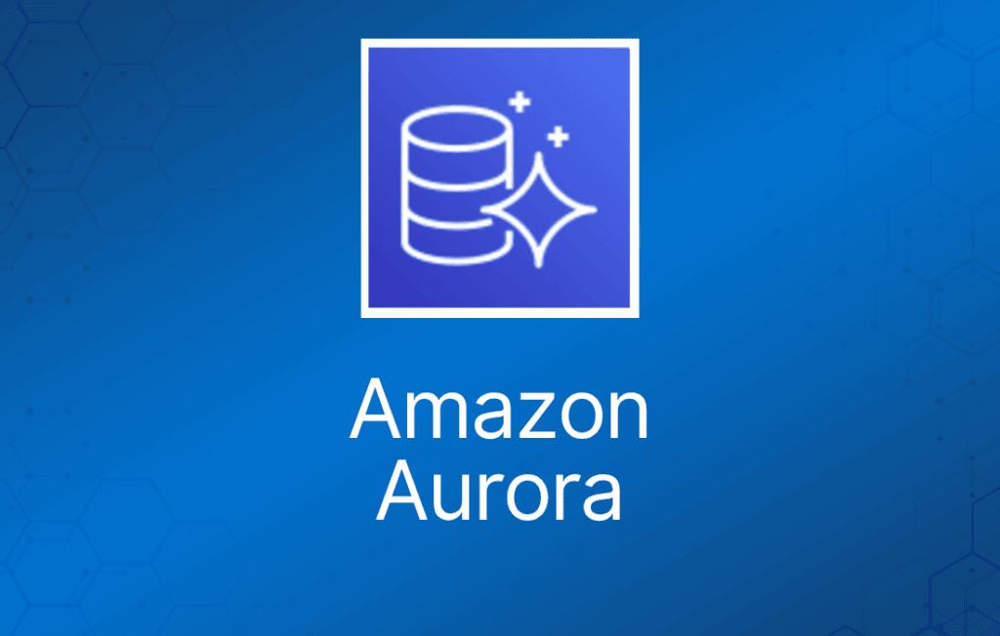
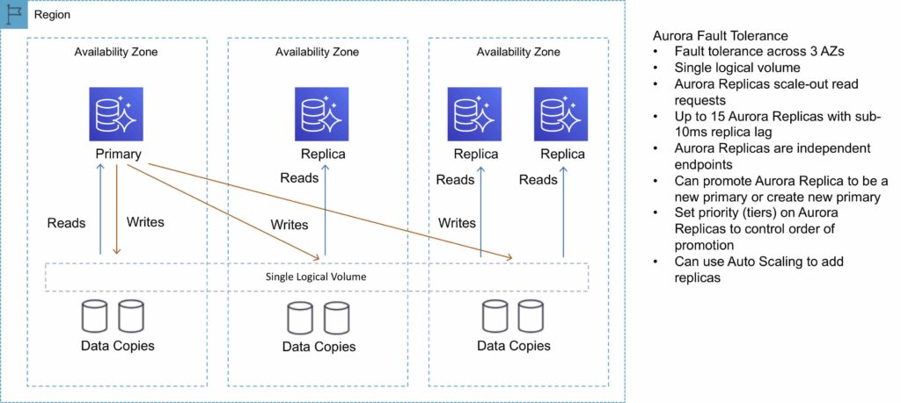
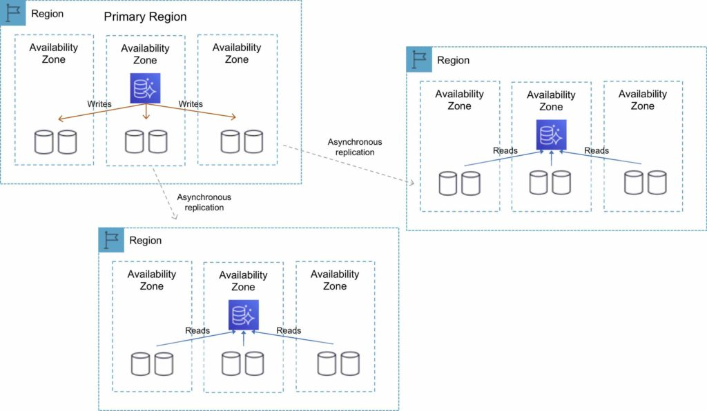
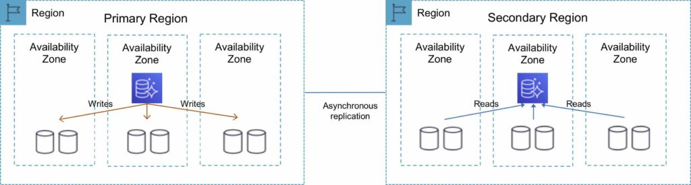

Amazon Aurora 是一项关系型数据库服务，它将高端商业数据库的速度和可用性与开源数据库的简单性和成本效益结合在一起。

Aurora 是 AWS 自研的专有数据库。

完全托管的服务。

高性能，低价格。

每个可用区（AZ）中保存 2 份数据副本，最少跨 3 个 AZ（共 6 份副本）。

可以容忍丢失最多两份数据副本而不影响数据库写入可用性，丢失最多三份副本而不影响读取可用性。

下图展示了 Aurora 容错和副本的工作方式：

## Aurora 副本（Aurora Replicas）

有两种复制类型：Aurora 副本（最多 15 个）、MySQL 只读副本（最多 5 个）。

下表描述了两种副本选项之间的区别：

|  |  |  |
| --- | --- | --- |
| **特性** | **Aurora 副本** | **MySQL 副本** |
| 副本数量 | 最多 15 个 | 最多 5 个 |
| 复制类型 | 异步（毫秒级） | 异步（秒级） |
| 对主实例的性能影响 | 低 | 高 |
| 副本位置 | 区域内 | 跨区域 |
| 可作为故障转移目标 | 是（无数据丢失） | 是（可能丢失数分钟的数据） |
| 自动故障转移 | 是 | 否 |
| 支持用户自定义复制延迟 | 否 | 是 |
| 支持与主实例不同的数据或 schema | 否 | 是 |

你可以为 Amazon Aurora 数据库在最多五个 AWS 区域创建只读副本。此功能适用于兼容 MySQL 的 Amazon Aurora。

## 跨区域只读副本（Cross-Region Read Replicas）

跨区域只读副本让你可以改善灾难恢复能力，在更靠近应用用户的区域扩展读取操作，并轻松实现区域间的迁移。

跨区域副本为你的用户提供快速的本地读取。

每个区域可以额外拥有 15 个 Aurora 副本，以进一步扩展本地读取。

你可以在提供最佳复制性能的 [**Global Database**](https://aws.amazon.com/rds/aurora/global-database/) 和传统的基于 binlog 的复制之间进行选择。

你还可以与外部 MySQL 数据库搭建自己的 binlog 复制。

下图展示了跨区域只读副本的拓扑结构：

## Global Database

对于全球分布式应用，你可以使用 [**Global Database**](https://aws.amazon.com/rds/aurora/global-database/)，单个 Aurora 数据库可以跨多个 AWS 区域，实现快速本地读取和快速灾难恢复。

Global Database 使用基于存储的复制将数据库复制到多个 AWS 区域，典型延迟小于 1 秒。

你可以将次要区域用作备份选项，以便在需要从区域性能下降或中断中快速恢复时使用。

次要区域中的数据库可以在不到 1 分钟内提升为具备完整读写能力。

下图展示了 Aurora Global Database 的拓扑结构：

## Multi-Master（多主）

Amazon Aurora Multi-Master 是 Aurora MySQL 兼容版的一项新功能，它能够跨多个可用区横向扩展写入性能，允许应用将读写工作负载定向到数据库集群中的多个实例，并以更高的可用性运行。

Aurora Multi-Master 旨在跨数据库节点集群实现高可用性和 ACID 事务，并提供可配置的写后读一致性。

## 架构

一个 Aurora 集群由一组计算（数据库）节点和一个共享存储卷组成。

存储卷由放置在三个可用区中的六个存储节点组成，以实现用户数据的高可用性和持久性。

集群中的每个数据库节点都是可以运行读写语句的写入节点（writer node）。

集群中没有单点故障。

应用可以使用任何写入节点来满足其读写和 DDL 需求。

写入节点所做的数据库更改会写入三个可用区中的六个存储节点，从而提供数据持久性以及对存储节点和可用区故障的容错能力。

所有写入节点在功能上都是平等的，一个写入节点的故障不会影响集群中其他写入节点的可用性。

## 高可用性

Aurora Multi-Master 在单主版本 Amazon Aurora 的高可用性基础上进一步改进，因为集群中的所有节点都是读写节点。

在单主 Aurora 中，单个写入节点的故障需要将只读副本提升为新的写入节点。

而在 Aurora Multi-Master 中，写入节点的故障只需使用该写入节点的应用打开与另一个写入节点的连接即可。

## Aurora Serverless

Amazon Aurora Serverless 是 Amazon Aurora 的一种按需、自动扩缩配置。

适用于 MySQL 兼容版和 PostgreSQL 兼容版。

数据库会根据应用需求自动启动、关闭以及向上或向下扩展容量。

它让你能够在云中运行数据库而无需管理任何数据库实例。对于不频繁、间歇性或不可预测的工作负载，这是一个简单且经济高效的选择。

你只需创建一个数据库端点，可选地指定所需的数据库容量范围，然后连接应用即可。

使用 Aurora Serverless，你只需为数据库存储以及数据库处于活动状态时消耗的数据库容量和 I/O 付费。

数据库处于活动状态时，按秒为所使用的数据库容量付费。

只需在 Amazon RDS 管理控制台中点击几下，即可在标准配置和 Serverless 配置之间迁移。

下表提供了 Amazon Aurora Serverless 的几个示例用例：

|  |  |
| --- | --- |
| **使用场景** | **示例** |
| 不常使用的应用 | 每天或每周只使用几次、每次仅几分钟的应用。需要一种经济高效、仅在活动时才需付费的数据库。使用 Aurora Serverless，你只需为消耗的数据库资源付费。 |
| 新应用 | 正在部署新应用，不确定需要哪种实例规格。使用 Aurora Serverless，你只需创建一个端点，让数据库自动扩展到应用所需的容量。 |
| 可变工作负载 | 运行一个使用率较低的应用，每天或每年几次出现 30 分钟到数小时的高峰。现在你只需按负载所需的资源付费——避免为闲置资源付费或冒着性能不佳的风险。 |
| 不可预测的工作负载 | 运行全天都有数据库使用且活动高峰难以预测的工作负载。使用 Aurora Serverless，数据库会自动扩展容量以满足应用峰值负载的需求，并在活动高峰结束后缩减容量。 |
| 开发和测试数据库 | 软件开发和 QA 团队在工作时间使用数据库，但夜间或周末不需要。使用 Aurora Serverless，数据库在不使用时会自动关闭，并在第二天开始工作时更快地启动。 |
| 多租户应用 | 基于 Web 的应用，为每个客户分配一个数据库。现在你无需为应用群中的每个应用单独管理数据库容量。Aurora 为你管理每个数据库的容量，节省宝贵的时间。 |

## 容错和自愈存储

数据库卷的每个 10GB 数据块都会以六种方式复制，跨三个可用区。

Amazon Aurora 存储具有容错能力，可以透明地处理丢失最多两份数据副本而不影响数据库写入可用性，丢失最多三份副本而不影响读取可用性。

Amazon Aurora 存储还具有自愈能力；数据块和磁盘会被持续扫描以检查错误，并自动替换。

## Aurora Auto Scaling

Aurora Auto Scaling 使用单主复制动态调整为 Aurora 数据库集群预置的 Aurora 副本数量。

Aurora Auto Scaling 同时适用于 Aurora MySQL 和 Aurora PostgreSQL。

Aurora Auto Scaling 让你的 Aurora 数据库集群能够应对连接数或工作负载的突然增长。

当连接数或工作负载下降时，Aurora Auto Scaling 会移除不必要的 Aurora 副本，这样你就不必为未使用的预置数据库实例付费。

## 备份与恢复

Amazon Aurora 的备份功能支持实例的时间点恢复（point-in-time recovery）。

这允许你将数据库恢复到保留期内的任意秒，最晚可恢复到最近 5 分钟内。

自动备份保留期最长可配置为 35 天。

自动备份存储在 [**Amazon S3**](https://aws.amazon.com/s3/) 中，其设计持久性为 99.999999999%。Amazon Aurora 备份是自动、增量且连续的，对数据库性能没有影响。

为你的数据库实例开启自动备份后，Amazon RDS 会自动执行数据的每日完整快照（在你偏好的备份窗口期间），并捕获事务日志（在对数据库实例进行更新时）。

自动备份默认启用，数据存储在 S3 上，大小等于数据库的大小。

Amazon RDS 在一段有限的用户指定时间（称为保留期）内保留数据库实例的备份，默认为 7 天，但最长可达 35 天。

备份和恢复 RDS 数据库实例有两种方法：

- Amazon RDS 自动备份。
- 用户发起的手动备份。

两种选项都会备份整个数据库实例，而不仅仅是单个数据库。

两种选项都会创建整个数据库实例的存储卷快照。

你可以复制自动备份和手动快照。

自动备份会将数据备份到多个 AZ，以保证数据持久性。

多 AZ 备份从备用实例获取（适用于 MariaDB、MySQL、Oracle 和 PostgreSQL）。

数据库实例必须处于活动（Active）状态才能进行自动备份。

只有自动备份可用于数据库实例的时间点恢复。

时间点恢复的粒度为 5 分钟。

Amazon RDS 创建每日完整存储卷快照，并定期捕获事务日志。

你可以选择备份窗口。

备份本身不收取额外费用，但你需要支付 S3 上的存储成本。

你可以通过将保留期设置为零（0）来禁用自动备份。

如果将备份保留期从零改为非零值或反过来的话，会发生中断（outage）。

保留期是 AWS 在删除自动备份之前保留它们的时间。

保留期：

- 对于除 Aurora 之外的所有数据库引擎，从控制台配置时默认保留期为 7 天。
- 从 API 或 CLI 配置时默认保留期为 1 天。
- Aurora 的默认保留期为 1 天，无论如何配置。
- 你可以将保留期延长至最多 35 天。

在备份窗口期间 I/O 可能会暂停。

删除 RDS 数据库实例时，自动备份也会被删除。

自动备份仅支持 MySQL 的 InnoDB 存储引擎（不支持 MyISAM）。

恢复数据库实例时会应用默认的数据库参数组和安全组——之后你必须再应用自定义的数据库参数组和安全组。

你无法从数据库快照恢复到现有数据库实例。

恢复后，新的数据库实例将拥有一个新的端点。

恢复快照时可以更改存储类型。
