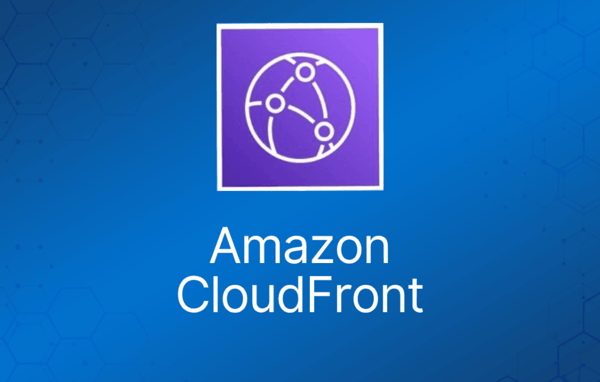
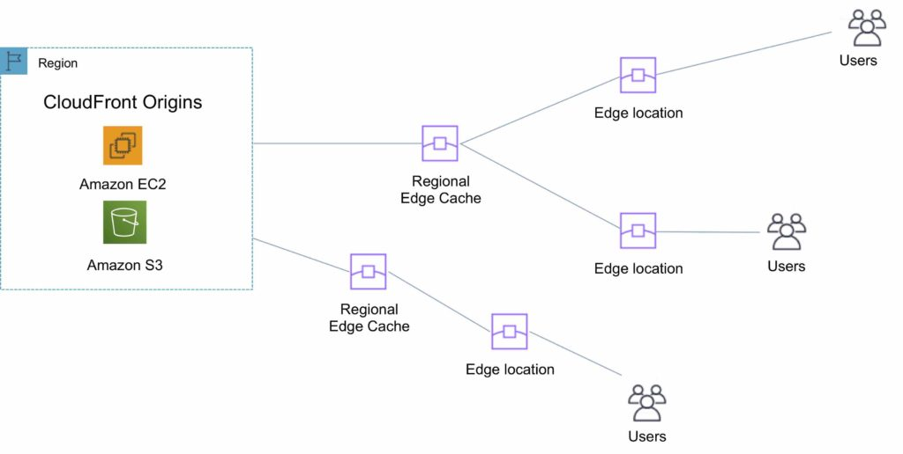
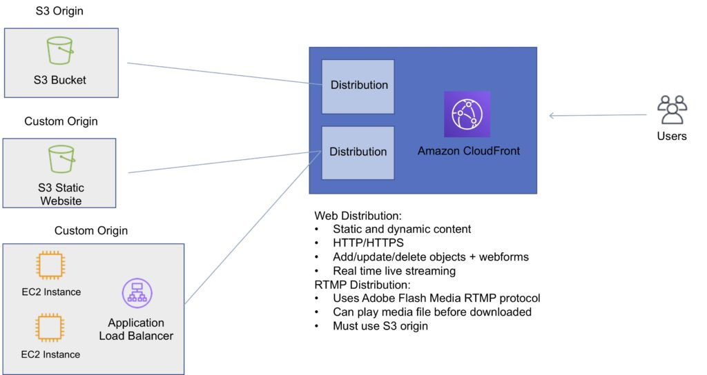

CloudFront 是一项 Web 服务，为企业和 Web 应用开发人员提供了一种简单且经济高效的方式，以低延迟和高数据传输速度分发内容。

CloudFront 非常适合分发频繁访问、能从边缘分发中受益的静态内容——比如流行的网站图片、视频、媒体文件或软件下载。

可用于动态、静态、流式和交互式内容。

CloudFront 是一项全球服务：

- 入站（Ingress）用于上传对象。
- 出站（Egress）用于分发内容。

Amazon CloudFront 提供简单的 API，让你可以：

- 通过遍布全球的边缘站点网络处理请求，以低延迟和高数据传输速率分发内容。
- 无需协商合同和最低承诺即可开始使用。

你可以在 CloudFront 上使用根域名（zone apex）。

CloudFront 支持通配符 CNAME。

支持通配符 SSL 证书、Dedicated IP、Custom SSL 和 SNI Custom SSL（更便宜）。

支持完美前向保密（Perfect Forward Secrecy），为每个 SSL 会话创建新的私钥。

## 边缘站点与区域边缘缓存（Edge Locations and Regional Edge Caches）

边缘站点（edge location）是内容缓存的位置（独立于 AWS 区域/AZ）。

请求会自动路由到最近的边缘站点。

边缘站点不与可用区或区域绑定。

区域边缘缓存（Regional Edge Cache）位于源站 Web 服务器和全球边缘站点之间，拥有更大的缓存。

区域边缘缓存比任何单个边缘站点拥有更大的缓存宽度，因此你的对象在这些位置的缓存中保留时间更长。

区域边缘缓存旨在让内容更靠近用户。

PUT/POST/PATCH/OPTIONS/DELETE 等代理方法从边缘站点直接到达源站，不经过区域边缘缓存代理。

动态内容直接到达源站，不流经区域边缘缓存。

边缘站点不只是只读的，你也可以向它们写入。

下图展示了区域边缘缓存和边缘站点相对于终端用户的位置：

## 源站（Origins）

源站是 CDN 将要分发的文件的来源。

源站可以是 S3 bucket、EC2 实例、Elastic Load Balancer 或 Route 53——也可以是外部（非 AWS）的。

使用 Amazon S3 作为源站时，你将所有对象放在 bucket 中。

你可以使用现有 bucket，bucket 不会被做任何修改。

默认情况下，所有新建的 bucket 都是私有的。

你可以使用以下方式设置 bucket 的访问控制：

- Bucket policy。
- 访问控制列表（Access Control List）。

你可以将对象设为公开可用，或使用 CloudFront 签名 URL。

自定义源站服务器是一个 HTTP 服务器，可以是 EC2 实例或本地/非 AWS 的 Web 服务器。

使用本地或非 AWS 的 Web 服务器时，你必须指定希望 CloudFront 从源站获取对象时使用的 DNS 名称、端口和协议。

自定义源站支持大多数 CloudFront 功能，除了 RTMP 分配（必须是 S3 bucket）。

使用 EC2 作为自定义源站时，Amazon 建议：

- 使用能自动安装 Web 服务器软件的 AMI。
- 使用 ELB 处理跨多个 EC2 实例的流量。
- 将负载均衡器的 URL 指定为源站服务器的域名。

S3 静态网站：

- 在配置中填写你的 bucket 的 S3 静态网站托管端点。
- 示例：http://<bucketname>.s3-website-<region>.amazonaws.com。

对象默认缓存 24 小时。

过期时间通过 TTL 控制。

最小过期时间为 0。

Amazon S3 上的静态网站被视为自定义源站。

AWS 源站指 Amazon S3 bucket（而非静态网站）。

CloudFront 与源站服务器保持持久连接。

文件也可以上传到 CloudFront。

**通过源站故障转移（Origin Failover）实现高可用性：**

- 可以为需要高可用性的场景配置 CloudFront 源站故障转移。
- 使用源站组（origin group），在其中为 CloudFront 指定一个主源站，以及当主源站返回特定 HTTP 状态码失败响应时 CloudFront 自动切换到的第二个源站。
- 更多信息请参阅此[**文章**](https://docs.aws.amazon.com/AmazonCloudFront/latest/DeveloperGuide/high_availability_origin_failover.html)。
- 也可与 Lambda@Edge 函数配合使用。

## 分配（Distributions）

要使用 CloudFront 分发内容，你需要创建一个分配（distribution）。

分配包含 CDN 的配置，包括：

- 内容源站。
- 访问权限（公开或受限）。
- 安全性（HTTP 或 HTTPS）。
- Cookie 或查询字符串转发。
- 地理限制（Geo-restriction）。
- 访问日志（记录查看者活动）。

分配有两种类型。

Web 分配（Web Distribution）：

- 静态和动态内容，包括 .html、.css、.php 和图形文件。
- 通过 HTTP 和 HTTPS 分发文件。
- 添加、更新或删除对象，以及从 Web 表单提交数据。
- 使用实时流（live streaming）实时流式传输事件。

RTMP：

- 使用 Adobe Flash Media Server 的 RTMP 协议分发流媒体文件。
- 允许终端用户在文件从 CloudFront 边缘站点下载完成之前就开始播放媒体文件。
- 文件必须存储在 S3 bucket 中。

要使用 CloudFront 实时流，请创建 Web 分配。

要同时提供媒体播放器和媒体文件，你需要两种类型的分配：

- 用于媒体播放器的 Web 分配。
- 用于媒体文件的 RTMP 分配。

S3 bucket 可以配置为创建访问日志和 cookie 日志，记录对 S3 bucket 发出的所有请求。

可以使用 Amazon Athena 分析访问日志。

CloudFront 与 CloudTrail 集成。

CloudTrail 将日志保存到你指定的 S3 bucket。

CloudTrail 捕获所有请求的信息，无论请求是通过 CloudFront 控制台、CloudFront API、AWS SDK、CloudFront CLI 还是其他服务发出的。

CloudTrail 可用于确定发出了哪些请求、源 IP 地址、谁发出的请求等。

要在 CloudTrail 日志中查看 CloudFront 请求，你必须更新现有跟踪（trail）以包含全球服务。

要删除一个分配，必须先将其禁用（可能需要长达 15 分钟）。

下图展示了 Amazon CloudFront 的分配和源站：

## 缓存行为（Cache Behavior）

允许你为给定的 URL 路径模式配置各种 CloudFront 功能。

对于每个缓存行为，你可以配置以下功能：

- 路径模式（例如 /images/\*.jpg、/images\*.php）。
- 请求转发到的源站（如果有多个源站）。
- 是否转发查询字符串。
- 是否要求签名 URL。
- 允许的 HTTP 方法。
- 文件在 CloudFront 缓存中保留的最短时间（无论任何 cache-control header 的值如何）。

默认缓存行为仅允许路径模式 /\*。

创建分配后，需要定义额外的缓存行为来更改路径模式。

你可以使用以下方法限制对内容的访问：

- 使用签名 cookie 或签名 URL 限制对内容的访问。
- 限制对 S3 bucket 中对象的访问。

可以使用一种称为 Origin Access Identity（OAI）的特殊用户来限制对 Amazon S3 bucket 中内容的访问。

通过使用 OAI，你可以限制用户，使他们无法直接使用 S3 URL 访问内容，必须通过 CloudFront 连接。

你可以定义查看者协议策略（viewer protocol policy）：

- HTTP 和 HTTPS。
- 将 HTTP 重定向到 HTTPS。
- 仅 HTTPS。

你可以定义允许的 HTTP 方法：

- GET、HEAD。
- GET、HEAD、OPTIONS。
- GET、HEAD、OPTIONS、PUT、POST、PATCH、DELETE。

对于 Web 分配，你可以配置 CloudFront 要求查看者使用 HTTPS。

字段级加密（Field-Level Encryption）：

- 字段级加密在 HTTPS 之上增加了额外的一层安全保护，让你可以保护特定数据，使其仅对特定应用可见。
- 字段级加密允许你安全地将用户提交的敏感信息上传到你的 Web 服务器。
- 敏感信息在更靠近用户的边缘位置加密，并在整个应用处理过程中保持加密状态。

源站策略（Origin policy）：

- 仅 HTTPS。
- 匹配查看者（Match viewer）—— CloudFront 与你的自定义源站匹配协议。
- 仅当你为查看者协议策略指定"将 HTTP 重定向到 HTTPS"或"仅 HTTPS"时，才使用匹配查看者。
- 即使查看者使用 HTTP 和 HTTPS 发出请求，CloudFront 也只缓存对象一次。

对象失效（Object invalidation）：

- 你可以通过使对象失效来将其从缓存中移除。
- 提交后无法取消失效操作。
- 当你为相应的缓存行为启用了 Smooth Streaming 时，无法使 Microsoft Smooth Streaming 格式的媒体文件失效。

对象按 TTL 缓存（始终以秒为单位记录，默认为 24 小时，默认最大值为 1 年）。

仅缓存 GET 请求（不缓存 PUT、POST、PATCH、DELETE）。

动态内容也会被缓存。

设置 TTL 时要考虑文件更改的频率。

失效（invalidation）可用于立即撤销缓存的对象——收费。

删除会传播到各处。

## 缓存命中率（Cache Hit Ratio）

良好的缓存命中率意味着更多请求由缓存提供服务。

提高缓存命中率的方法包括：

- 使用 Cache-Control max-age 指令延长对象在缓存中的保留时间。
- 使用 Origin Shield。
- 仅转发源站会为其返回唯一对象的查询字符串参数。
- 配置 CloudFront 仅转发指定的 cookie，而不是转发所有 cookie。
- 配置 CloudFront 仅基于指定的 header 进行转发和缓存，而不是基于所有 header。

## 限制（Restrictions）

黑名单和白名单可用于地理位置限制——同一时间只能使用其中一种。

地理限制（geo-blocking）有两个可用选项：

- 使用 CloudFront 地理限制功能（用于限制对分配中所有文件的访问，粒度为国家级）。
- 使用第三方地理位置服务（用于限制对分配中部分文件的访问，并在国家级别实现更细粒度控制）。

## Lambda@Edge

可用于在边缘站点运行 Lambda。

让你运行 Node.js 和 Python Lambda 函数来自定义 CloudFront 交付的内容。

在更靠近查看者的 AWS 位置执行函数。

你可以在以下时间点使用 Lambda 函数更改 CloudFront 请求和响应：

- CloudFront 收到查看者请求之后（viewer request）。
- CloudFront 将请求转发到源站之前（origin request）。
- CloudFront 收到源站响应之后（origin response）。
- CloudFront 将响应转发给查看者之前（viewer response）。

Lambda@Edge 可以执行以下操作：

- 检查 cookie 并重写 URL 以执行 A/B 测试。
- 根据 User-Agent header 向用户发送特定对象。
- 在将请求传递给源站之前查找特定 header，从而实现访问控制。
- 添加、删除或修改 header，以将用户引导到不同的缓存对象。
- 生成新的 HTTP 响应。
- 干净地支持旧版 URL。
- 修改或精简 header 或 URL 以提高缓存利用率。
- 向其他互联网资源发出 HTTP 请求，并使用结果来自定义响应。

***考试提示：****Lambda@Edge 可用于根据 User-Agent HTTP header 加载不同的资源。*

## 签名 URL 和签名 Cookie（Signed URLs and Signed Cookies）

签名 URL 包含额外信息，例如过期日期和时间，让你能够更好地控制对内容的访问。这些额外信息出现在策略声明中，策略声明基于预设策略（canned policy）或自定义策略（custom policy）。

当你不想更改当前 URL，或者想要提供对多个受限文件的访问（例如网站订阅者区域中的所有文件）时，CloudFront 签名 cookie 允许你控制谁可以访问你的内容。

应用必须先对用户进行身份验证，然后向查看者发送三个 Set-Cookie header；查看者存储名称-值对，并在请求访问内容时将它们添加到请求的 Cookie header 中。

在以下情况下使用签名 URL：

- 你想限制对单个文件的访问，例如应用的安装下载。
- 你的用户使用的客户端（例如自定义 HTTP 客户端）不支持 cookie。

在以下情况下使用签名 cookie：

- 你想提供对多个受限文件的访问，例如 HLS 格式视频的所有文件或网站订阅者区域中的所有文件。
- 你不想更改当前的 URL。

## Origin Access Identity

与签名 URL 和签名 cookie 结合使用，限制对 S3 bucket 的直接访问（防止绕过 CloudFront 控制）。

Origin Access Identity（OAI）是与分配关联的特殊 CloudFront 用户。

然后必须更改 Amazon S3 bucket 上的权限，将访问限制为仅 OAI。

如果用户直接使用 Amazon S3 URL 请求文件，他们会被拒绝访问。

Origin Access Identity 有权访问你 Amazon S3 bucket 中的文件，但普通用户没有。

## AWS WAF

AWS WAF 是一种 Web 应用防火墙，让你可以监控转发到 CloudFront 的 HTTP 和 HTTPS 请求，并控制对内容的访问。

借助 AWS WAF，你可以基于 Web 访问控制列表（web ACL）中的条件来保护对内容的访问，例如：

- 源 IP 地址。
- 查询字符串中的值。

CloudFront 会以请求的内容或 HTTP 403 状态码（禁止访问）响应请求。

CloudFront 也可以配置为返回自定义错误页面。

需要将相关分配与 web ACL 关联。

## 安全性

符合 PCI DSS 标准，但建议不要在边缘站点缓存信用卡信息。

作为符合 HIPAA 条件的服务，符合 HIPAA 要求。

分布式拒绝服务（DDoS）防护：

- CloudFront 将流量分布到多个边缘站点并过滤请求，确保只有有效的 HTTP(S) 请求会被转发到后端主机。CloudFront 还支持地理封锁（geo-blocking），你可以用它阻止来自特定地理位置的请求。

## 域名

CloudFront 通常会创建类似 a232323.cloudfront.net 的域名。

可以使用别名记录（alias record，Route 53）添加备用域名。

对于其他服务提供商，使用 CNAME（CNAME 不能使用根域名 zone apex）。

在分配之间移动域名：

- 你可以自行移动子域名。
- 对于根域名，你需要联系 AWS Support。

## 高可用性

CloudFront 在全球边缘站点缓存内容。缓存服务的对象越多，对源站的请求就越少。这降低了源站服务器的负载并减少了延迟。

你可以为需要高可用性的场景配置 CloudFront [**源站故障转移**](https://docs.aws.amazon.com/AmazonCloudFront/latest/DeveloperGuide/high_availability_origin_failover.html)。

要设置源站故障转移，你必须拥有一个至少包含两个源站的分配。接下来，为你的分配创建一个包含两个源站的源站组，将其中一个设置为主源站。最后，创建或更新一个缓存行为以使用该源站组。

## 监控与报告

你可以在 CloudFront 控制台中查看有关 CloudFront 分配和 Lambda@Edge 函数的[**运营指标**](https://docs.aws.amazon.com/AmazonCloudFront/latest/DeveloperGuide/viewing-cloudfront-metrics.html)。

所有 CloudFront 分配均免费包含以下默认指标：

**请求数（Requests）**

CloudFront 收到的查看者请求总数，涵盖所有 HTTP 方法以及 HTTP 和 HTTPS 请求。

**下载字节数（Bytes downloaded）**

查看者通过 GET、HEAD 和 OPTIONS 请求下载的总字节数。

**上传字节数（Bytes uploaded）**

查看者通过 CloudFront 使用 POST 和 PUT 请求上传到你的源站的总字节数。

**4xx 错误率**

响应的 HTTP 状态码为 4xx 的查看者请求所占的百分比。

**5xx 错误率**

响应的 HTTP 状态码为 5xx 的查看者请求所占的百分比。

**总错误率**

响应的 HTTP 状态码为 4xx 或 5xx 的查看者请求所占的百分比。

除默认指标外，你还可以付费启用额外指标。

这些额外指标必须为每个分配单独启用：

**缓存命中率（Cache hit rate）**

CloudFront 从其缓存提供内容的所有可缓存请求所占的百分比。HTTP POST 和 PUT 请求以及错误不被视为可缓存请求。

**源站延迟（Origin latency）**

对于由源站（而非 CloudFront 缓存）提供服务的请求，从 CloudFront 收到请求到开始向网络（而非查看者）提供响应所花费的总时间。这也称为首字节延迟（first byte latency）或 time-to-first-byte。

**按状态码统计的错误率**

响应的 HTTP 状态码为 4xx 或 5xx 范围内特定代码的查看者请求所占的百分比。此指标适用于以下所有错误代码：401、403、404、502、503 和 504。

## 日志与审计

S3 bucket 可以配置为创建访问日志和 cookie 日志，记录对 S3 bucket 发出的所有请求。

可以使用 Amazon Athena 分析访问日志。

CloudFront 与 CloudTrail 集成。

CloudTrail 将日志保存到你指定的 S3 bucket。

CloudTrail 捕获所有请求的信息，无论请求是通过 CloudFront 控制台、CloudFront API、AWS SDK、CloudFront CLI 还是其他服务发出的。

CloudTrail 可用于确定发出了哪些请求、源 IP 地址、谁发出的请求等。

要在 CloudTrail 日志中查看 CloudFront 请求，你必须更新现有跟踪以包含全球服务。

## 费用

可选择 12 个月或更长时间的预留容量（从单个区域 10TB 数据传输起步）。

你需要为以下项目付费：

- 传出到互联网的数据传输。
- 传出到源站的数据传输。
- HTTP/HTTPS 请求数量。
- 失效请求（Invalidation Request）。
- 专用 IP 自定义 SSL（Dedicated IP Custom SSL）。
- 字段级加密请求。

你无需为以下项目付费：

- AWS 区域与 CloudFront 之间的数据传输。
- 区域边缘缓存。
- AWS ACM SSL/TLS 证书。
- 共享 CloudFront 证书。
