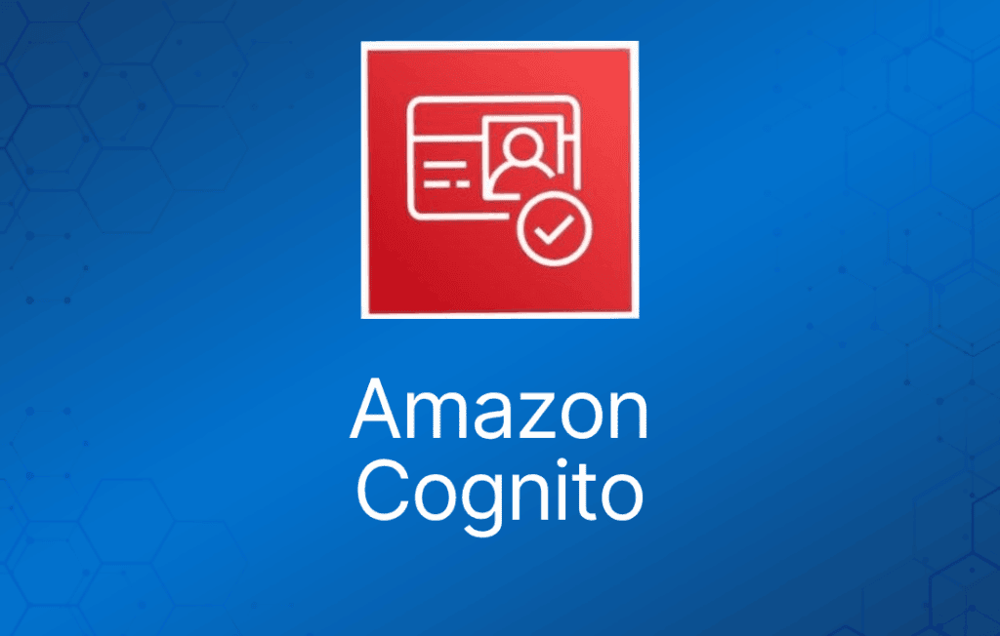
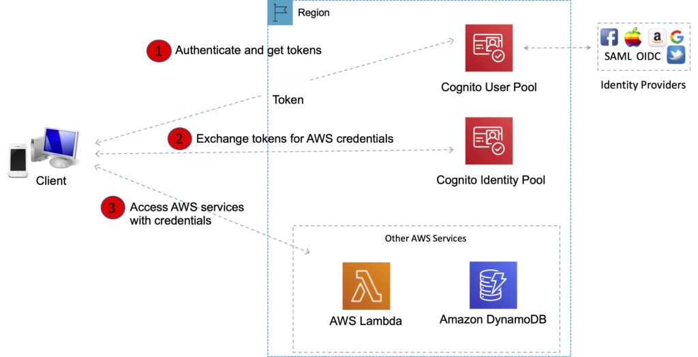
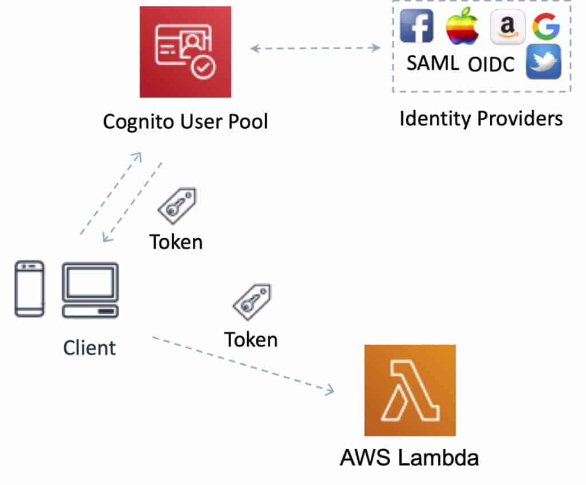
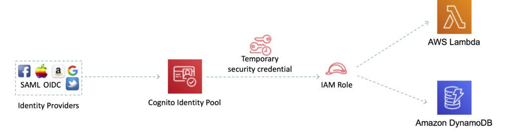

Amazon Cognito 让你能够快速轻松地为 Web 和移动应用添加用户注册、登录和访问控制功能。

Amazon Cognito 为你的 Web 和移动应用提供身份验证、授权和用户管理。

你的用户可以直接使用用户名和密码登录，也可以通过 Facebook、Amazon 或 Google 等第三方登录。

## Web 身份联合（Web Identity Federation）

AWS Cognito 与支持 SAML 或 OpenID Connect 的外部身份提供商以及社交身份提供商（如 Facebook、Twitter、Amazon）配合工作。

联合（Federation）允许用户通过 Web 身份提供商（例如 Google、Facebook、Amazon）进行身份验证。

用户首先通过 Web 身份提供商进行身份验证并收到身份验证 token，然后将该 token 交换为临时 AWS 凭证，从而可以代入 IAM role 以访问所需资源。

Cognito 是一个身份代理（Identity Broker），负责处理你的应用与 Web 身份提供商之间的交互（你无需为此编写自己的代码）。

你可以使用 Amazon、Facebook、Twitter、Digits、Google 以及任何其他兼容 OpenID Connect 的身份提供商。

你也可以集成自己的身份提供商。

## 用户池与身份池（User Pools and Identity Pools）

AWS Cognito 的两个主要组件是用户池（user pool）和身份池（identity pool）：

- 用户池是用户目录，为你的应用用户提供注册和登录选项。
- 身份池让你能够授予用户访问其他 AWS 服务的权限。

你可以单独或一起使用身份池和用户池。

应用无需在设备本地嵌入或存储 AWS 凭证，并且为用户在所有移动设备上提供无缝体验。

Cognito Identity 提供临时安全凭证，用于访问你应用在 AWS 上的后端资源或 Amazon API Gateway 之后的任何服务。

Cognito 暴露服务器端 API。

用户可以使用电子邮件、电话号码或用户名注册和登录。

应用的终端用户也可以使用基于短信的 MFA 登录。

有一个导入工具可以将用户迁移到 Amazon Cognito 用户池中。

## 用户池（User Pools）

Cognito 用户池是用于管理移动和 Web 应用注册与登录功能的用户目录。

借助用户池，用户可以通过 Amazon Cognito 登录你的 Web 或移动应用。

用户还可以通过 Facebook 或 Amazon 等社交身份提供商以及 SAML 身份提供商登录。

无论用户直接登录还是通过第三方登录，用户池的所有成员都有一个目录配置文件，你可以通过 SDK 访问。

Cognito 充当身份提供商与 AWS 之间的身份代理（Identity Broker）。

用户池提供：

- 注册和登录服务。
- 内置的可自定义 Web UI 用于用户登录。
- 支持 Facebook、Google 和 Login with Amazon 的社交登录，以及使用用户池中 SAML 身份提供商的登录。
- 用户目录管理和用户配置文件。
- 多因素身份验证（MFA）、泄露凭证检查、账户盗用防护以及电话和电子邮件验证等安全功能。
- 通过 AWS Lambda 触发器实现自定义工作流和用户迁移。

成功验证用户身份后，Amazon Cognito 会签发 JSON Web Token（JWT），你可以用它来保护和授权对自己 API 的访问，或将其交换为 AWS 凭证。

## 身份池（Identity Pools）

身份池让你能够为用户创建唯一身份，并通过身份提供商对其进行身份验证。

有了身份，你就可以获取临时的、权限受限的 AWS 凭证来访问其他 AWS 服务。

Cognito 会跟踪用户身份与其登录所用的各种不同设备之间的关联。

为了给你的应用提供无缝的用户体验，Cognito 使用推送同步（Push Synchronization）在多台设备之间推送更新并同步用户数据。

每当存储在云中的数据发生变化时，Amazon SNS 会向所有设备发送静默推送通知。

Amazon Cognito 身份池支持以下身份提供商：

- 公共提供商：Login with Amazon（Identity Pools）、Facebook（Identity Pools）、Google（Identity Pools）。
- Amazon Cognito 用户池。
- OpenID Connect 提供商（Identity Pools）。
- SAML 身份提供商（Identity Pools）。
- 开发者验证身份（Developer Authenticated Identities，Identity Pools）。

***考试提示：****为了更容易记住用户池和身份池之间的区别，可以把用户池想象成 IAM 用户或 Active Directory，把身份池想象成 IAM Role。*

## Amazon Cognito Sync

Amazon Cognito Sync 是一项 AWS 服务和客户端库，可实现应用相关用户数据的跨设备同步。

你可以使用它在移动设备和 Web 之间同步用户配置文件数据，无需自己的后端。

客户端库在本地缓存数据，因此无论设备连接状态如何，你的应用都可以读写数据。

当设备在线时，你可以同步数据；如果设置了推送同步（push sync），还可以立即通知其他设备有可用的更新。

***考试提示：****AWS AppSync 是一个类似的服务，但具备更多能力。使用 AppSync 可以跨设备和跨用户同步移动应用数据（Cognito Sync 不能跨用户同步，只能跨设备），它支持更多设备和数据类型，并且基于 GraphQL。*
