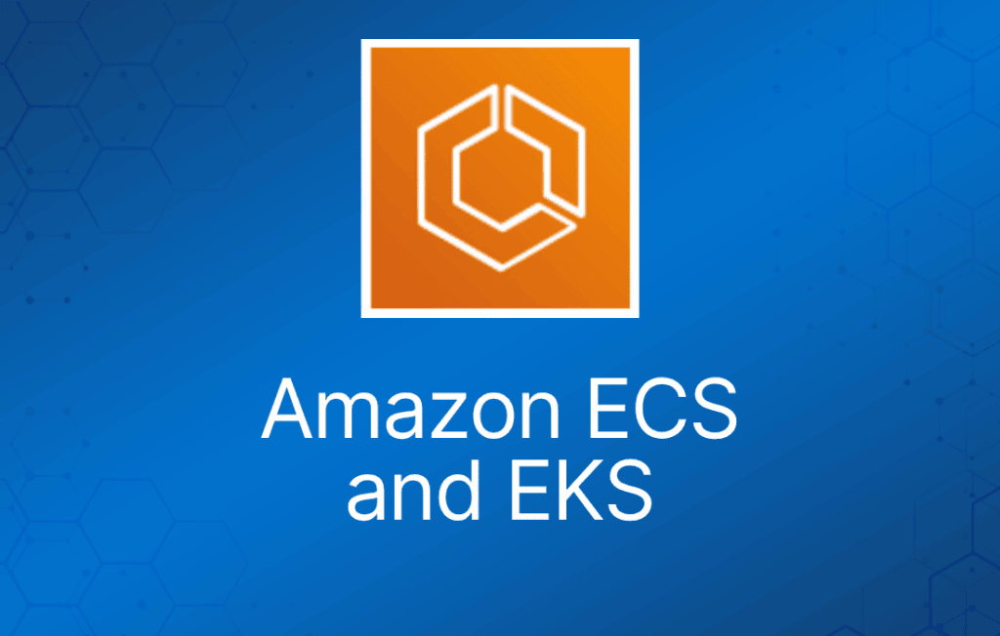
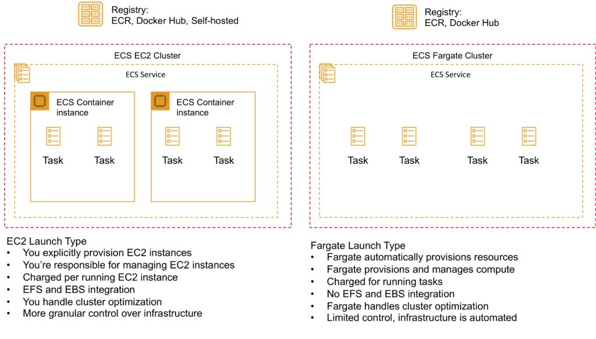
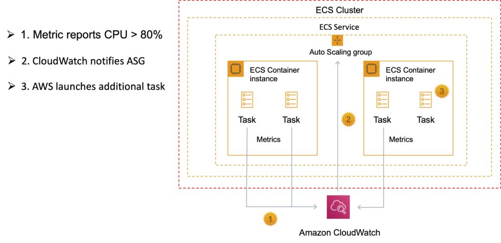
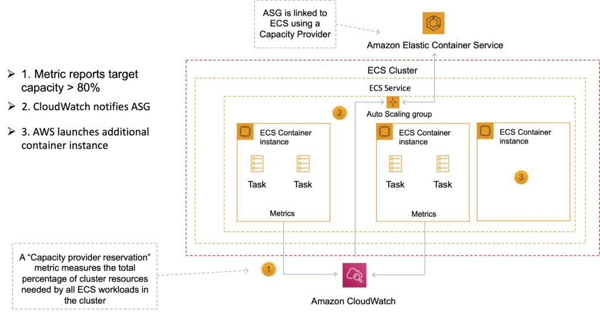
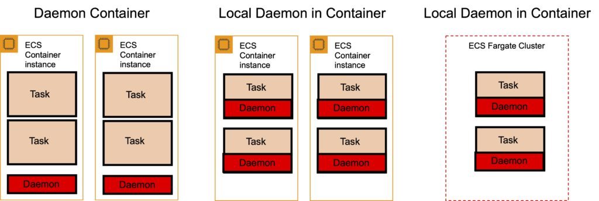
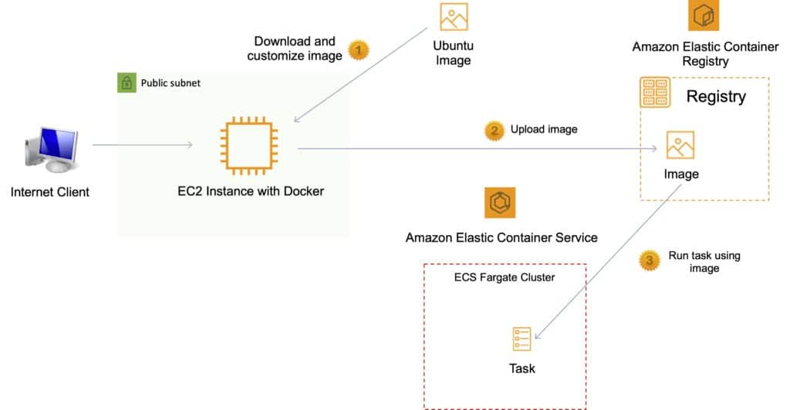
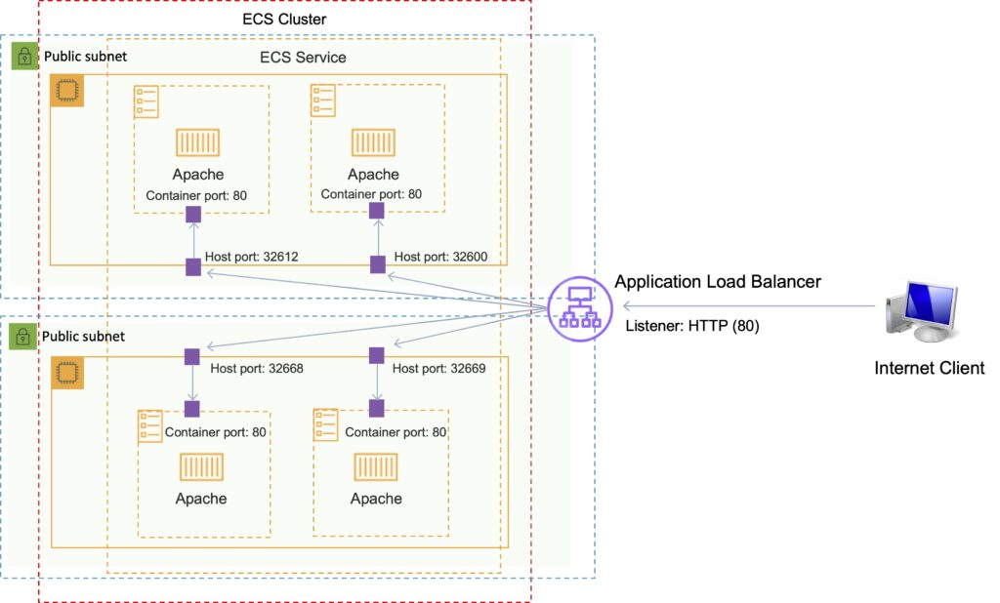

Amazon Elastic Container Service (ECS) 是一个高度可扩展、高性能的容器管理服务，支持 Docker 容器。

Amazon ECS 让你能轻松地在托管的 Amazon EC2 实例集群上运行应用。

Amazon ECS 免去了你自行安装、运维和扩展集群管理基础设施的负担。

通过 API 调用，你可以启动和停止容器化应用、查询集群的完整状态，并使用 security group、Elastic Load Balancing、EBS volume 和 IAM role 等功能。

Amazon ECS 可以根据资源需求和可用性要求，调度容器在集群中的放置位置。

Amazon ECS 本身不额外收费。你需要为以下内容付费：

- 使用 EC2 启动类型创建的资源（例如 EC2 实例和 EBS volume）。
- Fargate 启动类型下运行的任务数量与配置。

可以使用 Elastic Beanstalk 来处理 Amazon ECS 集群的预置、负载均衡、自动扩展、监控以及容器在集群中的放置。

也可以直接使用 ECS，对应用架构进行更细粒度的控制。

可以将 Amazon ECS 上的服务关联到 Elastic Load Balancing (ELB) 服务中的 Application Load Balancer (ALB)。

ALB 支持包含一组实例端口的 target group。你可以在 ECS 任务定义中指定动态端口，当容器被调度到 EC2 实例上时会获得一个未使用的端口。

你可以使用任何符合 Amazon ECS AMI 规范的 AMI。例如，请参阅 [Amazon ECS 优化 AMI](https://docs.aws.amazon.com/AmazonECS/latest/developerguide/ecs-optimized_AMI.htm) 的相关链接。

## Amazon ECS 与 Amazon EKS 对比

Amazon 还提供 Elastic Container Service for Kubernetes (Amazon EKS)，可用于在 AWS 上使用 Kubernetes 部署、管理和扩展容器化应用。

下表描述了这两项服务之间的一些区别，帮助你理解何时选择其中一个：

|  |  |
| --- | --- |
| **Amazon ECS** | **Amazon EKS** |
| 托管的、高可用、高可扩展的容器平台 | 托管的、高可用、高可扩展的容器平台 |
| AWS 专有平台，支持 Docker 容器 | 与上游 Kubernetes 兼容，便于从其他 Kubernetes 部署直接迁移（lift and shift） |
| 被认为更简单、更易用 | 被认为功能更丰富但更复杂，学习曲线较陡 |
| 利用 Route 53、ALB 和 CloudWatch 等 AWS 服务 | 托管的 Kubernetes 平台，内部处理很多事情 |
| "Task"（任务）是运行在底层计算资源上、相对隔离的容器实例 | "Pod" 是共同放置的容器，可以相互共享访问 |
| 可扩展性有限 | 可通过丰富的第三方和社区插件扩展。 |

## 启动类型（Launch Type）

Amazon ECS 启动类型决定任务和服务托管在哪种基础设施上。

有两种启动类型，下表描述了两者的一些区别：

|  |  |
| --- | --- |
| **Amazon EC2** | **Amazon Fargate** |
| 你可以显式预置 EC2 实例 | 控制平面请求资源，Fargate 自动预置 |
| 你负责 EC2 资源池的升级、打补丁和日常维护 | Fargate 按需预置计算资源 |
| 你必须处理集群优化 | Fargate 处理客户侧的优化 |
| 对基础设施有更细粒度的控制 | 控制有限，因为基础设施是自动化的 |

### Fargate 启动类型

- Fargate 启动类型让你无需预置和管理后端基础设施即可运行容器化应用。只需注册任务定义，Fargate 就会为你启动容器。
- Fargate 启动类型是由 AWS 管理的无服务器（serverless）基础设施。
- Fargate 仅支持托管在 Elastic Container Registry (ECR) 或 Docker Hub 上的容器镜像。

### EC2 启动类型

- EC2 启动类型让你可以在自己管理的 Amazon EC2 实例集群上运行容器化应用。
- 私有仓库仅 EC2 启动类型支持。

下图展示了两种启动类型并总结了一些关键区别：

## ECS 术语

下表概述了 Amazon ECS 中使用的一些术语：

|  |  |
| --- | --- |
| **Amazon ECS 术语** | **定义** |
| Cluster | EC2 实例的逻辑分组 |
| Container Instance | 运行 ECS agent 的 EC2 实例 |
| Task Definition | 描述 Docker 容器应如何启动的蓝图 |
| Task | 使用 Task Definition 中设置运行的容器 |
| Service | 定义长期运行的任务——可通过 Auto Scaling 控制任务数量并挂载 ELB |

## 镜像（Images）

容器是从称为镜像（image）的只读模板创建的，镜像包含创建 Docker 容器的指令。

镜像由 Dockerfile 构建。

目前仅支持 Docker 容器。

镜像包含创建 Docker 容器的指令。

镜像存储在 DockerHub 或 AWS Elastic Container Registry (ECR) 等镜像仓库中。

ECR 是托管的 AWS Docker 镜像仓库服务，安全、可扩展且可靠。

ECR 支持私有 Docker 仓库，使用 AWS IAM 实现基于资源的权限来访问仓库和镜像。

开发者可以使用 Docker CLI 推送、拉取和管理镜像。

## 任务与任务定义（Tasks and Task Definitions）

在 Amazon ECS 中运行 Docker 容器需要任务定义（task definition）。

任务定义是 JSON 格式的文本文件，描述一个或多个容器，最多 10 个。

任务定义使用 Docker 镜像来启动容器。

你需要指定要运行的任务数量（即容器数量）。

任务定义中可以指定的一些参数包括：

- 任务中的容器使用哪些 Docker 镜像。
- 每个容器使用多少 CPU 和内存。
- 任务中的容器是否相互链接。
- 任务中容器使用哪种 Docker 网络模式。
- 容器的哪些端口（如果有）映射到宿主容器实例。
- 容器完成或失败时任务是否继续。
- 容器启动时应运行的命令。
- 容器启动时应传入的环境变量。
- 任务中容器应使用的数据卷。
- 任务用于权限的 IAM role。

你可以使用 Amazon ECS Run task 一次性运行一个或多个任务。

## ECS 集群

ECS 集群是容器实例的逻辑分组，任务可以放置在其上。

系统会创建一个默认集群，但你也可以创建多个集群来隔离资源。

ECS 允许定义在集群中运行的指定数量（期望数量）的任务。

集群可以同时包含使用 Fargate 和 EC2 启动类型的任务。

对于 EC2 启动类型的集群，集群可以包含不同的容器实例类型。

每个容器实例同一时间只能属于一个集群。

"Service"（服务）为 ECS 提供自动扩展功能。

集群是区域性的。

你可以为集群创建 IAM policy，允许或限制用户对特定集群的访问。

## 服务调度器（Service Scheduler）

你可以使用服务调度器和自定义调度器来调度 ECS。

确保指定数量的任务持续运行，并在任务失败时重新调度。

可以确保任务注册到 ELB 上。

## 自定义调度器（Custom Scheduler）

你可以创建自己的调度器来满足业务需求。

可以利用 Blox 等第三方调度器。

Amazon ECS 调度器利用 Amazon ECS API 提供的相同集群状态信息来做出合适的放置决策。

## ECS 容器代理（Container Agent）

ECS 容器代理让容器实例能够连接到集群。

容器代理运行在 ECS 集群的每个基础设施资源上。

ECS 容器代理包含在 Amazon ECS 优化 AMI 中，也可以安装在任何支持 ECS 规范的 EC2 实例上（仅支持 EC2 实例）。

支持 Linux 和 Windows。

要在 AWS 上使用非 AWS 的 Linux 实例，必须手动安装 ECS 容器代理。

## Auto Scaling

### 服务自动扩展（Service Auto Scaling）

Amazon ECS 服务可以选择配置 Service Auto Scaling，自动上调或下调期望任务数量。

Service Auto Scaling 利用 Application Auto Scaling 服务提供该功能。

Amazon ECS Service Auto Scaling 支持以下类型的扩展策略：

- [目标跟踪扩展策略（Target Tracking Scaling Policies）](https://docs.aws.amazon.com/AmazonECS/latest/developerguide/service-autoscaling-targettracking.html)——基于特定 CloudWatch 指标的目标值来增加或减少服务运行的任务数量。这类似于恒温器维持室内温度的方式。你设定温度，恒温器完成剩下的工作。
- [步进扩展策略（Step Scaling Policies）](https://docs.aws.amazon.com/AmazonECS/latest/developerguide/service-autoscaling-stepscaling.html)——响应 CloudWatch 告警来增加或减少服务运行的任务数量。步进扩展基于一组称为步进调整的扩展调整，调整幅度随告警突破的大小而变化。
- [计划扩展（Scheduled Scaling）](https://docs.aws.amazon.com/autoscaling/application/userguide/application-auto-scaling-scheduled-scaling.html)——基于日期和时间增加或减少服务运行的任务数量。

### 集群自动扩展（Cluster Auto Scaling）

使用名为 Capacity Provider 的 Amazon ECS 资源类型。

Capacity Provider 可以与 EC2 Auto Scaling 组（ASG）关联。

当你将 ECS Capacity Provider 与 ASG 关联，并将该 Capacity Provider 加入 ECS 集群后，集群就可以利用 ECS 的两个新功能自动扩展你的 ASG：

1. **托管扩展（Managed scaling）**——在你的 ASG 上自动创建扩展策略，以及扩展策略使用的新扩展指标（Capacity Provider Reservation）；以及
2. **托管实例终止保护（Managed instance termination protection）**——在缩减（scale-in）时实现容器感知的实例终止。

## 安全/SLA

EC2 实例使用 IAM role 访问 ECS。

可以使用 IAM 在容器级别通过 IAM role 控制访问。

容器代理通过应用的 IAM role 和策略代表你调用 ECS API。

需要在容器实例启动之前为其应用 IAM role（EC2 启动类型）。

通过单独的 IAM role（IAM Roles for Tasks）为任务分配额外权限。

ECS 任务使用 IAM role 访问服务和资源。

Security group 附加在实例或容器级别。

你拥有 EC2 实例操作系统的 root 级访问权限。

Compute SLA 保证 Amazon ECS 的月度正常运行时间百分比至少为 99.99%。

## ECS 与 X-Ray

运行 X-Ray 有两种方式：

作为守护进程（daemon）：X-Ray agent 运行在守护进程容器中。

作为 "sidecar"：X-Ray 与每个容器一起运行。

对于 Fargate，X-Ray daemon 只能作为 sidecar 运行。

任务定义：

- X-Ray 运行在 UDP 2000 端口。
- 必须指定 daemon 地址。
- 必须将容器相互链接。

X-Ray 提供可以与你的应用一起部署的 Docker 容器镜像：

- 命令：*docker pull amazon/aws-xray-daemon*

## ECS 与 Elastic Beanstalk

有两个选项：单容器和多容器 Docker 模式。

### 单容器 Docker

单容器平台可用于将 Docker 镜像（在 Dockerfile 或 Dockerrun.aws.json 定义中描述）和源代码部署到 Elastic Beanstalk 环境中运行的 EC2 实例上。

当每个实例只需要运行一个容器时，使用单容器平台。

### 多容器 Docker（Multicontainer Docker）

另一个基础平台 Multicontainer Docker 使用 Amazon Elastic Container Service 协调将多个 Docker 容器部署到 Elastic Beanstalk 环境中的 Amazon ECS 集群。

环境中的每个实例运行相同的一组容器，这些容器在 Dockerrun.aws.json 文件中定义。

当需要向每个实例部署多个 Docker 容器时，使用多容器平台。

Elastic Beanstalk 会创建以下资源：

- ECS 集群。
- EC2 容器实例。
- 负载均衡器（高可用模式）。
- 任务定义与执行。

需要在源代码根目录放置配置文件 Dockerrun.aws.json。

你的 Docker 镜像必须预先构建好（可以存储在 ECR 中）。

## Amazon Elastic Container Registry (ECR)

Amazon Elastic Container Registry (ECR) 是全托管的 Docker 容器镜像仓库，让开发者能够轻松地存储、管理和部署 Docker 容器镜像。

Amazon ECR 与 Amazon Elastic Container Service (ECS) 集成。

Amazon ECR 以高可用、可扩展的架构托管你的镜像，让你能可靠地为应用部署容器。

与 AWS Identity and Access Management (IAM) 的集成提供对每个仓库的资源级控制。

### 向 ECR 推送和拉取镜像

必须先进行身份验证。

要使用 get-login-password 向 Amazon ECR 仓库验证 Docker，运行 **aws ecr get-login-password** 命令：

- aws ecr get-login-password –region us-east-1 | docker login –username AWS –password-stdin aws\_account\_id.dkr.ecr.us-east-1.amazonaws.com

为镜像打标签：

- docker tag e9ae3c220b23 aws\_account\_id.dkr.ecr.region.amazonaws.com/my-web-app

使用 **docker push** 命令推送镜像：

- docker push aws\_account\_id.dkr.ecr.region.amazonaws.com/my-web-app

使用 **docker pull** 命令拉取镜像。镜像名称格式应为 registry/repository[:tag] 按标签拉取，或 registry/repository[@digest] 按摘要拉取。

- docker pull aws\_account\_id.dkr.ecr.region.amazonaws.com/my-web-app:e9ae3c220b23

## 在 ECS 中使用 Amazon Elastic Load Balancer

可以将 Amazon ECS 上的服务关联到 Amazon Elastic Load Balancer (ELB)。

ALB 支持包含一组实例端口的 target group。

你可以在 ECS 任务定义中指定动态端口，当容器被调度到 EC2 实例上时会获得一个未使用的端口（这仅适用于 ALB）。

## Amazon EKS

Amazon Elastic Kubernetes Service (Amazon EKS) 是在 AWS 和本地运行 Kubernetes 的托管服务。

Amazon EKS 可以运行在 Amazon EC2 或 AWS Fargate 上。

与 Application Load Balancer、用于 RBAC 的 AWS IAM 以及 Amazon VPC 集成。

Amazon EKS 提供跨多个 AWS 可用区（AZ）运行的可扩展、高可用的 Kubernetes 控制平面。

Amazon EKS 自动管理 Kubernetes API 服务器和 etcd 持久层的可用性与可扩展性。

Amazon EKS 跨三个 AZ 运行 Kubernetes 控制平面以确保高可用，并自动检测和替换不健康的控制平面节点。

***考试提示：****主要使用场景是组织需要在混合云和多云环境中管理容器时使用一致的控制平面。*
