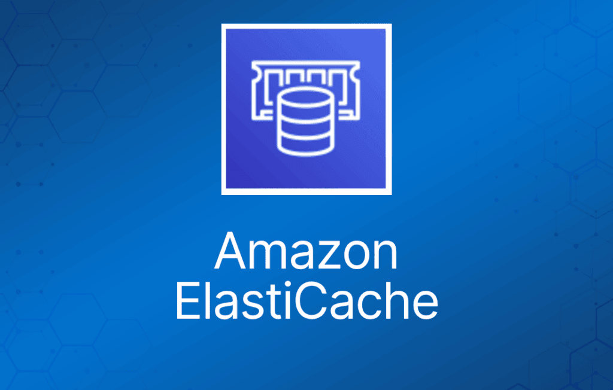
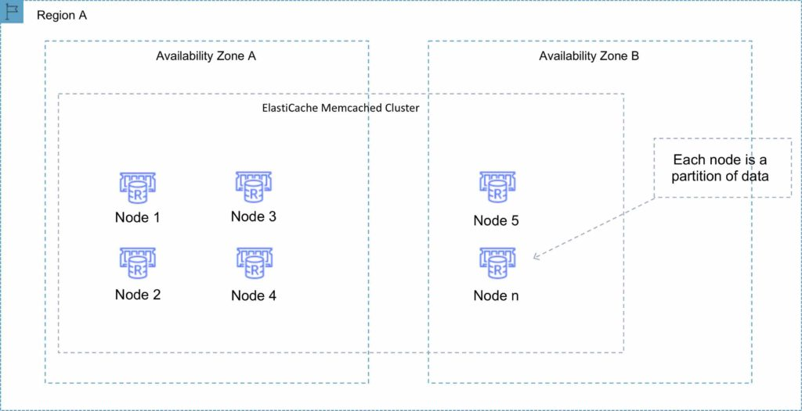
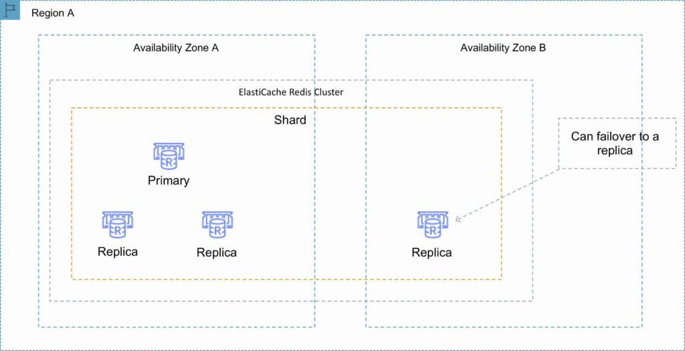
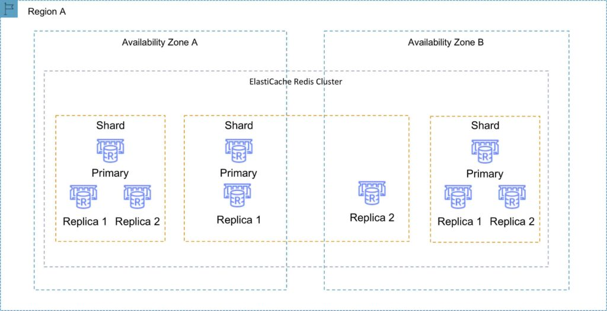
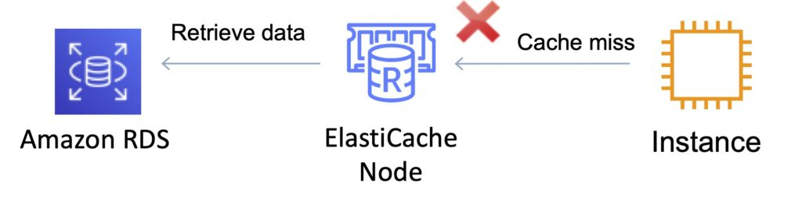
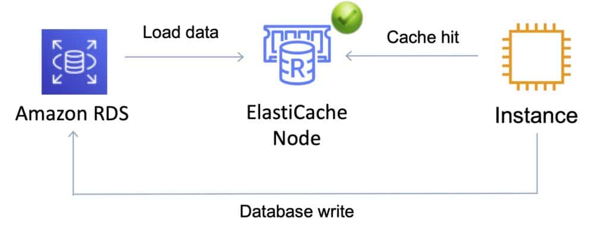

两种流行的内存数据存储——Redis 和 Memcached——的全托管实现。

ElastiCache 是一项 Web 服务，让你能轻松地在云中部署和运行兼容 Memcached 或 Redis 协议的服务器节点。

ElastiCache 提供的内存缓存可以显著改善许多读密集型应用工作负载或计算密集型工作负载的延迟和吞吐量。

最适合数据库负载基于联机分析处理（OLAP）事务的场景。

内存、写入和读取均支持一键扩展。

内存键/值（key/value）存储——并非传统意义上的持久化存储。

按节点大小和使用小时数计费。

ElastiCache EC2 节点无法从互联网访问，也不能被其他 VPC 中的 EC2 实例访问。

缓存的信息可能包括 I/O 密集型数据库查询的结果或计算密集型计算的结果。

也可以使用按需或预留实例（但不能用 Spot 实例）。

ElastiCache 可用于存储会话状态（session state）。

节点（node）是固定大小的安全、网络附加 RAM 块，是最小的构建单元。

每个节点运行一个兼容 Memcached 或 Redis 协议的服务实例，拥有自己的 DNS 名称和端口。

故障节点会被自动替换。

对 ElastiCache 节点的访问由 VPC security group 和 subnet group 控制（部署在 VPC 中时）。

Subnet group 是为你的 Amazon ElastiCache 集群指定的一组子网集合。

不能将 VPC 之外的现有 Amazon ElastiCache 集群移入 VPC。

你需要为托管 EC2 实例和 ElastiCache 集群的 VPC 配置 ElastiCache 的 subnet group。

不使用 VPC 时，Amazon ElastiCache 允许你通过 Cache Security Group 控制对集群的访问（需要关联对应的 EC2 Security Group）。

ElastiCache 节点以集群形式部署，可以跨同一 subnet group 中的多个子网。

集群（cluster）是使用相同缓存引擎的一个或多个节点的集合。

应用程序通过端点（endpoint）连接 ElastiCache 集群。

端点是节点或集群的唯一地址。

可以定义维护窗口，允许在此期间进行软件打补丁。

ElastiCache 引擎有两种类型：

- Memcached——最简单的模型，可运行多核/多线程的大节点，可横向扩展和缩减，可缓存数据库等对象。
- Redis——较复杂的模型，支持加密、主/从复制、跨 AZ（高可用）、自动故障转移和备份/恢复。

## 使用场景

下表描述了 ElastiCache 的几个典型使用场景：

|  |  |
| --- | --- |
| **使用场景** | **好处** |
| Web 会话存储 | 在负载均衡的 Web 服务器场景下，将 Web 会话信息存储在 Redis 中，这样即使某台服务器丢失，会话信息也不会丢失，其他 Web 服务器可以接管 |
| 数据库缓存 | 在 AWS RDS 前面使用 Memcached 缓存热门查询，减轻 RDS 的负担并更快地向用户返回结果 |
| 排行榜（Leaderboard） | 使用 Redis 为移动应用的数百万用户提供实时排行榜 |
| 流数据仪表盘 | 为工厂车间的传感器流数据提供落脚点，提供实时仪表盘展示 |

***考试提示：****ElastiCache 的关键使用场景是卸载数据库读取、存储计算结果和会话状态。另外记住 ElastiCache 是内存数据库，而且是托管服务（所以你不能在 EC2 上自行运行它）。*

下表描述了决定使用 Memcached 还是 Redis 引擎的需求：

|  |  |
| --- | --- |
| **Memcached** | **Redis** |
| 简单、无花哨功能 | 你需要加密 |
| 你需要弹性（横向扩展和缩减） | 你需要 HIPAA 合规 |
| 你需要运行多个 CPU 核心和线程 | 支持集群（clustering） |
| 你需要缓存对象（例如数据库查询） | 你需要复杂数据类型 |
|  | 你需要高可用（复制） |
|  | Pub/Sub 能力 |

## Memcached

最简单的模型，可运行大节点。

可以横向扩展和缩减，可缓存数据库等对象。

被广泛采用的内存对象缓存系统。

多线程。

通过添加和移除节点横向扩展/缩减。

是数据存储（RDS、DynamoDB 等）的理想前端。

使用场景：

- 缓存数据库内容。
- 缓存动态生成网页的数据。
- 临时会话数据。
- 高流量 Web 应用中用于准入控制的高频计数器。

每个区域最多 100 个节点，每个集群 1-20 个节点（软限制）。

可以与 SNS 集成，获取节点故障/恢复通知。

支持自动发现集群中添加/移除的节点。

通过添加/移除节点进行横向扩展/缩减（水平）。

通过更改节点系列/类型进行纵向扩展/缩减（垂直）。

不支持多 AZ 故障转移或复制。

不支持快照。

你可以将节点放置在不同的 AZ 中。

在 ElastiCache Memcached 中，每个节点代表一个数据分区，集群中的节点可以跨可用区：

## Redis

开源的内存键值存储。

支持更复杂的数据结构：有序集合（sorted set）和列表（list）。

数据是持久化的，可以用作数据存储（datastore）。

Redis 不是多线程的。

通过添加分片（shard）而不是节点来扩展。

支持主/从复制和多 AZ，实现跨 AZ 冗余。

支持自动故障转移和备份/恢复。

Redis 分片是集群键空间（keyspace）的子集，可以包含一个主节点和零个或多个只读副本。

支持自动和手动快照（S3）。

备份包含集群数据和元数据。

你可以通过创建新的 Redis 集群并从备份填充数据来恢复数据。

备份期间不能对集群执行 CLI 或 API 操作。

自动备份默认启用（Redis 删除时自动删除）。

要在区域之间移动快照，只能先从 ElastiCache 导出，再移到其他区域（之后可以用数据填充新集群）。

### 集群模式禁用（Clustering mode disabled）

只能有一个分片。

一个分片可以有一个读写主节点和 0-5 个只读副本。

你可以将副本分布到同一区域内的多个 AZ。

从主节点的复制是异步的。

下图展示了集群模式禁用的 Redis 集群：

### 集群模式启用（Clustering mode enabled）

最多可以有 15 个分片。

每个分片可以有一个主节点和 0-5 个只读副本。

做快照会拖慢节点，最好从只读副本上做。

下图展示了集群模式启用的 Redis 集群：

## 多 AZ 故障转移

故障由 ElastiCache 检测。

ElastiCache 自动提升复制延迟（replica lag）最小的副本。

DNS 记录保持不变，但指向新主节点的 IP。

其他副本开始与新主节点同步。

同时启用集群模式和多 AZ 故障转移，可以获得全自动、容错的 ElastiCache-Redis 实现。

下表对比了 Memcached 和 Redis 引擎：

|  |  |  |  |
| --- | --- | --- | --- |
| **特性** | **Memcached** | **Redis（集群模式禁用）** | **Redis（集群模式启用）** |
| 数据持久化 | 否 | 是 | 是 |
| 数据类型 | 简单 | 复杂 | 复杂 |
| 数据分区 | 是 | 否 | 是 |
| 加密 | 否 | 是 | 是 |
| 高可用（复制） | 否 | 是 | 是 |
| 多 AZ | 是，可将节点放在多个 AZ。无故障转移或复制 | 是，支持自动故障转移。使用只读副本（每分片 0-5 个） | 是，支持自动故障转移。使用只读副本（每分片 0-5 个） |
| 扩展 | 纵向（节点类型）；横向（添加节点） | 单分片（可添加副本） | 添加分片 |
| 多线程 | 是 | 否 | 否 |
| 备份与恢复 | 否（也无快照） | 是，自动和手动快照 | 是，自动和手动快照 |

## 缓存策略

有两种可用的缓存策略：Lazy Loading（惰性加载）和 Write-Through（直写）：

### Lazy Loading（惰性加载）

- 仅在需要时才将数据加载到缓存中（发生缓存未命中时）。
- 惰性加载避免了用不会被请求的数据填满缓存。
- 如果请求的数据在缓存中，ElastiCache 将数据返回给应用。
- 如果数据不在缓存中或已过期，ElastiCache 返回 null。
- 应用随后从数据库获取数据，并将收到的数据写入缓存，供下次使用。
- 如果仅使用惰性加载而不配合其他策略（例如 TTL），缓存中的数据可能会过时（stale）。

### Write Through（直写）

- 使用直写策略时，每当底层数据库有新的写入或更新，缓存就会被更新。
- 让缓存数据保持最新。
- 这会增加应用中写操作的等待时间。
- 没有 TTL 的话，缓存中可能积累大量永远不会被读取的数据。

## 处理过时数据——Time to Live (TTL)

- 惰性加载和直写技术的缺点可以通过 TTL 缓解。
- TTL 指定键（数据）过期前的秒数，避免缓存中保留过时数据。
- 读取过期键时，应用会检查底层数据库中的值。
- 惰性加载将过期键视为缓存未命中，促使应用从数据库检索数据，随后将数据连同新的 TTL 写入缓存。
- 根据数据变化的频率，此策略可能无法完全消除过时数据——但有助于避免。

***考试提示：****与 DynamoDB Accelerator (DAX) 对比时记住，DAX 专门针对 DynamoDB 优化，且只支持直写缓存策略（不使用惰性加载）。*

## 监控与报告

### Memcached 指标

以下 [**CloudWatch**](https://digitalcloud.training/amazon-cloudwatch/) 指标能很好地反映 ElastiCache Memcached 的性能：

**CPUUtilization——**这是以百分比报告的主机级指标。因为 Memcached 是多线程的，该指标最高可达 90%。如果超过此阈值，可以使用更大的缓存节点类型纵向扩展缓存集群，或通过添加更多缓存节点横向扩展。

**SwapUsage——**这是以字节报告的主机级指标。该指标不应超过 50 MB。如果超过，建议增大 ConnectionOverhead 参数值。

**Evictions——**这是缓存引擎指标。如果超过你设定的阈值，可以使用更大的节点类型纵向扩展集群，或通过添加更多节点横向扩展。

**CurrConnections——**这是缓存引擎指标。CurrConnections 数量不断增加可能表明应用存在问题；你需要排查应用行为来解决该问题。

### Redis 指标

以下 CloudWatch 指标能很好地反映 ElastiCache Redis 的性能：

**EngineCPUUtilization——**提供 Redis 引擎线程的 CPU 利用率。由于 Redis 是单线程的，你可以用这个指标分析 Redis 进程本身的负载。

**MemoryFragmentationRatio——**表示 Redis 引擎内存分配的效率。不同的阈值意味着不同的行为。建议值是碎片率高于 1.0。

**CacheHits——**主字典中成功的只读键查找次数。

**CacheMisses——**主字典中失败的只读键查找次数。

**CacheHitRate——**表示 Redis 实例的使用效率。如果缓存命中率低于约 0.8，意味着有大量键被驱逐、过期或不存在。

**CurrConnections——**客户端连接数，不包括来自只读副本的连接。ElastiCache 在每种情况下会使用其中两到四个连接来监控集群。

## 日志与审计

所有 Amazon ElastiCache 操作都会被 AWS CloudTrail 记录。

每个事件或日志条目都包含请求发起者的信息。身份信息可帮助你确定以下内容：

- 请求是使用 root 还是 IAM 用户凭证发起的。
- 请求是否使用了角色或联合用户的临时安全凭证。
- 请求是否由其他 AWS 服务发起。

## 授权与访问控制

访问 Amazon ElastiCache 需要 AWS 可用于验证请求的凭证。这些凭证必须拥有访问 AWS 资源（例如 ElastiCache 缓存集群或 Amazon Elastic Compute Cloud (Amazon EC2) 实例）的权限。

你可以在 Amazon ElastiCache 中使用[**基于身份的策略（identity-based policy）**](https://docs.aws.amazon.com/AmazonElastiCache/latest/red-ug/IAM.IdentityBasedPolicies.html)来提供所需访问权限。

你可以使用 [**Redis Auth**](https://docs.aws.amazon.com/AmazonElastiCache/latest/red-ug/auth.html) 让 ElastiCache Redis 要求提供令牌。

Redis 认证令牌让 Redis 在允许客户端执行命令之前要求提供令牌（密码），从而提高数据安全性。

## 费用

按每种节点类型消耗的节点小时数定价。

不足一小时的节点用量按整小时计费。

同一可用区内 Amazon EC2 与 Amazon ElastiCache 之间的数据传输不收费。

ElastiCache 的高可用

Memcached：

- 由于 Memcached 不支持复制，节点故障会导致数据丢失。
- 使用多个节点，尽量减少节点故障导致的数据丢失。
- 跨多个可用 AZ 启动多个节点，尽量减少 AZ 故障导致的数据丢失。

Redis：

- 每个分片使用多个节点，并将节点分布到多个 AZ。
- 在复制组上启用 Multi-AZ，以允许主节点故障时自动故障转移。
- 安排 Redis 集群的定期备份。
