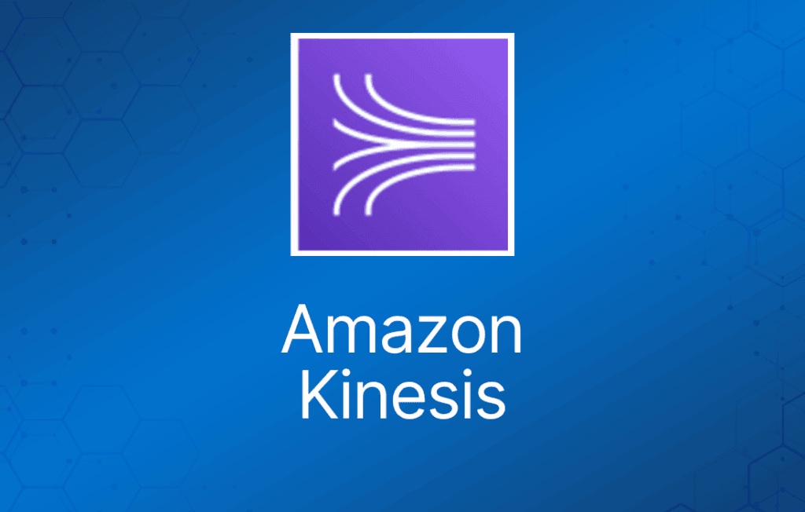
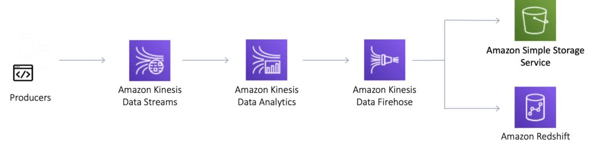
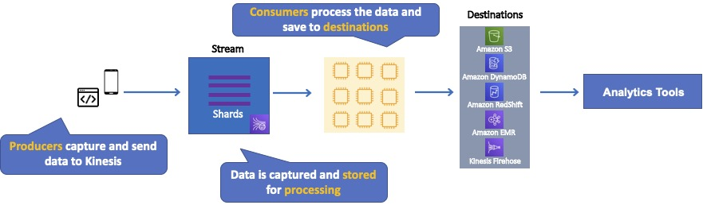
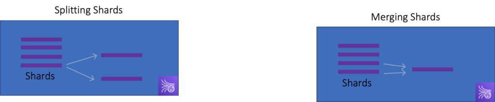
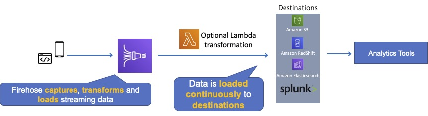
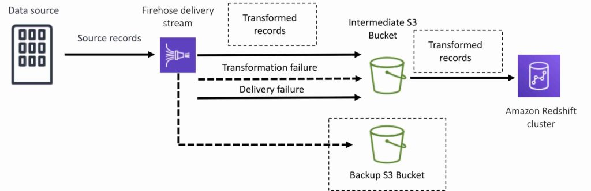
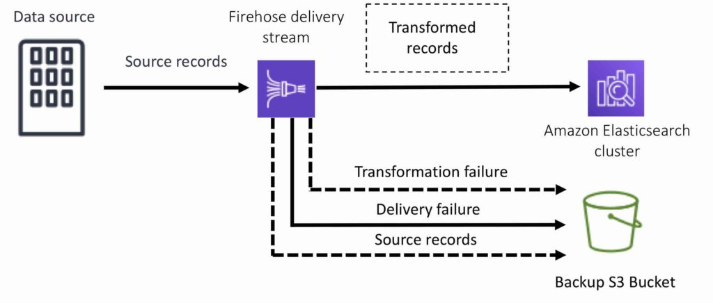
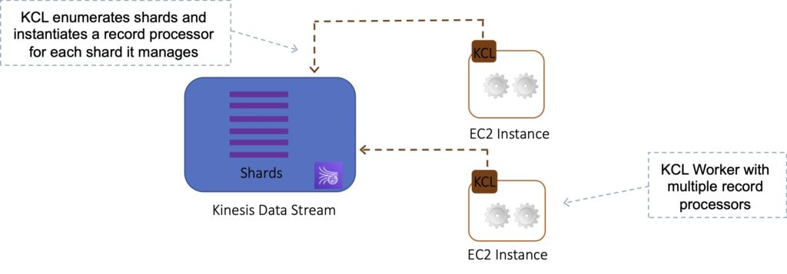
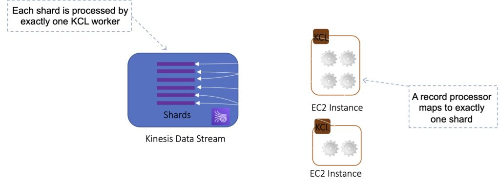

Amazon Kinesis 让你轻松地收集、处理和分析实时流数据，从而获得及时的洞察并快速响应新信息。

Kinesis 是一组用于处理各种数据流的服务集合。

数据以 "shard"（分片）为单位处理——每个分片每秒可摄入 1000 条记录。

默认限制为 500 个分片，但你可以申请提升，直至不限数量。

一条记录（record）由分区键（partition key）、序列号（sequence number）和数据 blob（最大 1 MB）组成。

临时数据存储——默认保留 24 小时，但最多可配置为 7 天。

Kinesis 服务有四种类型，详见下文。

## Kinesis Video Streams

Kinesis Video Streams 让你轻松地将视频从联网设备安全地流式传输到 AWS，用于分析、机器学习（ML）和其他处理。

持久化存储、加密视频数据流并为其建立索引，并允许通过易用的 API 访问数据。

生产者（producer）提供数据流。

默认存储数据 24 小时，最多 7 天。

数据存储在分片中——读取每秒 5 个事务，最大读取速率 2MB/秒；写入每秒最多 1000 条记录，最大写入速率 1MB/秒。

消费者（consumer）接收并处理数据。

一个流（stream）中可以有多个分片。

支持使用客户主密钥（customer master key）的服务器端加密（KMS）进行静态加密。

Kinesis Video Streams 在 AWS 考试中出现不多。

## Kinesis Data Streams

Kinesis Data Streams 让你能够构建处理或分析流数据的自定义应用，以满足特定需求。

Kinesis Data Streams 支持流式大数据的实时处理。

Kinesis Data Streams 适合快速地从数据生产者接收数据并持续处理这些数据。

Kinesis Data Streams **存储数据**供应用稍后处理（这是与 Firehose 的关键区别，Firehose 将数据直接投递到 AWS 服务）。

常见使用场景包括：

- 加速日志和数据馈送（data feed）的接收。
- 实时指标与报告。
- 实时数据分析。
- 复杂流处理。

下图展示了 Kinesis Data Streams 的高层架构。

- 生产者持续向 Kinesis Data Streams 推送数据。
- 消费者实时处理数据。
- 消费者可以使用 Amazon DynamoDB、Amazon Redshift 或 Amazon S3 等 AWS 服务存储处理结果。
- Kinesis Streams 应用是运行在 EC2 实例上的消费者。
- 分片是流中数据记录的唯一标识分组。
- 记录是存储在 Kinesis Stream 中的数据单元。

生产者创建构成流的数据。

生产者可以通过以下方式使用：

- Kinesis Streams API。
- Kinesis Producer Library (KPL)。
- Kinesis Agent。

记录（record）是存储在 Amazon Kinesis 数据流中的数据单元。

记录由序列号、分区键和数据 blob 组成。

默认情况下，流中的记录自加入流之时起最多可访问 24 小时（通过启用扩展数据保留可提高至 7 天）。

数据 blob 是数据生产者添加到数据流中的目标数据。

一条记录中数据 blob（Base64 编码前的数据负载）的最大大小为 1 MB。

分片（shard）是 Amazon Kinesis 数据流的基本吞吐量单位。

一个分片提供 1MB/秒的数据输入和 2MB/秒的数据输出能力。

每个分片每秒最多支持 1000 条 PUT 记录。

一个流由一个或多个分片组成。

流的总容量是其各分片容量之和。

Kinesis Data Streams 支持重新分片（resharding），让你能调整流中的分片数量，以适应流经流的数据速率变化。

重新分片操作有两种类型：分片拆分（shard split）和分片合并（shard merge）。

- 分片拆分是将一个分片分成两个分片。
- 分片合并是将两个分片合并为一个分片。

拆分会增加流中的分片数量，从而提高流的数据容量。

拆分会增加流的成本（按分片计费）。

合并会减少流中的分片数量，从而降低流的数据容量和成本。

消费者是分析从流中接收到的数据的 EC2 实例。

消费者被称为 Amazon Kinesis Streams 应用。

当数据速率上升时，添加更多分片以扩大流的容量。

数据速率下降时移除分片。

分区键用于在流内按分片对数据分组。

Kinesis Streams 使用 KMS 主密钥进行加密。

要从加密流读取或向其写入数据，生产者和消费者应用必须拥有访问主密钥的权限。

Kinesis Data Streams 跨三个 AZ 同步复制。

## Kinesis Data Firehose

Kinesis Data Firehose 是将流数据加载到数据存储和分析工具的最简单方式。

捕获、转换并加载流数据。

利用现有商业智能工具和仪表盘实现近实时分析。

Kinesis Data Streams 可用作 Kinesis Data Firehose 的数据源。

你可以配置 Kinesis Data Firehose 在投递数据之前对其进行转换。

使用 Kinesis Data Firehose 无需编写应用或管理资源。

Firehose 可以在加载数据之前对其进行批处理、压缩和加密。

Firehose 在将数据传输到目标时跨三个 AZ 同步复制数据。

每个投递流（delivery stream）最多存储数据记录 24 小时。

源（source）是你的流数据持续生成并被捕获的地方。

投递流是 Amazon Kinesis Data Firehose 的底层实体。

记录是数据生产者发送到投递流的目标数据。

一条记录的最大大小（Base64 编码前）为 1000 KB。

目标（destination）是数据将被投递到的数据存储。

Firehose 目标包括：

- Amazon S3。
- Amazon Redshift。
- Amazon Elasticsearch Service。
- Splunk。

生产者提供数据流。

没有分片概念，完全自动化。

可以使用现有的 AWS Key Management Service (KMS) 密钥加密数据。

如果 Kinesis Streams 用作数据源，可以使用服务器端加密。

Firehose 可以调用 AWS Lambda 函数，在将传入数据投递到目标之前对其进行转换。

对于 Amazon S3 目标，流数据会投递到你的 S3 bucket。如果启用了数据转换，你可以选择将源数据备份到另一个 Amazon S3 bucket：

对于 Amazon Redshift 目标，流数据先投递到你的 S3 bucket。然后 Kinesis Data Firehose 发出 Amazon Redshift **COPY** 命令，将数据从 S3 bucket 加载到你的 Amazon Redshift 集群。如果启用了数据转换，你可以选择将源数据备份到另一个 Amazon S3 bucket：

对于 Amazon Elasticsearch 目标，流数据会投递到你的 Amazon ES 集群，并且可以选择同时备份到你的 S3 bucket：

对于 Splunk 目标，流数据会投递到 Splunk，并且可以选择同时备份到你的 S3 bucket：

## Amazon Kinesis Data Firehose Splunk Destination

## Kinesis Data Analytics

Amazon Kinesis Data Analytics 是处理和分析实时流数据的最简单方式。

可以使用标准 SQL 查询处理 Kinesis 数据流。

提供实时分析。

使用场景：

- 生成时间序列分析。
- 为实时仪表盘提供数据。
- 创建实时告警和通知。

针对流数据源快速编写并运行强大的 SQL 代码。

可以从 Kinesis Streams 和 Kinesis Firehose 摄入数据。

输出到 S3、RedShift、Elasticsearch 和 Kinesis Data Streams。

位于 Kinesis Data Streams 和 Kinesis Data Firehose 之上。

一个 Kinesis Data Analytics 应用由三个组件组成：

- 输入（Input）——应用的流数据源。
- 应用代码（Application code）——处理输入并产生输出的一系列 SQL 语句。
- 输出（Output）——保存中间结果的一个或多个应用内流。

Kinesis Data Analytics 支持两种类型的输入：流数据源和参考数据源：

- 流数据源是持续生成的数据，被读入你的应用进行处理。
- 参考数据源是静态数据，应用用它丰富来自流数据源的数据。

可以配置目标来持久化结果。

支持 Kinesis Streams 和 Kinesis Firehose（S3、RedShift、Elasticsearch）作为目标。

可以使用 IAM 为 Kinesis Analytics 授予从数据源读取记录和写入目标的权限。

## Kinesis Client Library

Kinesis Client Library 是一个 Java 库，帮助分布式应用从 Kinesis Stream 读取记录并分担读取工作负载。

KCL 与 AWS SDK 中的 Kinesis Data Streams API 不同。

- Kinesis Data Streams API 帮助你管理 Kinesis Data Streams 的各个方面（包括创建流、重新分片以及写入和读取记录）。
- KCL 专门为消费者角色中的数据处理提供一层抽象。

KCL 充当你的记录处理逻辑与 Kinesis Data Streams 之间的中间层。

当你启动 KCL 应用时，它会调用 KCL 实例化一个 worker。KCL 执行以下任务：

- 连接到流。
- 枚举分片。
- 与其他 worker（如果有）协调分片关联。
- 为其管理的每个分片实例化一个记录处理器（record processor）。
- 从流中拉取数据记录。
- 将记录推送给对应的记录处理器。
- 为已处理的记录设置检查点（checkpoint）。
- 当 worker 实例数量变化时，平衡分片与 worker 的关联。
- 当分片被拆分或合并时，平衡分片与 worker 的关联。

KCL 确保每个分片都有一个记录处理器。

管理记录处理器数量与分片及消费者数量的相对关系。

如果你只有一个消费者，KCL 会在该单个消费者上创建所有记录处理器。

每个分片恰好由一个 KCL worker 处理，并且恰好有一个对应的记录处理器，因此你绝不需要多个实例来处理一个分片。

不过，一个 worker 可以处理任意数量的分片，所以分片数量超过实例数量也没关系。

如果有两个消费者，它会做负载均衡，在一半实例上创建一半处理器，另一半创建在另一个实例上。

扩展消费者：

- 使用 KCL 时，一般应确保实例数量不超过分片数量（故障或备用目的除外）。
- 每个分片只能被一个 KCL 实例读取。
- 你绝不需要多个实例来处理一个分片。

不过，一个 worker 可以处理多个分片。

示例：

- 4 个分片 = 最多 4 个 KCL 实例。
- 6 个分片 = 最多 6 个 KCL 实例。

进度通过检查点记录到 DynamoDB（需要 IAM 访问权限）。

KCL 可以运行在 EC2、Elastic Beanstalk 和本地服务器上。

记录在分片级别按顺序读取。

## 安全

使用 IAM policy 控制访问/授权。

使用 HTTPS 端点进行传输中加密。

使用 KMS 进行静态加密。

可以在客户端加密/解密数据。

提供 VPC 端点，可在 VPC 内访问 Kinesis。

## SQS vs SNS vs Kinesis

SQS：

- 消费者拉取数据。
- 数据被消费后即删除。
- 可以拥有任意数量的 worker（消费者）。
- 无需预置吞吐量。
- 无顺序保证（FIFO 队列除外）。
- 单条消息延迟。

SNS：

- 将数据推送给众多订阅者。
- 最多 10,000,000 个订阅者。
- 数据不持久化（未投递即丢失）。
- 发布/订阅（Pub/sub）模式。
- 最多 10,000,000 个主题（topic）。
- 无需预置吞吐量。
- 与 SQS 集成实现扇出（fan-out）架构模式。

Kinesis：

- 消费者拉取数据。
- 可以有任意数量的消费者。
- 可以重放数据。
- 面向实时大数据、分析和 ETL。
- 分片级别保证顺序。
- 数据在 X 天后过期。
- 必须预置吞吐量。
