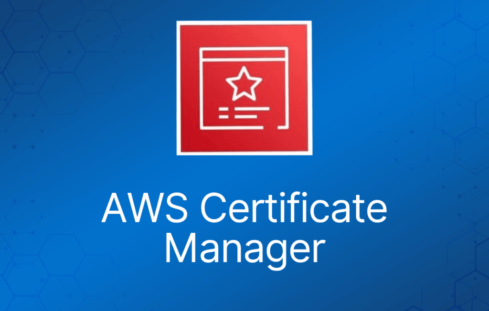

创建、存储和续订 SSL/TLS X.509 证书

支持单域名、多域名和通配符

与多项 AWS 服务集成，包括：

- Elastic Load Balancing。
- Amazon CloudFront。
- AWS Elastic Beanstalk。
- AWS Nitro Enclaves。
- AWS CloudFormation。

**公有证书**由 AWS 公有 Certificate Authority 签名。

你也可以使用 ACM 创建私有 CA。

然后即可签发私有证书。

还可以从第三方签发机构导入证书。
