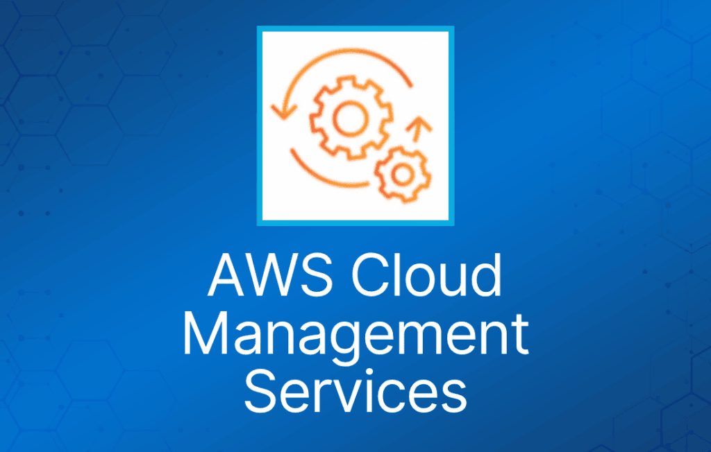
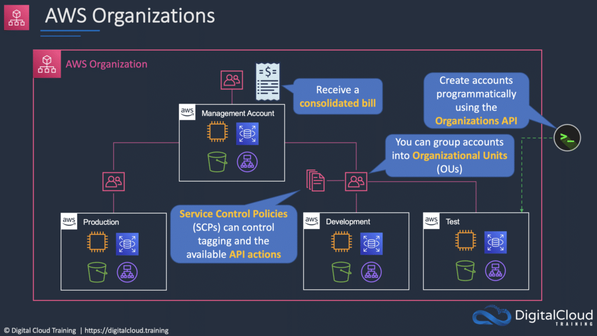
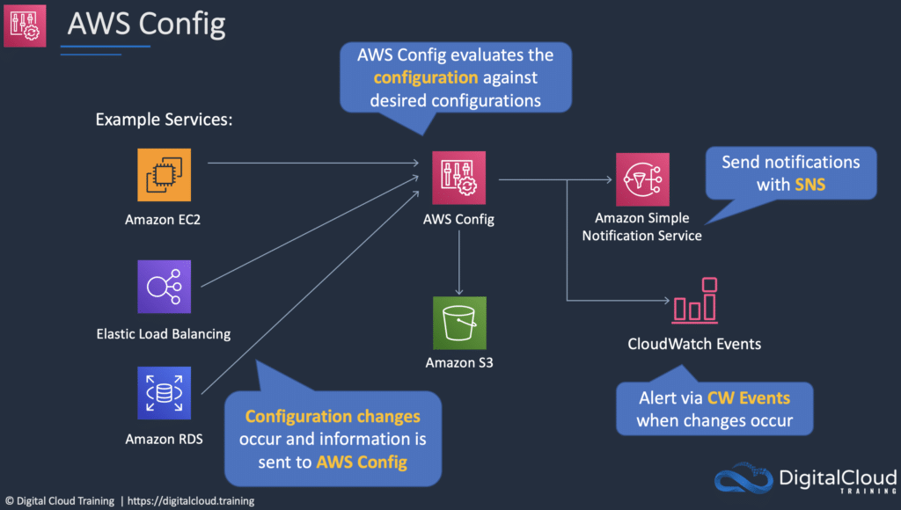

AWS 云管理服务可用于账户管理、配置合规、应用交付和系统管理。

## AWS Organizations

AWS Organizations 允许你将多个 AWS 账户整合到一个由你创建并集中管理的组织中。

提供两种功能集：

- Consolidated Billing。
- 全部功能。

包含 root 账户和组织单元（OU）。

策略应用于 root 账户或 OU。

Consolidated billing 包含：

- Paying Account —— 独立存在，无法访问其他账户的资源。
- Linked Accounts —— 所有 linked account 都是独立的。

## AWS Control Tower

简化创建多账户环境的过程。

为你搭建治理、合规和安全护栏（guardrail）。

与其他服务和功能集成，为你搭建环境，包括：

- AWS Organizations、SCP、OU、AWS Config、AWS CloudTrail、Amazon S3、Amazon SNS、AWS CloudFormation、AWS Service Catalog、AWS Single Sign-On（SSO）。

AWS Control Tower 可为你配置的护栏示例包括：

- 禁止对 Amazon Simple Storage Service（Amazon S3）bucket 的公开写访问。
- 禁止未启用多因素认证的 root 用户访问。
- 为挂载到 Amazon EC2 实例的 Amazon EBS 卷启用加密。

AWS Config

AWS Config 是一项全托管服务，为你提供 AWS 资源清单、配置历史和配置变更通知，以实现安全和监管合规。

使用 AWS Config，你可以发现现存和已删除的 AWS 资源，评估整体合规性是否符合规则，并深入查看资源在任意时间点的配置详情。AWS Config 支持合规审计、安全分析、资源变更跟踪和故障排查。

## AWS Service Catalog

AWS Service Catalog 允许组织创建和管理获准在 AWS 上使用的 IT 服务目录。

AWS Service Catalog 让你可以集中管理常用部署的 IT 服务。

IT 服务可以包括虚拟机镜像、服务器、软件、数据库以及多层应用架构。

让用户能够快速部署他们所需的、经过批准的 IT 服务。

## AWS Systems Manager

管理多种 AWS 资源，包括 Amazon EC2、Amazon S3、Amazon RDS 等。

Systems Manager 组件：

- Automation。
- Run Command。
- Inventory。
- Patch Manager。
- Session Manager。
- Parameter Store。

## AWS Personal Health Dashboard

当 AWS 发生可能影响你的事件时，AWS Personal Health Dashboard 会提供告警和修复指导。

Personal Health Dashboard 让你以个性化视角查看支撑你 AWS 资源的 AWS 服务的性能和可用性。

仪表板会显示相关且及时的信息，帮助你管理正在进行中的事件。

还提供主动通知，帮助你为计划中的活动提前做准备。

告警由 AWS 资源健康状态的变化触发，让你能看到事件并获得指导，快速诊断和解决问题。

你可以获得支撑应用的 AWS 服务状态的个性化视图，从而在 AWS 发生可能影响你的问题时第一时间发现。

还提供前瞻性的通知，你可以跨多个渠道（包括邮件和手机通知）设置告警，及时收到相关信息，为可能影响你的计划内变更做好准备。

告警包含修复详情和具体指导，让你能够立即采取行动，应对影响资源的 AWS 事件。

可与 Amazon CloudWatch Events 集成，让你构建自定义规则，并选择 AWS Lambda 函数等目标来定义自动化修复动作。

AWS Health API 允许你将健康数据和通知集成到现有的自研或第三方 IT 管理工具中。

## Service Health Dashboard

AWS 发布最新的服务可用性信息。

这些信息不是个性化的（与 Personal Health Dashboard 不同）。

## AWS OpsWorks

AWS OpsWorks 是一项配置管理服务，提供托管的 Chef 和 Puppet 实例。

更新内容包括补丁、更新、备份、配置和合规管理。

## AWS Trusted Advisor

AWS Trusted Advisor 是一款在线工具，提供实时指导，帮助你按照 AWS 最佳实践预配置资源。

Trusted Advisor 检查可以帮助你优化 AWS 基础设施、提升安全性和性能、降低总体成本，并监控服务限额。

AWS Basic Support 和 AWS Developer Support 客户可以使用 6 项安全检查（S3 Bucket Permissions、Security Groups – Specific Ports Unrestricted、IAM Use、MFA on Root Account、EBS Public Snapshots、RDS Public Snapshots）和 50 项服务限额检查。

AWS Business Support 和 AWS Enterprise Support 客户可以使用全部 115 项 Trusted Advisor 检查（14 项成本优化、17 项安全、24 项容错、10 项性能和 50 项服务限额）及建议。

## AWS CloudFormation

AWS CloudFormation 提供一种通用语言，让你可以描述和预配置云环境中的所有基础设施资源。

CloudFormation 允许你用一个简单的文本文件，以自动化且安全的方式，跨所有 region 和账户建模并预配置应用所需的全部资源。

这个文件就是你云环境的唯一事实来源（single source of truth）。

你可以使用 JSON 或 YAML 来描述要创建和配置哪些 AWS 资源。
