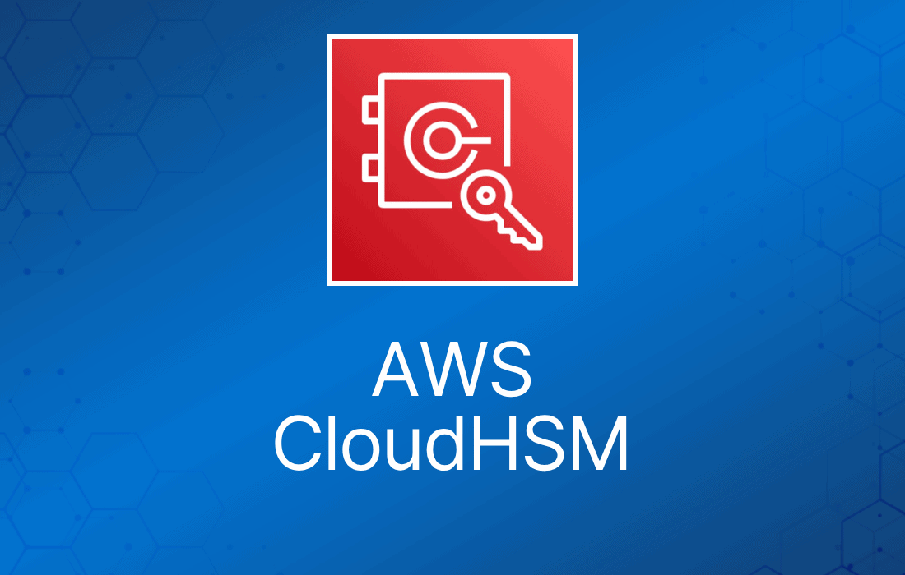
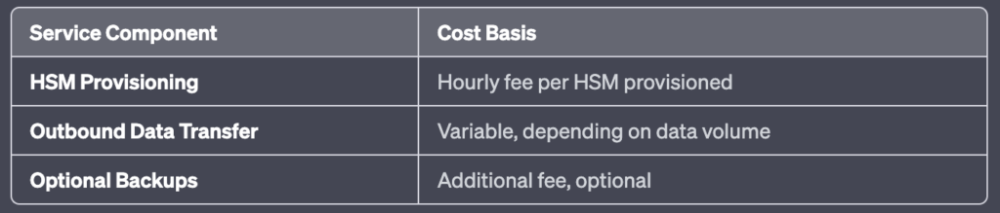
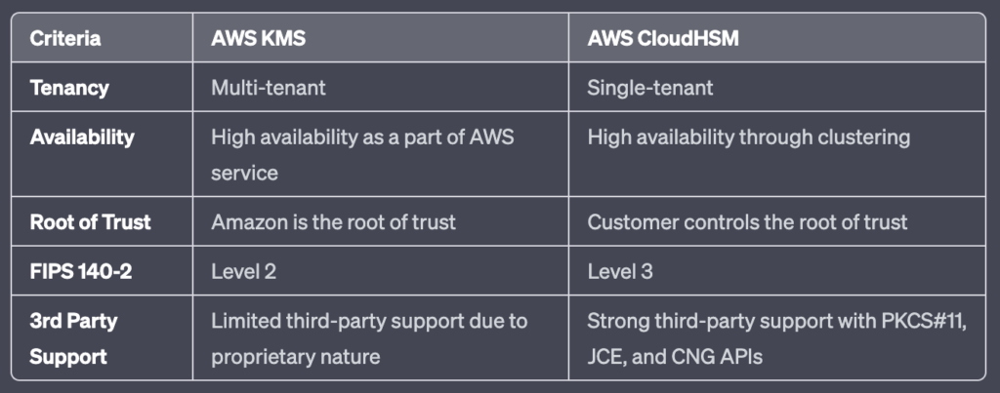

## 一、什么是 AWS CloudHSM？

[AWS CloudHSM](https://aws.amazon.com/cloudhsm/) 是一种基于云的硬件安全模块（HSM），可在防篡改的硬件设备中提供安全的加密密钥存储和运算能力。该服务通过使用经过 FIPS 140-2 Level 3 验证的 HSM，帮助你满足企业、合同及监管合规方面的数据安全要求。

## 二、AWS CloudHSM 的功能与优势

### A. 安全的密钥存储

AWS CloudHSM 让你能够安全地生成、存储和管理加密密钥。

### B. FIPS 140-2 Level 3 合规

该服务满足[高等级的合规标准](https://en.wikipedia.org/wiki/FIPS_140-2)，确保你的数据安全。

### C. 可扩展性

AWS CloudHSM 具备完全的可扩展性，可以按需增加容量。

### D. 灵活性

它支持多种 API，包括 [PKCS#11](https://www.ibm.com/docs/en/linux-on-systems?topic=introduction-what-is-pkcs-11)、[Java Cryptography Extensions (JCE)](https://www.oracle.com/java/technologies/javase-jce-all-downloads.html) 以及 [Microsoft CryptoNG (CNG)](https://learn.microsoft.com/en-us/windows/win32/seccng/cng-portal) 库。

### E. 控制与独立性

用户对集群中的每个 HSM 拥有独占的单租户访问权。

## 三、AWS CloudHSM 监控

AWS CloudHSM 可与 [AWS CloudTrail](https://aws.amazon.com/cloudtrail/) 和 [Amazon CloudWatch](https://aws.amazon.com/cloudwatch/) 集成。CloudTrail 会记录你账户的 API 调用，而 CloudWatch 则允许你收集和跟踪指标、收集并监控日志文件、设置告警，并自动响应 AWS 资源的变化。

## 四、AWS CloudHSM 定价

请注意，实际费用会因不同区域和具体使用模式而有所差异。最准确、最新的信息请始终以 [AWS 官方定价页面](https://aws.amazon.com/pricing/?nc2=h_ql_pr_ln&aws-products-pricing.sort-by=item.additionalFields.productNameLowercase&aws-products-pricing.sort-order=asc&awsf.Free%20Tier%20Type=*all&awsf.tech-category=*all)为准。

## 五、AWS CloudHSM 使用场景

### A. 保护签发 CA 的私钥

AWS CloudHSM 可以安全地生成和存储根 CA 或中间 CA 的私钥，降低未授权访问的风险。

### B. 为 Web 服务器卸载 SSL 处理

该服务可以将 SSL/TLS 处理从 Web 服务器上卸载，从而提升网站性能。

### C. 加密静态数据

AWS CloudHSM 支持对静态数据（data at rest）进行加密，为敏感数据提供额外一层保护。

## 六、AWS CloudHSM 常见问题

### A. AWS KMS 和 AWS CloudHSM 有什么区别？

### B. 什么时候应该用 AWS CloudHSM 而不是 AWS KMS？

当你需要在单租户硬件中控制和管理自己的加密密钥，或者有 AWS KMS 无法满足的合规要求时，建议使用 AWS CloudHSM。

### C. CloudHSM 达到什么合规级别？

AWS CloudHSM 符合 FIPS 140-2 Level 3，这是数据安全领域最高级别的合规标准之一。这意味着它满足对物理防篡改、基于角色的访问控制（role-based access control）的严格要求，并能够将模块内所有明文加密密钥和关键安全参数清零（zeroize）。该级别的认证保证 CloudHSM 在设计上能够防止对加密密钥的未授权物理和逻辑访问，因此适合处理敏感数据。

## 七、总结

AWS CloudHSM 提供了一个强大的平台，让企业能够在云端安全地生成、存储和管理加密密钥。该服务的灵活性来自对多种 API 的支持，可扩展性则来自按需扩容的能力。凭借包括 FIPS 140-2 Level 3 在内的高合规标准，它为加密运算提供了严格的安全保障。因此，对于希望在保持控制权并满足合规要求的同时安全管理加密密钥的企业来说，AWS CloudHSM 是一个非常合适的服务。
