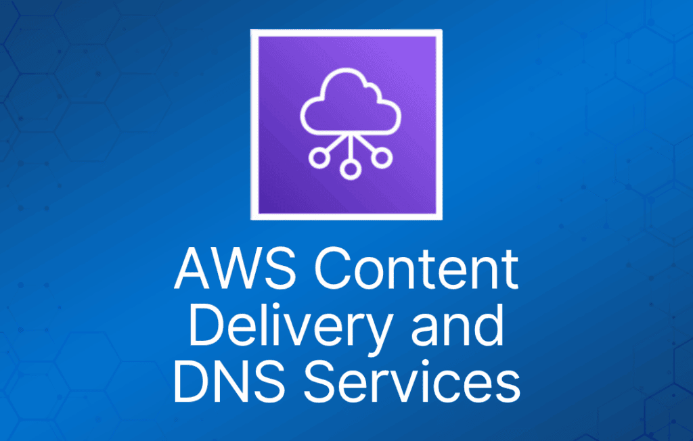
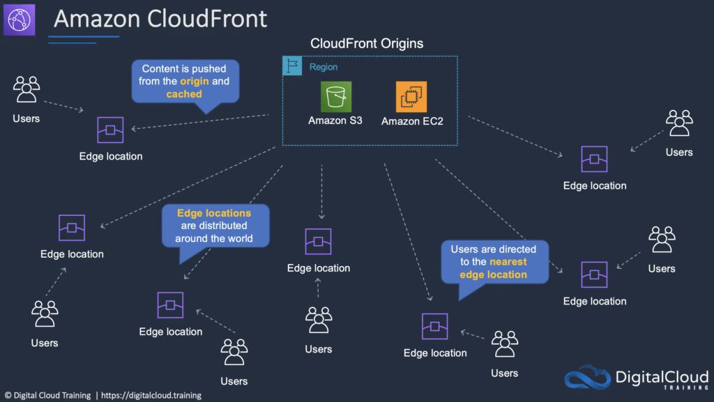

这一类 AWS 服务包括在全球范围缓存内容的服务，以及为应用提供智能域名系统（DNS）服务的产品。

## Amazon Route 53

Amazon Route 53 是 AWS 的域名服务（Domain Name Service）。

Route 53 主要提供三项功能：

- 域名注册 —— Route 53 允许你注册域名。
- 域名服务（DNS）—— Route 53 通过全球分布的权威 DNS 服务器网络，将域名解析为 IP 地址。
- 健康检查 —— Route 53 会向你的应用发送自动请求，验证其是否可达、可用且功能正常。

这些功能可以任意组合使用。

Route 53 的优势：

- 域名注册。
- DNS 服务。
- Traffic Flow（将用户引导到最佳端点）。
- 健康检查。
- DNS 故障转移（系统故障时自动切换域名端点）。
- 可与 ELB、S3 和 CloudFront 集成作为端点。

路由策略（routing policy）决定 Route 53 DNS 如何响应查询。

下表列出了每种路由策略的关键功能：

|  |  |
| --- | --- |
| **策略** | **作用** |
| Simple（简单路由） | 简单的 DNS 响应，返回与名称关联的 IP 地址 |
| Failover（故障转移） | 当主节点不可用（基于健康检查判断）时，路由到备用目标 |
| Geolocation（地理位置） | 根据用户所在的地理位置（如欧洲）将其路由到最近的区域 |
| Geoproximity（地理邻近） | 将用户路由到某个地理区域内最近的区域 |
| Latency（延迟） | 按照到资源延迟最低的路径进行引导 |
| Multivalue answer（多值应答） | 返回多个 IP 地址，相当于一个基础的负载均衡器 |
| Weighted（加权） | 根据分配给资源的相对权重决定路由目标 |

## Amazon CloudFront

Amazon CloudFront 是一个内容分发网络（CDN），让你可以把内容存储（缓存）在遍布全球的“边缘节点（edge location）”上。

这让客户可以更快地访问内容，同时还能防御 DDoS 攻击。

CloudFront 可用于分发数据、视频、应用和 API。

CloudFront 的优势：

- 在边缘节点缓存内容，快速分发给客户。
- 内置分布式拒绝服务（DDoS）攻击防护。
- 可与多种 AWS 服务集成（S3、EC2、ELB、Route 53、Lambda）。

源（Origin）与分配（Distribution）：

- origin 是 CDN 要分发的文件的来源。
- origin 可以是 S3 bucket、EC2 实例、Elastic Load Balancer 或 Route 53，也可以是外部（非 AWS）源。
- 要用 CloudFront 分发内容，需要创建一个 distribution。

CloudFront 使用边缘节点（Edge Location）和区域边缘缓存（Regional Edge Cache）：

- edge location 是缓存内容的位置（独立于 AWS 区域/AZ）。
- 请求会被自动路由到最近的 edge location。
- Regional Edge Cache 位于源站 Web 服务器和全球 edge location 之间，缓存容量更大。
- Regional Edge Cache 的目标是让内容更靠近用户。

下图展示了 Regional Edge Cache 和 Edge Location 相对于终端用户的位置：

