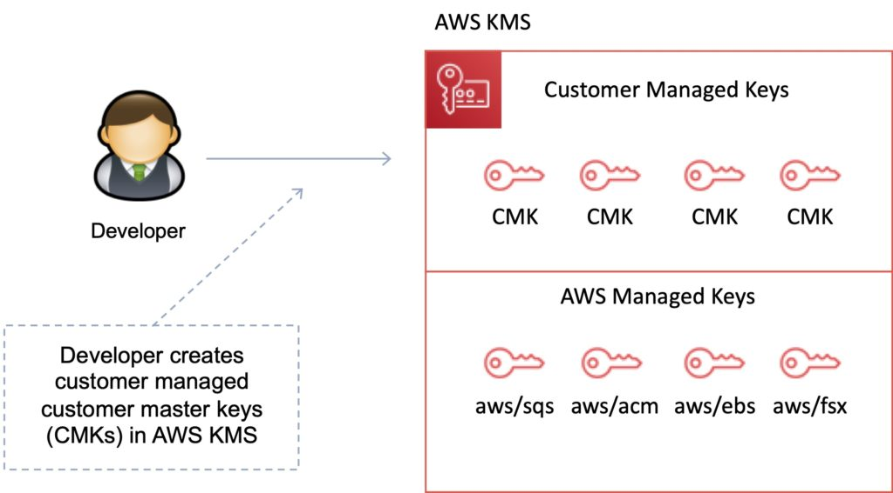
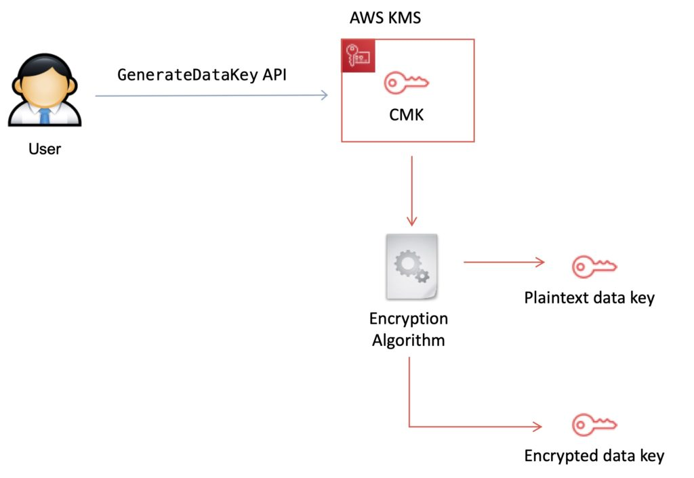

AWS Key Management Service (KMS) 是一项托管服务，让你能够轻松加密数据。

AWS KMS 提供高可用的密钥存储、管理和审计解决方案，让你能够加密自己应用程序中的数据，并控制跨 AWS 服务存储数据的加密。

AWS KMS 允许你集中管理并安全存储密钥。这些密钥称为 AWS KMS keys（以前称为 customer master keys，CMK）。

## AWS KMS Keys

KMS key 由以下部分组成：

- 别名（Alias）。
- 创建日期。
- 描述。
- 密钥状态。
- 密钥材料（由客户提供或由 AWS 提供）。

KMS keys 是 AWS KMS 中的主要资源。

KMS key 包含元数据，如 key ID、创建日期、描述和密钥状态。

KMS key 还包含用于加密和解密数据的密钥材料。

AWS KMS 支持对称和非对称 KMS keys。

KMS keys 在 AWS KMS 中创建。对称 KMS keys 和非对称 KMS keys 的私钥永远不会以未加密形式离开 AWS KMS。

默认情况下，AWS KMS 为 KMS key 创建密钥材料。

一个 KMS key 最多可加密 4KB 大小的数据。

KMS key 可以生成、加密和解密数据加密密钥（Data Encryption Keys，DEK）。

KMS key 永远无法从 KMS 导出（CloudHSM 允许导出）。

AWS 托管 KMS keys：

- 由 AWS 管理的 KMS keys 供与 KMS 交互的 AWS 服务用于加密数据。
- 它们只能由创建它们的服务在特定区域内使用。
- 在你首次使用该服务实施加密时创建。

客户托管 KMS keys：

- 提供更大的灵活性。
- 你可以执行轮换、访问治理和密钥策略配置。
- 当密钥不再需要时，你可以启用和禁用它。

## 客户托管 KMS keys

客户托管 KMS keys 是你在 AWS 账户中创建、拥有和管理的 KMS keys。

你对这些 KMS keys 拥有完全控制权，包括建立和维护其密钥策略、IAM 策略和授权（grants），启用和禁用它们，轮换其加密材料，添加标签，创建指向 KMS key 的别名，以及计划删除 KMS keys。

客户托管 KMS keys 会收取月费，超出免费额度的使用也会收费。

## AWS 托管 KMS keys

AWS 托管 KMS keys 是你账户中的 KMS keys，由与 AWS KMS 集成的 AWS 服务代表你创建、管理和使用。

你无法管理这些 KMS keys，无法轮换它们，也无法更改其密钥策略。

你也不能直接在加密操作中使用 AWS 托管 KMS keys；创建它们的服务会代表你使用它们。

AWS 托管 KMS keys 不收取月费。超出免费额度的使用可能会收费，但某些 AWS 服务会为你承担这些费用。

## AWS 拥有的 KMS Keys

AWS 拥有的 KMS keys 是某个 AWS 服务拥有并管理的 KMS keys 集合，用于多个 AWS 账户。

虽然 AWS 拥有的 KMS keys 不在你的 AWS 账户中，但 AWS 服务可以使用其 AWS 拥有的 KMS keys 来保护你账户中的资源。

你无需创建或管理 AWS 拥有的 KMS keys。

但是，你无法查看、使用、跟踪或审计它们。

AWS 拥有的 KMS keys 不收取月费或使用费，也不计入你账户的 AWS KMS 配额。

## 数据加密密钥（Data Encryption Keys）

数据密钥（data keys）是可用于加密数据的加密密钥，包括大量数据和其他数据加密密钥。

你可以使用 AWS KMS keys 生成、加密和解密数据密钥。

AWS KMS 不存储、管理或跟踪你的数据密钥，也不使用数据密钥执行加密操作。

你必须在 AWS KMS 之外使用和管理数据密钥。

可以使用 GenerateDataKey API 通过 KMS key 创建数据加密密钥：

## KMS 细节

你可以在密钥上设置使用策略，决定哪些用户可以使用它们加密和解密数据，以及在什么条件下使用。

密钥材料选项：

- 由 KMS 生成。
- 导入你自己的密钥材料。

你可以在 KMS 中生成 KMS keys，也可以在 AWS CloudHSM 集群中生成，或从你自己的密钥管理基础设施导入。

这些主密钥受硬件安全模块（HSM）保护，并且仅在这些模块内部使用。

你可以将数据直接提交给 KMS，使用这些主密钥进行加密或解密。

KMS 现在支持对称和非对称密钥。

KMS 仅用于静态数据加密（encryption at rest），不用于传输中加密（传输中加密请使用 SSL）。

KMS 与许多 AWS 服务紧密集成，如 Lambda、S3、EBS、EFS、DynamoDB、SQS 等。

数据密钥不由 KMS 保留或管理。

AWS 服务加密你的数据，并将加密后的数据密钥副本与其保护的数据一起存储。

当服务需要解密你的数据时，它会请求 KMS 使用你的主密钥解密数据密钥。

如果向 AWS 服务请求数据的用户根据你的主密钥策略有权解密，服务将从 KMS 收到解密后的数据密钥，并用它解密你的数据并以明文返回。

所有使用你主密钥的请求都会记录在 AWS CloudTrail 中，因此你可以了解谁在什么上下文中使用了哪个密钥，以及何时使用的。

你可以通过 IAM 用户和角色控制谁可以管理和访问密钥。

你可以通过 CloudTrail 审计密钥的使用情况。

KMS 与 Secrets Manager 的区别在于，KMS 专为加密密钥管理而构建。

KMS 已通过许多合规认证（例如 PCI DSS Level 1、FIPS 140-2 Level 2）。

**考试提示：**加密密钥是区域性的。

## 使用 KMS 进行密钥管理

你可以在 AWS KMS 中执行以下密钥管理功能：

- 创建具有唯一别名和描述的密钥。
- 导入你自己的密钥材料。
- 定义哪些 IAM 用户和角色可以管理密钥。
- 定义哪些 IAM 用户和角色可以使用密钥加密和解密数据。
- 选择让 AWS KMS 每年自动轮换你的密钥。
- 临时禁用密钥，使其无法被任何人使用。
- 重新启用已禁用的密钥。
- 删除不再使用的密钥。
- 通过检查 AWS CloudTrail 中的日志审计密钥使用情况。
- 创建自定义密钥存储（custom key stores）\*。
- 连接和断开自定义密钥存储\*。
- 删除自定义密钥存储\*。

\* 使用自定义密钥存储需要你的账户中有可用的 CloudHSM 资源。

## 数据加密场景

通常，数据在以下三种场景之一中进行加密：

1. 你可以直接使用 KMS API，通过存储在 KMS 中的主密钥加密和解密数据。
2. 你可以选择让 AWS 服务使用存储在 KMS 中的主密钥加密你的数据。在这种情况下，数据使用受 KMS 中主密钥保护的数据密钥进行加密。
3. 你可以使用与 AWS KMS 集成的 AWS Encryption SDK，在你自己的应用程序中执行加密，无论它们是否运行在 AWS 上。

## 自定义密钥存储（Custom Key Store）

AWS KMS 自定义密钥存储功能将 AWS CloudHSM 提供的控制能力与 AWS KMS 的集成和易用性结合在一起。

你可以配置自己的 CloudHSM 集群，并授权 KMS 将其用作密钥的专用密钥存储，而不是默认的 KMS 密钥存储。

在 KMS 中创建密钥时，你可以选择在 CloudHSM 集群中生成密钥材料。在自定义密钥存储中生成的主密钥永远不会以明文形式离开 CloudHSM 集群中的 HSM，所有使用这些密钥的 KMS 操作都只在你的 HSM 中执行。

在所有其他方面，存储在自定义密钥存储中的主密钥与其他 KMS keys 一致。

## 密钥删除

你可以计划在 AWS KMS 中删除你创建的客户主密钥及其关联元数据，等待期可配置为 7 到 30 天。

这个等待期让你能够验证删除密钥对依赖它的应用程序和用户的影响。

默认等待期为 30 天。

你可以在等待期内取消密钥删除。

## AWS KMS API

以下 API 对考试很有帮助：

Encrypt（aws kms encrypt）：

- 使用客户主密钥（KMS key）将明文加密为密文。
- 你可以加密少量任意数据，例如个人标识符、数据库密码或其他敏感信息。
- 你可以使用 Encrypt 操作将加密数据从一个 AWS 区域移动到另一个区域。

Decrypt（aws kms decrypt）：

- 解密由 AWS KMS key 使用以下任一操作加密的密文：
  - Encrypt
  - GenerateDataKey
  - GenerateDataKeyPair
  - GenerateDataKeyWithoutPlaintext
  - GenerateDataKeyPairWithoutPlaintext

Re-encrypt（aws kms re-encrypt）：

- 解密密文，然后完全在 AWS KMS 内部重新加密。
- 你可以使用此操作更改数据加密所用的客户主密钥（KMS key），例如手动轮换 KMS key 或更改保护密文的 KMS key 时。
- 你也可以使用它在同一个 KMS key 下重新加密密文，例如更改密文的加密上下文（encryption context）。

Enable-key-rotation：

- 为指定的对称客户主密钥（KMS key）启用密钥材料的自动轮换。
- 你无法对不同 AWS 账户中的 KMS key 执行此操作。

GenerateDataKey（aws kms generate-data-key）：

- 为指定的对称客户主密钥（KMS key）启用密钥材料的自动轮换。
- 你无法对不同 AWS 账户中的 KMS key 执行此操作。

GenerateDataKeyWithoutPlaintext（generate-data-key-without-plaintext）：

- 生成唯一的对称数据密钥。
- 此操作返回在你指定的客户主密钥（KMS key）下加密的数据密钥。
- 要请求非对称数据密钥对，请使用 GenerateDataKeyPair 或 GenerateDataKeyPairWithoutPlaintext 操作。

## KMS 信封加密（Envelope Encryption）

AWS KMS 与 AWS 服务和客户端工具包集成，使用一种称为信封加密（envelope encryption）的方法来加密你的数据。

在这种方法下，KMS 生成数据密钥用于加密数据，而数据密钥本身则使用你在 KMS 中的主密钥加密：

- KMS key 用于加密数据密钥（信封密钥）。
- 信封密钥用于解密数据。

## 限制

每个账户每个区域最多可创建 1000 个 KMS keys。

由于启用和禁用状态的 KMS keys 都计入该限制，AWS 建议删除不再使用的已禁用密钥。

代表你为在受支持的 AWS 服务中使用而创建的 AWS 托管主密钥不计入此限制。

使用主密钥派生的数据密钥数量没有限制，可用于你的应用程序或由 AWS 服务代表你加密数据。
