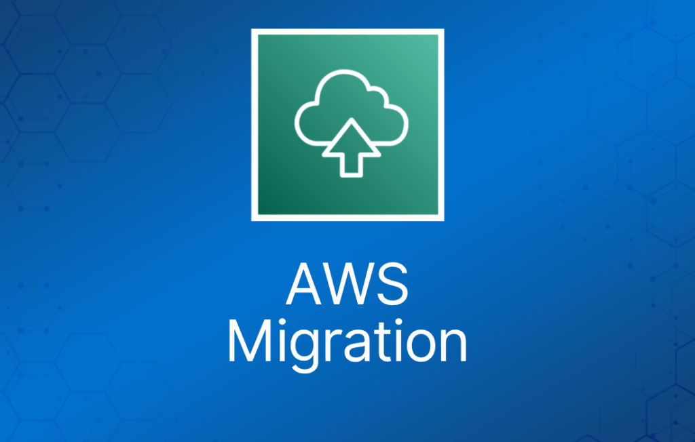

AWS Migration Hub 提供单一位置，用于跟踪跨多个 AWS 和合作伙伴解决方案的应用程序迁移进度。

AWS Migration Hub 允许你导入本地服务器和应用程序的信息，或者使用 AWS Discovery Agent 或 AWS Discovery Collector（一种面向 VMware 环境的无代理方式）进行更深入的发现。

AWS Migration Hub 的网络可视化功能让你能够快速识别服务器及其依赖关系、识别服务器的角色，并将服务器分组为应用程序，从而加速迁移规划。

要使用网络可视化，首先安装 AWS Discovery Agent，然后从 Data Collectors 页面开始数据收集。

AWS Migration Hub 在一个中心位置提供所有应用程序详情。

这使你可以跟踪所有迁移中所有环节的状态，更轻松地查看整体迁移进度，并减少确定当前状态和下一步骤所花的时间。

AWS Migration Hub 让你能够跟踪迁移到你的迁移工具所支持的任何 AWS 区域的状态。

无论迁移到哪个区域，使用集成工具时，迁移状态都会显示在 Migration Hub 中。

## Application Discovery Service

AWS Application Discovery Service 通过收集企业客户本地数据中心的信息，帮助他们规划迁移项目。

规划数据中心迁移可能涉及数千个通常深度相互依赖的工作负载。

服务器利用率数据和依赖关系映射是迁移过程中重要的第一步。

AWS Application Discovery Service 收集并呈现服务器的配置、使用情况和行为数据，帮助你更好地了解工作负载。

收集的数据以加密格式保存在 AWS Application Discovery Service 数据存储中。

你可以将这些数据导出为 CSV 文件，用于估算在 AWS 上运行的总拥有成本（TCO），并规划向 AWS 的迁移。

此外，这些数据也可在 AWS Migration Hub 中使用，你可以在其中迁移已发现的服务器，并在它们迁移到 AWS 时跟踪进度。

## Database Migration Service

AWS Database Migration Service 帮助你快速、安全地将数据库迁移到 AWS。

迁移期间源数据库保持完全运行，最大程度减少依赖该数据库的应用程序的停机时间。

AWS Database Migration Service 可以在大多数广泛使用的商业和开源数据库之间迁移数据。

支持的迁移路径包括：

- 本地和 EC2 数据库迁移到 Amazon RDS 或 Amazon Aurora。
- 同构迁移，例如 Oracle 到 Oracle。
- 不同数据库平台之间的异构迁移，例如 Oracle 或 Microsoft SQL Server 到 Amazon Aurora。

完整的支持的源列表请点击[**这里**](https://docs.aws.amazon.com/dms/latest/userguide/CHAP_Source.html)。

完整的支持的目标列表请点击[**这里**](https://docs.aws.amazon.com/dms/latest/userguide/CHAP_Target.html)。

使用 AWS Database Migration Service，你可以以高可用性持续复制数据，并通过将数据流式传输到 Amazon Redshift 和 Amazon S3，将数据库整合到 PB 级数据仓库中。

与 Schema Conversion Tool (SCT) 一起使用，将数据库迁移到 AWS RDS 或基于 EC2 的数据库。

AWS Database Migration Service 可以在大多数广泛使用的商业和开源数据库之间迁移数据。

Schema Conversion Tool 可以为同构迁移（相同数据库）复制数据库 schema，也可以为异构迁移（不同数据库）转换 schema。

DMS 用于较小、较简单的转换，并支持 MongoDB 和 DynamoDB。

SCT 用于较大、较复杂的数据集，如数据仓库。

DMS 具有从本地到 AWS、或到 Snowball 或 S3 的复制功能。

## Server Migration Service

AWS Server Migration Service (SMS) 是一项无代理服务，让你能够更轻松、更快速地将数千个本地工作负载迁移到 AWS。

AWS SMS 允许你自动化、计划并跟踪活动服务器卷的增量复制，让你更容易协调大规模服务器迁移。

AWS Transfer Family

AWS Transfer Family 为直接传入和传出 Amazon S3 或 Amazon EFS 的文件传输提供完全托管的支持。

AWS Transfer Family 支持 Secure File Transfer Protocol (SFTP)、File Transfer Protocol over SSL (FTPS) 和 File Transfer Protocol (FTP)，通过与现有身份认证系统集成，并借助 Amazon Route 53 提供 DNS 路由，帮助你将文件传输工作流无缝迁移到 AWS，你的客户和合作伙伴及其应用程序无需任何改变。

数据存入 Amazon S3 或 Amazon EFS 后，你可以将其与 AWS 服务结合使用，进行处理、分析、机器学习、归档，以及用作主目录和开发工具。

## AWS DataSync

AWS DataSync 是一项在线数据传输服务，可简化、自动化并加速本地存储系统与 AWS 存储服务之间、以及 AWS 存储服务之间的数据移动。

你可以使用 DataSync 将活跃数据集迁移到 AWS、归档数据以释放本地存储容量、将数据复制到 AWS 以实现业务连续性，或将数据传输到云端进行分析和处理。

DataSync 提供内置安全功能，例如传输中数据加密，以及传输中和静态的数据完整性验证。

它优化网络带宽的使用，并能自动从网络连接故障中恢复。

此外，DataSync 还提供控制和监控功能，例如数据传输计划，以及通过 Amazon CloudWatch 指标、日志和事件对传输过程进行细粒度可视化。

DataSync 可以在 Network File System (NFS) 共享、Server Message Block (SMB) 共享、自管理对象存储、AWS Snowcone、Amazon Simple Storage Service (Amazon S3) 存储桶、Amazon Elastic File System (Amazon EFS) 文件系统以及 Amazon FSx for Windows File Server 文件系统之间复制数据。
