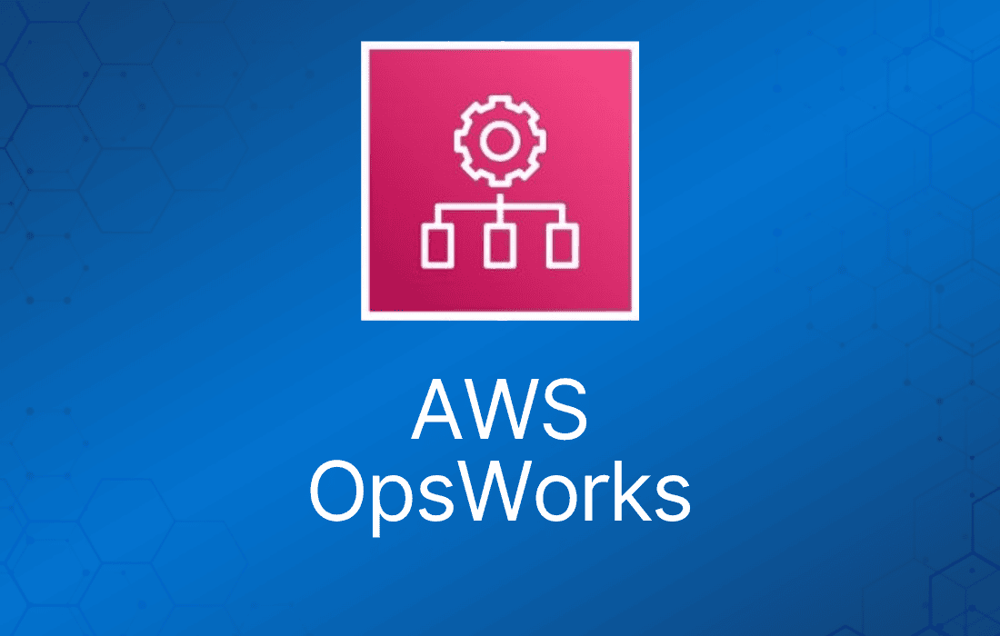

AWS OpsWorks 是一项配置管理服务，提供 Chef 和 Puppet 这两个开源工具的托管实例。

借助 OpsWorks，AWS 管理并自动化你的基础设施的配置、部署和管理方式。

AWS OpsWorks for Chef 与 Puppet 的区别在于，Chef 使用 AWS OpsWorks 的 Chef cookbook 和 recipe，而 AWS OpsWorks for Puppet Enterprise 使用 manifest 和 module。

一般来说，recipe 和 manifest 描述单一概念，而 cookbook 和 recipe 描述更宽泛的概念。

AWS OpsWorks 监控由 AWS OpsWorks 与 CloudWatch 的直接集成构成。

AWS OpsWorks 的服务使用和访问日志会原生且安全地传送到 AWS CloudTrail。

## AWS OpsWorks Stacks

AWS OpsWorks Stacks 是 OpsWorks AWS 工具集中的一项配置管理服务，让你能够自动化环境中的任何任务。

OpsWorks Stacks 的 AWS OpsWorks Auto Healing 还允许环境自动修复，确保环境主动保持健康。

这些任务的典型例子包括扩缩容、搭建数据库集群，以及在虚拟机中安装软件包和依赖。

OpsWorks Stacks 支持 Linux 和 Windows 工作负载，并使用 Chef Recipe 来配置那些最适合自动化的任务。

每个 OpsWorks stack 由多个层（layer）构成——每层代表不同的 stack 组件，例如一个独立的负载均衡器、一个数据库或一组 EC2 实例。

AWS OpsWorks Stacks 具有以下特性：

- EC2 实例可以使用模板配置部署，包括 EBS 卷。
- 实例上的软件可以按需配置，或根据随时间发生的事件自动配置——从将基础 OS 镜像引导为运行中的服务器，到修改运行中的服务以反映变更。
- Stack 可以由 AWS OpsWorks 服务自动修复。OpsWorks Stacks 可以用新实例替换 stack 中失败的实例，确保最大的正常运行时间和可用性。
- AWS OpsWorks Stacks 与 Amazon CloudTrail 完美集成，无需自己配置即可将日志发送到 CloudTrail 控制台。

## AWS OpsWorks for Chef Automate

Chef Automate 是一个企业级平台，以企业级的规模和性能为你的云架构提供可操作的洞察。

AWS OpsWorks for Chef Automate 是在 OpsWorks AWS 中启动 Chef Automate 服务器的托管方式。

在 AWS 中，你可以运行 Chef Automate 服务器而无需担心预置任何硬件。

Chef Automate 的 AWS OpsWorks Auto Healing 同样允许环境自动修复，确保环境主动保持健康。

Chef Automate 还自行处理运维、备份、恢复和软件升级。

你可以将任何本地计算机或任何运行受支持操作系统（[列表在此](http://man.hubwiz.com/docset/Chef.docset/Contents/Resources/Documents/docs.chef.io/platforms.html)）且能通过网络访问 AWS OpsWorks for Chef Automate 服务器的 EC2 实例接入进来。

你可以原生配置自动备份，备份存储在 S3 中。

向 Chef 服务器添加新节点非常简单，只需将 OpsWorks for Chef Automate 提供的 user-data 代码插入你的 Auto Scaling 组即可。

所有 Chef 通信均使用 SSL 加密，确保服务器与架构中的其他部分安全通信。

你获得的是完整的 Chef Automate 平台，其中包含可与 Chef 服务器一起使用的高级功能，如 Chef Workflow、Chef Visibility 和 Chef Compliance，全部在同一服务中。

OpsWorks for Chef Automate 还可以在你定义的每周维护窗口内自动安装更新。

你可以通过控制台、CloudFormation 或 CLI/SDK 启动 Chef Automate 服务器。

## AWS OpsWorks for Puppet Enterprise

OpsWorks for Puppet Enterprise 是 OpsWorks 的另一个子集，让你几分钟内就能启动 Puppet Enterprise master，而不再需要数小时。

你可以原生配置自动备份，备份存储在 S3 中。

向 Puppet Enterprise 服务器添加新节点非常简单，只需将 AWS OpsWorks for Puppet Enterprise 提供的 user-data 代码插入你的 Auto Scaling 组即可。

Puppet Enterprise 通信使用 SSL 加密，确保服务器与架构中的其他部分安全通信。

删除 Puppet Enterprise 服务器也会删除与其关联的所有内容，包括备份和所有其他支持资源。

AWS OpsWorks for Puppet Enterprise 还可以在你定义的每周维护窗口内自动安装更新。

你可以通过控制台、CloudFormation 或 CLI/SDK 启动 Puppet Enterprise 服务器。

## AWS OpsWorks 定价

OpsWorks Stacks 不额外收费。你只需为作为该服务一部分启动的资源付费，OpsWorks Stacks 本身不收费。

OpsWorks Stacks 的本地部署每小时 $0.02，两种部署方式均无最低费用、无预付费承诺。

AWS OpsWorks for Chef Automate 和 AWS OpsWorks for Puppet Enterprise 单独计费。

费用根据连接到 Chef Automate 实例的节点数量、节点运行时长以及所运行的 EC2 实例来计算。

最终价格考虑每月节点数量和节点小时数。

对于 OpsWorks Puppet Enterprise 和 Chef Automate，AWS 免费套餐每月提供 7,500 个免费节点小时。

## OpsWorks AWS 端点与配额

OpsWorks for Chef Automate 和 AWS OpsWorks for Puppet Enterprise 目前并非在所有区域都可用——目前仅存在于九个区域（[列表在此](https://docs.aws.amazon.com/general/latest/gr/opsworks-service.html)）。

OpsWorks Stacks 则在十五个区域中可用，且任何资源都无法从其他区域管理。

AWS OpsWorks Stacks 的服务配额信息请见下表。

|  |  |  |  |
| --- | --- | --- | --- |
| **名称** | **描述** | **默认限制（每区域）** | **硬限制 / 软限制** |
| Stacks | Stack 数量 | 40 | 软限制 |
| 每个 Stack 的层数 | 多个不同的 stack 组件，例如一个独立的负载均衡器、一个数据库或一组 EC2 实例。 | 40 | 软限制 |
| 每个 Stack 的实例数 | 一个 OpsWorks stack 中可拥有的最大实例数。 | 40 | 软限制 |
| 每个 Stack 的应用数 | 一个 OpsWorks stack 中可拥有的最大应用数。 | 40 | 软限制 |

OpsWorks for Chef Automate 和 AWS OpsWorks for Puppet Enterprise 的服务配额信息请见下表。

|  |  |  |
| --- | --- | --- |
| **名称** | **默认限制（每区域）** | **硬限制 / 软限制** |
| 每台服务器的手动备份数 | 10 | 软限制 |
| 每台服务器的计划（自动）备份数 | 10 | 软限制 |
| 服务器数量 | 5 | 软限制 |
