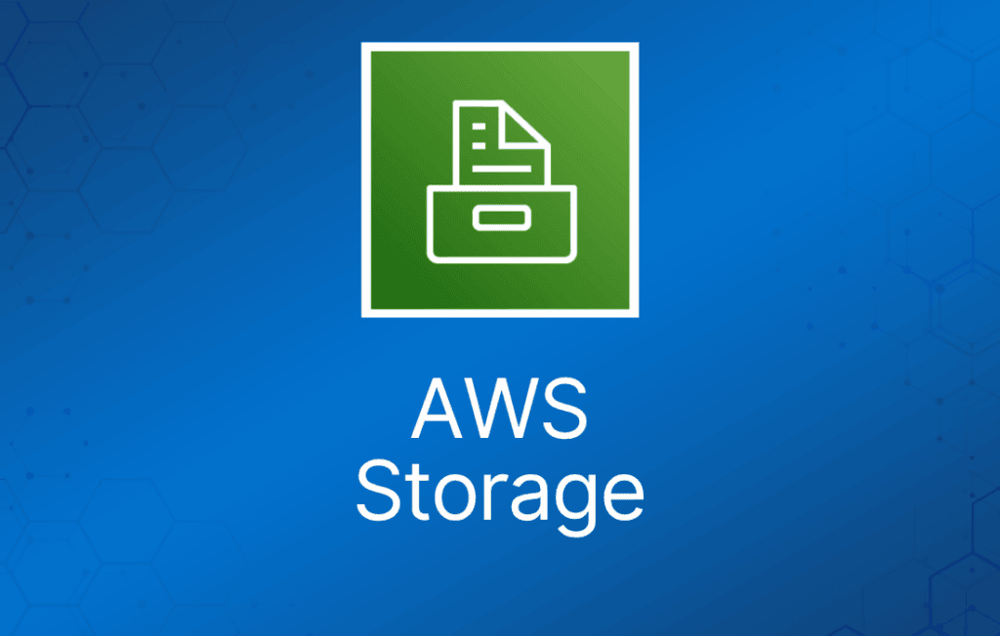
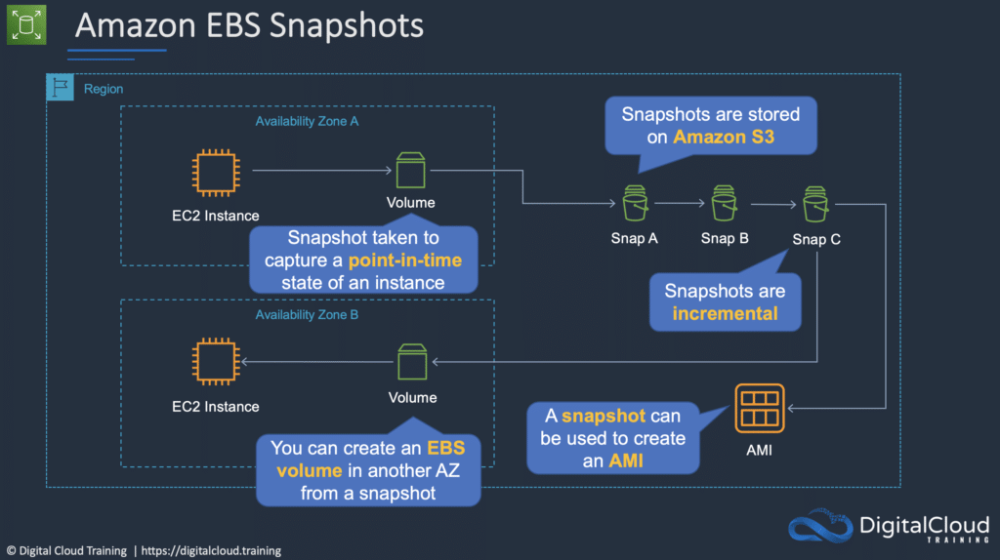
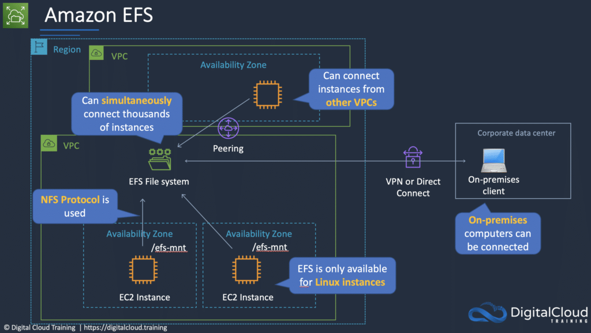

在 AWS 云中，针对各种不同类型的架构有多种服务选项。关于不同的 AWS 存储类型服务，本 cheat sheet 将深入介绍如何决定选择哪种 AWS 存储方案，以及哪种 AWS 存储服务最适合特定的使用场景。

从众多 AWS 存储服务中挑选合适的服务看似困难，但本 cheat sheet 提供了各 AWS 存储服务的简明对比，让这项任务变得轻松。

本文还会在 AWS Certified Cloud Practitioner 考试的语境下讨论 AWS Compute。请记住，AWS Compute 是考试指南涵盖的关键技术领域之一。

## Amazon Simple Storage Service (S3)

Amazon S3 是一种对象存储，可从任何位置存储和检索任意数量的数据——网站和移动应用、企业应用，以及来自 IoT 传感器或设备的数据。

你可以在 S3 中存储任何类型的文件。

S3 的设计目标是提供 99.999999999% 的持久性，为各行业领先企业使用的数百万应用存储数据。

S3 提供全面的安全与合规能力，即使是最严格的监管要求也能满足。

S3 让客户能够灵活地管理数据，以实现成本优化、访问控制和合规。

典型使用场景包括：

- **备份与存储** – 为他人提供数据备份和存储服务。
- **应用托管** – 提供部署、安装和管理 Web 应用的服务。
- **媒体托管**– 构建冗余、可扩展且高可用的基础设施，托管视频、照片或音乐的上传和下载。
- **软件分发** – 托管可供客户下载的软件应用。
- **静态网站** – 你可以配置一个从 S3 bucket 运行的静态网站。

S3 提供原地查询（query-in-place）功能，允许你直接对 S3 中的静态数据运行强大的分析。Amazon S3 是目前获得支持最广泛的云存储服务，拥有最大规模的第三方解决方案、系统集成商合作伙伴以及其他 AWS 服务的集成生态。

文件大小可以从 0 字节到 5 TB。

存储空间没有上限。

文件存储在 bucket 中。

Bucket 是根级文件夹。

Bucket 内的任何子文件夹称为"folder"。

S3 是全局统一的命名空间，因此 bucket 名称必须全局唯一。

S3 共有七种存储类别。

- S3 Standard（持久、立即可用、频繁访问）。
- S3 Intelligent-Tiering（自动将数据移动到最具成本效益的层级）。
- S3 Standard-IA（持久、立即可用、不频繁访问）。
- S3 One Zone-IA（不频繁访问数据的更低成本选择，弹性较低）。
- S3 Glacier Instant Retrieval（极少访问且需要毫秒级检索的数据）。
- S3 Glacier Flexible Retrieval（归档数据，检索时间为数分钟到数小时）。
- S3 Glacier Deep Archive（长期保留的最低成本存储类别）。

下表提供了各 Amazon S3 存储类别的详细信息：

|  |  |  |  |  |  |  |  |
| --- | --- | --- | --- | --- | --- | --- | --- |
|  | **S3 Standard** | **S3 Intelligent Tiering** | **S3 Standard-IA** | **S3 One Zone-IA** | **S3 Glacier Instant Retrieval** | **S3 Glacier Flexible Retrieval** | **S3 Glacier Deep Archive** |
| **设计持久性** | 11 个 9 | 11 个 9 | 11 个 9 | 11 个 9 | 11 个 9 | 11 个 9 | 11 个 9 |
| **设计可用性** | 99.99% | 99.9& | 99.9% | 99.5% | 99.9% | 99.99% | 99.99% |
| **可用性 SLA** | 99.9% | 99% | 99% | 99% | 99% | 99.99% | 99.9% |
| **可用区数量** | ≥3 | ≥3 | ≥3 | 1 | ≥3 | ≥3 | ≥3 |
| **每对象最小容量计费** | N/A | N/A | 128KB | 128KB | 128KB | 40KB | 40KB |
| **最短存储时长计费** | N/A | N/A | 30 天 | 30 天 | 90 天 | 90 天 | 180 天 |
| **检索费用** | N/A | N/A | 按检索的 GB 收费 | 按检索的 GB 收费 | 按检索的 GB 收费 | 按检索的 GB 收费 | 按检索的 GB 收费 |
| **首字节延迟** | 毫秒级 | 毫秒级 | 毫秒级 | 毫秒级 | 毫秒级 | 数分钟或数小时 | 数小时 |

当你成功上传文件到 S3 时，会收到 HTTP 200 状态码。

S3 是持久化、高持久性的数据存储。

持久化数据存储（persistent data store）是非易失性存储系统，断电后数据依然保留。

这与 transient 数据存储和 ephemeral 数据存储形成对比，后者在断电时会丢失数据。

下表说明了 persistent、transient 和 ephemeral 数据存储的区别以及对应的 AWS 服务：

|  |  |  |
| --- | --- | --- |
| **存储类型** | **描述** | **示例** |
| **Persistent Data Store** | 数据具有持久性，在重启、重新启动或断电后仍然存在 | S3、Glacier、EBS、EFS |
| **Transient Data Store** | 数据只是临时存储，会传递给另一个进程或持久化存储 | SQS、SNS |
| **Ephemeral Data Store** | 系统停止时数据丢失 | EC2 Instance Store、Memcached |

Bucket 名称必须遵循一组规则：

- 名称在整个 AWS 中必须唯一。
- 名称长度必须为 3 到 63 个字符。
- 名称只能包含小写字母、数字和连字符。
- 名称不能采用 IP 地址格式。

对象由以下部分组成：

- Key（对象的名称）。
- Value（由字节序列构成的数据）。
- Version ID（用于版本控制）。
- Metadata（关于所存数据的数据）。

子资源：

- Access control list（ACL）。
- Torrent。

对象共享 —— 可以通过 URL 将任何对象公开的能力。

生命周期管理 —— 设置规则，在定义的时间间隔将对象在存储类别之间转移。

版本控制 —— 自动保留对象的多个版本（启用时）。

可以为 bucket 启用加密。

数据通过 ACL 和 bucket policy 来保障安全。

收费项：

- 存储。
- 请求。
- 存储管理定价。
- 数据传输定价。
- 传输加速（Transfer Acceleration）。

创建 bucket 时需要选择其所在的区域。

最佳实践是在物理上离用户最近的区域创建 bucket，以降低延迟。

Amazon S3 提供的其他功能包括：

|  |  |
| --- | --- |
| **其他 S3 功能** | **工作原理** |
| Transfer Acceleration | 通过反向使用 CloudFront 加速数据上传 |
| Requester Pays | 由请求方而非 bucket 拥有者支付请求和数据传输费用 |
| Tags | 为对象分配标签，用于成本核算、计费、安全等 |
| Events | 当 bucket 中发生特定事件时，向 SNS、SQS 或 Lambda 触发通知 |
| Static Web Hosting | 简单且可大规模扩展的静态网站托管 |
| BitTorrent | 使用 BitTorrent 协议检索任何公开对象，自动生成 .torrent 文件 |

## AWS Snowball

借助 AWS Snowball（Snowball），你可以在本地数据中心和 Amazon Simple Storage Service (Amazon S3) 之间传输数百 TB 或 PB 级的数据。

使用安全的存储设备进行物理运输。

AWS Snowball Client 是安装在本地计算机上的软件，用于识别、压缩、加密和传输数据。

使用 256 位加密（由 AWS KMS 管理），并采用带 TPM 的防篡改外壳。

下表从整体上描述了 AWS Snow 系列服务：

|  |  |
| --- | --- |
| **服务** | **简介** |
| AWS Snowball | 批量数据传输、边缘存储和边缘计算 |
| AWS Snowmobile | 一个装满存储设备的集装箱（最高 100PB），用卡车运输 |
| AWS Snowcone | 系列中最小的设备，最适合数据中心以外的场景 |

Snowball 可以导入数据到 S3，也可以从 S3 导出数据。

Import/Export 是指将自己的磁盘寄给 AWS —— 这种方式正在被淘汰，由 Snowball 取代。

Snowball 必须在同一区域订购和归还。

为了加快数据传输速度，建议在多个终端中同时运行 AWS Snowball Client 实例，并将小文件按批次传输。

## Amazon Elastic Block Store (EBS)

Amazon Elastic Block Store (Amazon EBS) 为 AWS 云中的 Amazon EC2 实例提供持久化块存储卷。

每个 Amazon EBS 卷都会在其可用区内自动复制，保护你免受组件故障影响，提供高可用性和持久性。

Amazon EBS 卷提供运行工作负载所需的一致、低延迟性能。使用 Amazon EBS，你可以在几分钟内扩展或缩减用量——同时只需为你开通的容量支付低廉的价格。

以下 EBS 卷类型在 AWS 考试中最常出现：

|  |  |  |  |  |
| --- | --- | --- | --- | --- |
| **卷类型** | **EBS Provisioned IOPS SSD (io1/io2)** | **EBS General Purpose SSD (gp2/gp3)** | **Throughput Optimized HDD (st1)** | **Cold HDD (sc1)** |
| **简介** | 为延迟敏感型事务工作负载设计的最高性能 SSD 卷 | 通用型 SSD 卷，在价格与性能之间取得平衡，适用于各种事务工作负载 | 低成本 HDD 卷，专为频繁访问、吞吐量密集型工作负载设计 | 最低成本 HDD 卷，专为访问频率较低的工作负载设计 |
| **使用场景** | I/O 密集型 NoSQL 和关系型数据库 | 启动卷、低延迟交互式应用、开发与测试 | 大数据、数据仓库、日志处理 | 每天扫描次数较少的冷数据 |
| **卷大小** | 4 GiB – 16 TiB | 1 GiB – 16 TiB | 125 GB – 16 TiB | 125 GB – 16 TiB |
| **最大 IOPS\*\* / 卷** | 64,000 | 16,000 | 500 | 250 |
| **最大吞吐量\*\*\* / 卷** | 1,000 MiB/s | 250 MiB/s (gp2)   1000 MiB/s (gp3) | 500 MiB/s | 250 MiB/s |
| **可作为启动卷？** | 是 | 是 | 否 | 否 |
| **EBS Multi-attach** | 支持 | 不支持 | 不支持 | 不支持 |

EBS 卷数据的生命周期独立于实例。

EBS 卷不需要附加到实例。

你可以将多个 EBS 卷附加到一个实例。

你不能将一个 EBS 卷附加到多个实例（改用 Elastic File System）。

EBS 卷必须与所附加的实例位于同一可用区。

终止保护默认关闭，必须手动启用（在实例终止时保留卷/数据）。

根 EBS 卷默认在实例终止时被删除。

额外的非启动卷默认在实例终止时不会被删除。

可以通过修改 "DeleteOnTermination" 属性来改变该行为。

EBS 快照：

- 快照捕获实例在某个时间点的状态。
- 快照存储在 S3 上。
- 不提供细粒度备份（不能替代备份软件）。
- 如果你定期为卷创建快照，快照是增量的，即新快照只保存自上次快照以来设备上发生变化的块。
- 尽管快照是增量保存的，但快照删除机制的设计让你只需保留最新的快照即可恢复卷。
- 快照只能通过 EC2 API 访问。
- EBS 卷是可用区级别的，但快照是区域级别的。

## Instance Store 卷

Instance store 卷是物理连接到 EC2 实例所在宿主机的高性能本地磁盘。

Instance store 是临时性（ephemeral）的，意味着断电时数据会丢失（非持久化）。

Instance store 非常适合存储频繁变化的临时信息，例如缓冲区、缓存或临时数据。

Instance store 卷的根设备由存储在 S3 上的 AMI 模板创建。

Instance store 卷无法分离/重新附加。

## Amazon Elastic File System (EFS)

EFS 是一项全托管服务，让你在 Amazon 云中轻松设置和扩展文件存储。

适合大数据与分析、媒体处理工作流、内容管理、Web 服务、主目录等场景。

EFS 使用 NFS 协议。

按使用量付费（无需预先开通容量）。

可扩展到 PB 级。

EFS 具有弹性，会随数据的增加和删除自动伸缩。

可以从多个可用区并发连接 1 到数千个 EC2 实例。

一个文件系统可以被其所在区域的所有可用区并发访问。

默认情况下，每个账户最多可以创建 10 个文件系统。

可以通过 Direct Connect 或 AWS VPN 实现本地访问。

可以选择 General Purpose 或 Max I/O 模式（均为 SSD）。

连接实例的 VPC 必须启用 DNS hostname。

EFS 提供文件系统接口和文件系统访问语义（如强一致性和文件锁）。

数据存储在一个区域内的多个可用区中。

写后读一致性（read-after-write consistency）。

需要创建挂载目标（mount target）并选择要包含的可用区（建议包含所有可用区）。

实例可以位于 ELB 之后。

有两种性能模式：

- "General Purpose" 性能模式适用于大多数文件系统。
- "Max I/O" 性能模式针对数十、数百或数千个 EC2 实例同时访问文件系统的应用进行了优化。

Amazon EFS 设计为可突发（burst），以在一段时间内提供高吞吐量。

## AWS Storage Gateway

AWS Storage Gateway 是一种混合云存储服务，让你在本地即可访问几乎无限的云存储。

客户使用 Storage Gateway 简化存储管理，并降低关键混合云存储场景的成本。

这些场景包括将备份迁移到云端、使用由云存储支撑的本地文件共享，以及为本地应用提供对 AWS 中数据的低延迟访问。

为支持这些场景，Storage Gateway 提供三种不同类型的网关：

- File Gateway – 为本地服务器提供文件系统接口。
- Volume Gateway – 为本地服务器提供块级访问。
- Tape Gateway – 提供与常见备份软件兼容的虚拟磁带库（块和文件接口）。

## AWS Backup

AWS Backup 服务提供集中的备份控制台、API 和命令行界面，用于跨 AWS 服务管理备份，包括：

- Amazon Simple Storage Service (S3)
- Amazon Elastic Block Store (EBS)
- Amazon FSx
- Amazon Elastic Compute Cloud (EC2)
- Amazon Relational Database Service (RDS)
- Amazon DynamoDB
- Amazon Elastic File System (EFS)
- AWS Storage Gateway
- … 等等

AWS Backup 允许你集中管理满足备份要求的备份策略，并将其应用于跨 AWS 服务的 AWS 资源以及混合云工作负载。这让你能够一致地、合规地备份应用数据。此外，AWS Backup 的集中备份控制台提供了备份和备份活动日志的统一视图，让备份审计更加轻松。

## Amazon FSx for Lustre

对于计算工作负载，Amazon FSx for Lustre 提供可扩展、高性能、高性价比的存储。FSx for Lustre 基于全球最流行的 Lustre 高性能文件系统，提供亚毫秒级延迟、高达 TB 级吞吐量和数百万 IOPS 的共享存储。你还可以将 FSx for Lustre 文件系统链接到 Amazon Simple Storage Service (S3) bucket，从而同时从两者访问和处理数据。

世界上最快的多台计算机都使用 Lustre 开源文件系统来快速、低成本地处理不断增长的数据集。它适用于从基因组测序到视频转码、机器学习再到欺诈检测等各种工作负载。Lustre 已在能源、生命科学、媒体制作、金融服务等众多行业经受了实战检验。

## Amazon FSx for Windows File Server

你的应用和最终用户可以通过 Amazon FSx for Windows File Server 访问可靠、高性能且安全的共享文件存储。使用 Amazon FSx，你可以创建跨多个可用区（AZ）的高可用、高持久性文件系统，并支持多达数千个计算实例访问。

除了提供丰富的管理和安全功能外，它还与 Microsoft Active Directory (AD) 集成。针对各种工作负载，Amazon FSx 提供高水平的文件系统吞吐量和 IOPS，以及稳定的亚毫秒级延迟。

Amazon FSx 基于 Windows Server，包含丰富的管理功能，包括最终用户文件还原、用户配额和访问控制列表（ACL）。Windows Server 原生支持 SMB 协议，允许基于 Windows 的应用访问共享文件存储。Linux 和 macOS 也可以访问 SMB 文件共享，因此任何应用或用户都可以访问该存储。AWS Microsoft Managed AD 和你本地的 Microsoft Active Directory 都可以与 Amazon FSx 集成，用于控制用户访问。
