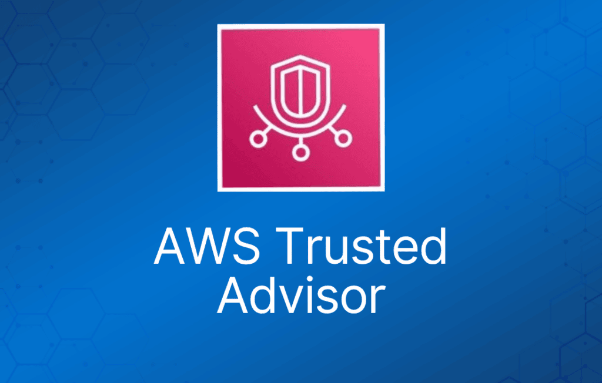

Trusted Advisor 是一个在线资源，通过优化你的 AWS 环境来帮助降低成本、提升性能并改善安全性。

Trusted Advisor 提供实时指导，帮助你按照最佳实践来配置资源。

Advisor 会在成本优化、性能、安全性和容错能力方面为你提供建议。

Trusted Advisor 会扫描你的 AWS 基础设施，并将其与 AWS 最佳实践在五个类别中进行对比：

- 成本优化。
- 性能。
- 安全性。
- 容错能力。
- 服务限制。

Trusted Advisor 有两个版本。

核心检查和建议（免费）：

- 提供 7 项核心检查，帮助提升安全性和性能。
- 检查项包括 S3 bucket 权限、Security Group、IAM 使用情况、root 账户的 MFA、EBS 公开快照、RDS 公开快照。

完整版 Trusted Advisor 权益（商业版和企业版支持计划）。

提供全套检查，帮助优化你的整个 AWS 基础设施。

在安全性、性能、成本、容错能力和服务限制方面提供建议。

额外权益包括每周更新通知、告警、通过 CloudWatch 执行自动化操作，以及使用 AWS Support API 进行编程访问。
