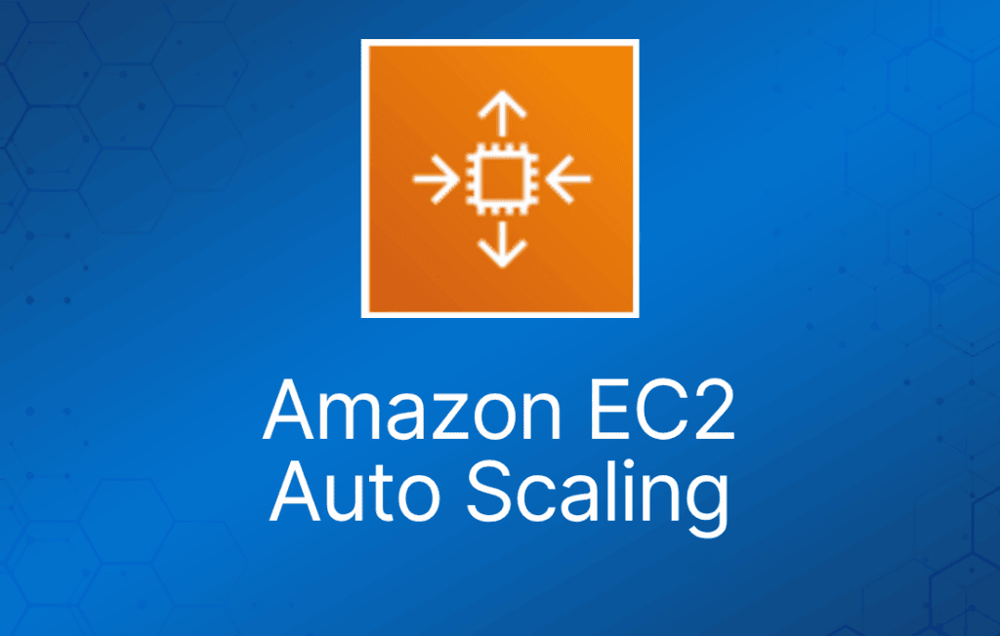
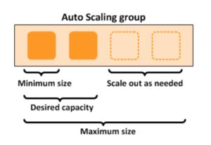

AWS Auto Scaling 监控你的应用程序并自动调整容量，以尽可能低的成本维持稳定、可预测的性能。

AWS Auto Scaling 指跨多个 AWS 服务的一组 Auto Scaling 能力的集合。

AWS Auto Scaling 家族中的服务包括：

- Amazon EC2（称为 Amazon EC2 Auto Scaling）。
- Amazon ECS。
- Amazon DynamoDB。
- Amazon Aurora。

本页专门介绍 Amazon EC2 Auto Scaling——其他服务的 Auto Scaling 会在各自页面中讨论。

## Amazon EC2 Auto Scaling 功能

Amazon EC2 Auto Scaling 帮助你确保拥有正确数量的 Amazon EC2 实例来处理应用的负载。

你可以创建 EC2 实例的集合，称为 Auto Scaling 组（ASG）。

自动为实例提供水平扩展（scale-out）能力。

由扩展操作事件触发，启动或终止实例。

可用性、成本和系统指标都可以作为扩展的依据。

Auto Scaling 是区域级服务。

Auto Scaling 可以跨同一 AWS 区域内的多个 AZ。

Auto Scaling 可以通过控制台、CLI、SDK 和 API 配置。

Auto Scaling 本身不额外收费，你只需为预置的资源（EC2 实例）付费。

Auto Scaling 可与 ELB、CloudWatch 和 CloudTrail 配合使用。

你可以指定 Auto Scaling 在哪些 subnet 中启动新实例。

Auto Scaling 会尽量将 EC2 实例均匀分布到各个 AZ。

Launch configuration 是用于创建新 EC2 实例的模板，包含实例系列、实例类型、AMI、密钥对和 security group 等参数。

launch configuration 一旦定义就不能编辑。

launch configuration：

- 可以从 AWS 控制台或 CLI 创建。
- 可以创建新的 launch configuration，或者
- 可以使用现有运行中的 EC2 实例来创建 launch configuration。
  - AMI 必须存在于 EC2 上。
  - 实例启动后创建的 EC2 实例标签和任何额外块存储卷不会被考虑在内。
- 如果想更改 launch configuration，必须新建一个，做出所需修改，然后在 Auto Scaling 组中使用它。

一个 launch configuration 可以用于多个 Auto Scaling 组（ASG）。

Launch template 与 launch configuration 类似，但提供更多选项（详见下文）。

Auto Scaling 组（ASG）是由 Auto Scaling 策略管理的 EC2 实例的逻辑分组。

ASG 定义后可以编辑。

你可以为现有 ASG 附加一个或多个 classic ELB。

你可以为 ASG 附加一个或多个 Target Group，将实例置于 ALB 之后。

ELB 必须在同一区域内。

配置后，ASG 中现有或新增的 EC2 实例都会自动注册到 ASG 定义的 ELB 上。

如果向 ASG 添加实例会导致超出 ASG 的最大容量，请求会失败。

满足以下条件时可以将运行中的实例加入 ASG：

- 实例处于 running 状态。
- 用于启动实例的 AMI 仍然存在。
- 实例不属于其他 ASG。
- 实例位于 ASG 相同的 AZ 中。

## 扩展选项

扩展选项定义触发条件以及何时预置/释放实例。

有四种扩展选项：

- Maintain（维持）——保持特定或最小数量的实例运行。
- Manual（手动）——使用最大、最小或特定数量的实例。
- Scheduled（计划）——按计划增加或减少实例数量。
- Dynamic（动态）——基于实时系统指标（例如 CloudWatch 指标）进行扩展。
- Predictive（预测）——利用机器学习，在预期的流量变化到来之前调度合适数量的 EC2 实例。

下表描述了可用的扩展选项及其使用时机：

|  |  |  |
| --- | --- | --- |
| **扩展方式** | **描述** | **何时使用** |
| Maintain | 确保所需数量的实例在运行 | 当你始终需要已知数量的实例运行时使用 |
| Manual | 手动更改期望容量 | 当需求变化频率低到可以接受手动调整时使用 |
| Scheduled | 在特定日期/时间或周期性时间段调整最小/最大值 | 当你知道业务的高峰和低谷时间时使用。可确保在高峰到来之前有足够实例 |
| Dynamic | 使用指标响应系统负载或其他触发条件进行扩展 | 适合根据系统利用率调整容量，例如 CPU 达到 80% |
| Predictive | 使用机器学习提前预测所需容量 | 适合容量和实例数量未知的场景 |

### 计划扩展（Scheduled Scaling）

基于计划的扩展让你能在可预测的负载变化之前提前扩展应用。

例如，你可能知道应用在周一至周五上午 9 点到中午 12 点之间流量最高。

### 动态扩展（Dynamic Scaling）

Amazon EC2 Auto Scaling 让你能紧密跟随应用的需求曲线，减少手动提前预置 Amazon EC2 容量的需要。

例如，你可以跟踪 EC2 实例的 CPU 利用率，或通过 "Request Count Per Target" 跟踪流经 Application Load Balancer 的请求数。

Amazon EC2 Auto Scaling 随后会自动调整 EC2 实例数量，以维持你的目标值。

### 预测扩展（Predictive Scaling）

Predictive Scaling 使用机器学习，在即将到来的流量变化之前调度最优数量的 EC2 实例。

Predictive Scaling 会预测未来流量，包括周期性出现的流量峰值，并提前预置合适数量的 EC2 实例。

Predictive Scaling 使用机器学习算法检测每日和每周模式的变化，然后自动调整预测。

你可以通过 Scaling Policy 配置扩展选项，决定 ASG 何时、是否以及如何横向扩展和缩减。

下表描述了动态扩展策略可用的策略类型及其使用时机（后文有更详细说明）：

|  |  |  |
| --- | --- | --- |
| **扩展策略** | **是什么** | **何时使用** |
| Target Tracking Policy（目标跟踪） | 按需增减容量，使指标保持或接近指定目标值 | 你想让 ASG 的 CPU 使用率保持在 70% |
| Simple Scaling Policy（简单扩展） | 等待健康检查和冷却期结束后再重新评估 | 适合负载不规律的场景。AWS 建议在大多数情况下使用步进扩展替代简单扩展 |
| Step Scaling Policy（步进扩展） | 基于一组称为步进调整（step adjustment）的扩展调整来增加或减少 Auto Scaling 组的配置容量 | 你想根据告警突破的幅度调整扩缩量 |

下图展示了一个 Auto Scaling 组，其扩展策略设置为最小 1 个实例、期望容量 2 个实例、最大 4 个实例：

### 基于 Amazon SQS 的扩展

也可以基于 Amazon Simple Queue Service (SQS) 队列进行扩展。

这是 SAA-C02 考试中的一道考题。

使用发送到 Amazon CloudWatch 的自定义指标，衡量队列中的消息数与 Auto Scaling 组中每个 EC2 实例的关系。

目标跟踪策略配置 Auto Scaling 组基于自定义指标和设定的目标值进行扩展。CloudWatch 告警触发扩展策略。

使用自定义的"每实例积压量"（backlog per instance）指标来跟踪队列中的消息数以及可检索的消息数。

可以基于 SQS 指标 "ApproximateNumberOfMessages" 进行调整。

## Launch Template 与 Launch Configuration 对比

Launch template 与 [launch configuration](https://docs.aws.amazon.com/autoscaling/ec2/userguide/LaunchConfiguration.html) 类似，都用于指定实例配置信息。

信息包括 Amazon Machine Image (AMI) 的 ID、实例类型、密钥对、security group，以及启动 EC2 实例时使用的其他参数。

Launch template 包含额外功能，例如支持模板的多个版本。

借助版本管理，你可以创建完整参数集的子集，然后复用它来创建其他模板或模板版本。

## EC2 Auto Scaling 生命周期钩子（Lifecycle Hook）

当 Auto Scaling 组启动或终止 EC2 实例时，lifecycle hook 会暂停实例，让你可以执行自定义操作。

被暂停的实例会保持等待状态，直到你使用 complete-lifecycle-action 命令或 CompleteLifecycleAction 操作完成生命周期操作，或直到超时期限结束（默认一小时）。

Lifecycle hook 让你对实例的启动和终止过程有更大的控制权。

当实例进入等待状态时，你可以使用 Amazon EventBridge、Amazon SNS 或 Amazon SQS 接收通知。

## 高可用性

当实例启动到至少两个可用区时，Amazon EC2 Auto Scaling 提供高可用性（HA）。

你可以使用 Amazon Elastic Load Balancer 或 Amazon Route 53 将传入连接引导至 EC2 实例。

EC2 Auto Scaling 是区域级服务，无法跨多个 AWS 区域提供高可用。

## 监控与报告

启用 Auto Scaling 组指标后，Auto Scaling 组每分钟向 [CloudWatch](https://digitalcloud.training/amazon-cloudwatch/) 发送采样数据（免费）。

你可以使用 AWS Management Console、AWS CLI 或 AWS SDK 启用和禁用 Auto Scaling 组指标。

AWS/AutoScaling 命名空间包含以下指标，每 1 分钟发送到 CloudWatch：

- GroupMinSize
- GroupMaxSize
- GroupDesiredCapacity
- GroupInServiceInstances
- GroupPendingInstances
- GroupStandbyInstances
- GroupTerminatingInstances
- GroupTotalInstances

Amazon EC2 实例也会向 Amazon CloudWatch 发送指标：

- 基本监控每 5 分钟向 CloudWatch 发送 ASG 实例的 EC2 指标。
- 可以启用详细监控，每 1 分钟发送指标（收费）。
- 如果从控制台创建 launch configuration，默认启用 EC2 实例的基本监控。
- 如果从 CLI 创建 launch configuration，默认启用 EC2 实例的详细监控。

EC2 Auto Scaling 使用健康检查来判断实例是否健康可用。

- 默认情况下 Auto Scaling 使用 EC2 状态检查。
- 除 EC2 状态检查外，Auto Scaling 还支持 ELB 健康检查和自定义健康检查。
- 如果任何已配置的健康检查返回不健康状态，实例将被终止。
- 启用 ELB 健康检查后，如果 ELB 报告实例为 OutOfService，该实例会被标记为不健康。
- 健康的实例进入 InService 状态。
- 如果 EC2 实例被标记为不健康，它将被安排替换。
- 如果启用了连接耗尽（connection draining），EC2 Auto Scaling 会等待进行中的请求完成或超时后再终止实例。
- 健康检查宽限期是新实例在执行健康检查之前允许的预热时间（默认 300 秒）。

***注意：****使用 Elastic Load Balancer 时，AWS 最佳实践是启用 ELB 健康检查。如果不启用，可能出现 EC2 状态检查显示实例健康、但 ELB 判定其不健康的情况。此时实例会被 ELB 移出服务，但不会被 Auto Scaling 终止。*

## 日志与审计

[AWS CloudTrail](https://docs.aws.amazon.com/autoscaling/plans/APIReference/logging-using-cloudtrail.html) 将 AWS Auto Scaling 的所有 API 调用捕获为事件。

被捕获的 API 调用包括来自 Amazon EC2 Auto Scaling 控制台的调用和代码对 AWS Auto Scaling API 的调用。

如果创建了 trail，你可以将 CloudTrail 事件持续投递到 Amazon S3 bucket，包括 AWS Auto Scaling 的事件。

如果未配置 trail，你仍可在 CloudTrail 控制台的**事件历史（Event history）**中查看最近（最多 90 天）的事件。

CloudTrail 事件包括对 AWS Auto Scaling 的调用、请求来源的 IP 地址、请求发起者、请求时间以及其他详细信息。

## 授权与访问控制

EC2 Auto Scaling 支持[基于身份的 IAM policy](https://docs.aws.amazon.com/autoscaling/ec2/userguide/control-access-using-iam.html)。

Amazon EC2 Auto Scaling 不支持 resource-based policy。

Amazon EC2 Auto Scaling 使用[服务相关角色（service-linked role）](https://docs.aws.amazon.com/autoscaling/ec2/userguide/autoscaling-service-linked-role.html)来获得代表你调用其他 AWS 服务所需的权限。

服务相关角色是一种直接关联到 AWS 服务的独特 IAM role。

你的账户有一个默认的服务相关角色，名为 **AWSServiceRoleForAutoScaling**。

除非你指定了其他服务相关角色，否则此角色会自动分配给你的 Auto Scaling 组。

Amazon EC2 Auto Scaling 也不支持访问控制列表（ACL）。

你可以在为 Amazon EC2 Auto Scaling 创建的基于身份的策略中应用基于标签的资源级权限。

这能更好地控制用户可以创建、修改、使用或删除哪些资源。

## ASG 行为与配置

EC2 Auto Scaling——终止策略（Termination Policy）：

- 终止策略控制发生缩减（scale-in）事件时哪些实例先被终止。
- 系统配置了默认终止策略，你也可以创建自定义的终止策略。
- 默认终止策略有助于确保 EC2 实例均匀分布在各可用区，以实现高可用。
- 默认策略相当通用且灵活，可覆盖多种场景。

你可以启用实例保护（Instance Protection），防止 Auto Scaling 缩减并终止 EC2 实例。

如果 Auto Scaling 在某个 AZ 启动实例失败，它会尝试其他 AZ 直到成功。

默认健康检查宽限期为 300 秒。

"Scale out"（横向扩展）是扩展策略启动 EC2 实例的过程。

"Scale in"（缩减）是扩展策略终止 EC2 实例的过程。

建议为每个配置的扩展事件创建对应的缩减事件。

出现不均衡（imbalance）可能是由于：

- 手动从配置中移除 AZ/subnet。
- 手动终止 EC2 实例。
- EC2 容量问题。
- 达到了 Spot 价格。

所有 Elastic IP 和 EBS volume 会从被终止的 EC2 实例上卸载，需要手动重新挂载。

使用自定义健康检查时，可以通过 CLI 命令将实例状态设置为不健康，例如：

***aws autoscaling set–instance-health –instance-id i-123abc45d –health-status Unhealthy***

EC2 实例一旦进入 terminating 状态，就无法再回到服务中。

不过，在很短的一段时间内可以运行 AWS CLI 命令将实例改回健康状态。

不健康实例会先被终止，然后 Auto Scaling 再启动新实例来替换被终止的实例。这与 AZ 再平衡（rebalancing）不同。

你可以使用 AWS 控制台或 AWS CLI 手动将实例从 ASG 中移除（detach）。

卸载 EC2 实例时，可以选择减少 ASG 的期望容量（防止它再启动新实例）。

一个实例同一时间只能属于一个 Auto Scaling 组。

你可以随时暂停（suspend）然后恢复（resume）ASG 的一个或多个扩展进程。

当你想排查应用问题并做出修改而不触发扩展进程时，这很有用。

你可以手动将实例从 ASG 中移出并置于 standby（备用）状态。

处于 standby 状态的实例仍由 Auto Scaling 管理，正常计费，但不计入可用于工作负载/应用的 EC2 实例数。

Auto Scaling 不会对处于 standby 状态的 EC2 实例执行健康检查。

standby 状态可用于执行更新/修改/故障排查等操作，而不会触发健康检查或启动替换实例。

删除 Auto Scaling 组时，所有 EC2 实例都会被终止。

你可以在 launch configuration 中选择使用 Spot 实例。

ASG 对待 Spot 实例与按需实例相同。

可以混合使用 Spot 实例与按需实例（使用 launch template 时）。

ASG 可以配置为在以下情况发送 Amazon SNS 通知：

- 实例启动时。
- 实例终止时。
- 实例启动失败时。
- 实例终止失败时。

合并 ASG：

- 可以将多个单 AZ 的 Auto Scaling 组合并为一个多 AZ 的 ASG。
- 合并只能通过 CLI 执行。
- 操作过程是将其中一个组重新划分区域（rezone），使其覆盖其他 ASG 所在的 AZ，然后删除其他 ASG。
- 无论 ASG 是否附加了 ELB 都可以执行此操作。

冷却期（Cooldown Period）：

- 冷却期是你可以为 Auto Scaling 组配置的设置，确保在上一次扩展活动生效之前不会启动或终止更多实例。
- 创建 Auto Scaling 组时默认应用 300 秒的冷却期。
- 你可以在创建 Auto Scaling 组时配置冷却期。
- 你可以通过特定扩展活动的冷却期（scaling-specific cooldown）覆盖默认冷却期。

预热期（warm-up period）是指在使用步进扩展的 ASG 中，新启动的 EC2 实例不计入 ASG 指标的时间段。
