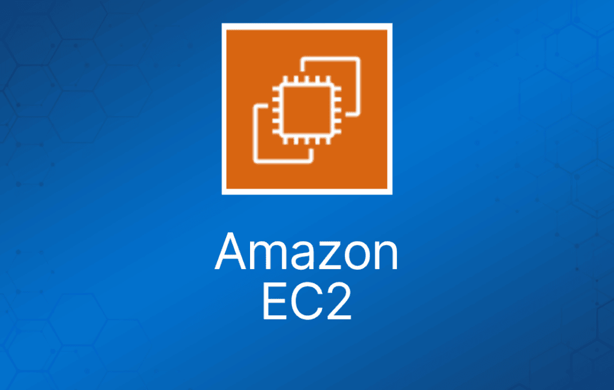

Amazon Elastic Compute Cloud (Amazon EC2) 是一项在云中提供可调整计算容量的 Web 服务。

通过 Amazon EC2，你可以在 AWS 云上启动虚拟服务器实例。

每台虚拟服务器称为一个"实例"（instance）。

实例使用称为 Amazon Machine Images (AMI) 的预配置模板。

每个 AMI 包含启动 EC2 实例所需的信息（包括操作系统和自带的软件包）。

Amazon EC2 目前支持多种操作系统，包括：

- Amazon Linux。
- Ubuntu。
- Windows Server。
- MacOS。
- Red Hat Enterprise Linux。
- SUSE Linux Enterprise Server。
- Fedora。
- Debian。
- CentOS。
- Gentoo Linux。
- Oracle Linux。
- FreeBSD。

EC2 计算单元（ECU）提供对 Amazon EC2 实例整数处理能力的相对度量。

使用 EC2 时，你在操作系统层拥有完全控制权（root/admin 权限）。

密钥对（key pair）用于安全地连接到 EC2 实例：

- 密钥对由 AWS 保存的**公钥**和你自己保存的**私钥文件**组成。
- 对于 Windows AMI，需要私钥文件来获取登录实例的密码。
- 对于 Linux AMI，私钥文件让你可以安全地通过 SSH（secure shell）登录实例。

Metadata 与 User Data：

- User data 是用户在实例启动时以脚本形式提供的数据。
- Instance metadata 是关于实例的数据，可用于配置或管理运行中的实例。
- User data 上限为 16KB。
- User data 和 metadata 不加密。
- Instance metadata 可从 http://169.254.169.254/latest/meta-data/ 获取（末尾的 "/" 是必需的）。
- Instance user data 可从以下地址获取：http://169.254.169.254/latest/user-data。
- IP 地址 169.254.169.254 是链路本地地址（link-local），仅在实例内部有效。
- 在 Linux 上可以用 curl 命令查看 metadata 和 user data，例如 "curl http://169.254.169.254/latest/meta-data/"。
- Instance Metadata Query 工具让你无需输入完整 URI 或类别名称即可查询实例 metadata。

## EC2 实例类型

Amazon EC2 提供大量针对不同使用场景优化的实例类型。

实例类型由 CPU、内存、存储和网络容量的不同组合构成，让你可以灵活地为应用选择合适的资源组合。

每种实例类型包含一个或多个实例大小，让你能根据目标工作负载的要求扩展资源。

|  |  |  |
| --- | --- | --- |
| **类别** | **系列** | **用途/设计** |
| 通用型（General Purpose） | Mac, T4g, T3, T3a, T2, M6g, M6i, M5, M5a, M5n, M5zn, M5, A1 | 通用型实例在计算、内存和网络资源上取得平衡，可用于各种多样化的工作负载。 |
| 计算优化型（Compute Optimized） | C6g, C6gn, C6i, C5, C5a, C5n, C4 | 计算优化型非常适合受益于高性能处理器的计算密集型应用。 |
| 内存优化型（Memory Optimized） | R6g, R5, R5a, R5b, R5n, R4, X2gd, X1e, X1, High Memory, z1d | 内存优化型实例为在内存中处理大数据集的工作负载提供快速性能。 |
| 加速计算型（Accelerated Computing） | P4, P3, P2, DL1, Inf1, G5, G4dn, G4ad, G3, F1, VT1 | 加速计算型实例使用硬件加速器或协处理器来执行浮点计算、图形处理或数据模式匹配等功能。 |
| 存储优化型（Storage Optimized） | I3, I3en, D2, D4, D3en, H1 | 该实例系列提供基于 Non-Volatile Memory Express (NVMe) SSD 的实例存储，针对低延迟、极高的随机 I/O 性能、高顺序读取吞吐量和高 IOPS 进行了优化，且成本较低。 |

## 启动 EC2 实例

选择一个 Amazon Machine Image (AMI)。

选择是否自动分配公网 IP——默认使用 subnet 的设置。

可以将实例加入 placement group（详见下文）。

可以为实例分配 IAM role，为其配置访问 AWS 资源的凭证。

可以启用终止保护（termination protection），防止实例被终止。

默认启用基本监控（5 分钟粒度），可以启用详细监控（1 分钟粒度，收费）。

可以定义共享（shared）或专用（dedicated）租期。

T2 unlimited 允许应用按需突破 CPU 性能基线（收费）。

可以添加启动时运行的脚本（user data）。

可以加入目录（仅限 Windows 实例）。

有启用 Elastic GPU 的选项（仅限 Windows 实例）。

存储选项包括添加额外卷以及选择卷类型。

如需将共享文件系统挂载到多个 EC2 实例，使用 Amazon Elastic File System (EFS)。

非根卷可以加密。

根卷可以在启动时加密。

可以选择创建标签（也可以稍后再做）。

可以选择现有 security group 或创建新的。

必须创建或使用现有密钥对——如果你想通过 SSH 访问实例这是必需的。不过，你也可以为 EC2 实例附加 'AmazonEC2RoleforSSM' IAM role，以通过 Systems Manager（Session Manager）连接实例。

## Amazon Machine Images

Amazon Machine Image (AMI) 提供启动实例所需的信息。

AMI 包含以下内容：

- 实例根卷的模板（例如操作系统、应用服务器和应用程序）。
- 启动权限，控制哪些 AWS 账户可以使用该 AMI 启动实例。
- block device mapping，指定实例启动时要挂载的卷。

AMI 是区域性的。你只能从 AMI 所在区域启动它。不过可以通过控制台、命令行或 API 将 AMI 复制到其他区域。

挂载到实例的卷可以是 EBS 或 instance store：

- Amazon Elastic Block Store (EBS) 提供持久化存储。卷由驻留在 Amazon S3 上的 EBS 快照创建。
- Instance store volume 是临时性的（非持久化）。这意味着实例关闭后数据会丢失。卷由存储在 Amazon S3 上的模板创建。

## 计费与预置

使用和支付 Amazon EC2 实例的方式有几种选择。

### 按需（On-Demand）

- 按使用小时数付费，无承诺期。
- 低成本且灵活，无预付费。
- 非常适合 Auto Scaling 组和不可预测的工作负载。
- 适合开发/测试。

### 竞价型（Spot）

- Amazon EC2 Spot 实例让你可以利用 AWS 云中闲置的 EC2 容量。
- Spot 实例相比按需价格最高可享 90% 折扣。
- Spot 实例可用于各种无状态、容错或灵活的应用，例如大数据、容器化工作负载、CI/CD、Web 服务器、高性能计算（HPC）以及其他测试与开发工作负载。
- 可以通过 Spot 管理控制台、CLI、API，或与启动按需实例相同的界面（选择使用 Spot 选项）来请求 Spot 实例。
- 你还可以选择 Launch Template 或预配置/自定义的 Amazon Machine Image (AMI)，为 Spot 实例配置安全和网络访问，从多种实例类型和位置中选择，使用静态 IP 端点，并为 Spot 实例挂载持久化块存储。
- **新定价模型：**Spot 价格由 EC2 闲置容量供需的[长期趋势决定](https://aws.amazon.com/blogs/compute/new-amazon-ec2-spot-pricing/)。
  - 在新定价模型中无需为 Spot 实例竞价，只需按启动实例当前小时生效的 Spot 价格付费。
  - 当 EC2 需要收回容量时，Spot 实例会收到两分钟的中断通知。
  - 实例不会因为更高的竞争出价而被中断。
- 为降低中断影响并优化 Spot 实例，应分散部署，让应用跨多个容量池运行。
- 每个区域内的每个可用区中的每个实例系列、每个实例大小，都是一个独立的 Spot 容量池。
- 可以使用 RequestSpotFleet API 一次启动数千个 Spot 实例并自动实现资源分散。
- 为了进一步降低中断的影响，你还可以配置 Spot 实例和 Spot Fleet，使其在容量不可用时通过停止或休眠（而不是终止）实例来[响应](https://docs.aws.amazon.com/AWSEC2/latest/UserGuide/spot-interruptions.html#interruption-behavior)中断通知。

### 预留实例（Reserved）

- 提前购买（或同意购买）EC2 实例用量，相比按需价格可获得大幅折扣。
- 在特定 AZ 使用时提供容量预留。
- 当你启动的实例与购买的 RI 匹配时，AWS Billing 会自动应用折扣费率。
- 容量预留期限为 1 年或 3 年。
- EC2 有三种 RI 类型：Standard、Convertible 和 Scheduled。
- Standard = 承诺 1 年或 3 年，无论实例是否运行都计费。
- Scheduled = 预留特定时间段，按小时累积费用，在期限（1 年）内按月计费。
- Scheduled RI 将容量预留与可预测的周期性计划匹配。
- Standard 和 Convertible RI 的区别见下表。
- RI 适用于稳定状态的工作负载和可预测的用量。
- 非常适合需要预留容量的应用。
- 预付费可以降低小时费率。
- 可以在同一区域内更换 AZ。
- 可以在同一实例类型内更改实例大小。
- 实例类型修改仅支持 Linux。
- 不能更改 Windows RI 的实例大小。
- 无论是否运行都计费。
- 可以在 AWS Marketplace 上出售预留实例。
- 可用于 Auto Scaling 组。
- 可用于 Placement Group。
- 可在 Consolidated Billing 内的多个账户之间共享。
- 如果不再需要 RI，可以尝试在 Reserved Instance Marketplace 上出售。

|  |  |  |
| --- | --- | --- |
|  | Standard | Convertible |
| 期限 | 1 年、3 年 | 1 年、3 年 |
| 相对按需价格的平均折扣 | 40% – 60% | 31% – 54% |
| 更改 AZ、实例大小、网络类型 | 可以，通过 ModifyReservedInstance API 或控制台 | 可以，通过 ExchangeReservedInstance API 或控制台 |
| 更改实例系列、操作系统、租期、付款选项 | 不可以 | 可以 |
| 享受降价优惠 | 不可以 | 可以 |

RI 属性：

- 实例类型——指定 CPU、内存、网络能力。
- 平台——Linux、SUSE Linux、RHEL、Microsoft Windows、Microsoft SQL Server。
- 租期——默认（共享）租期或专用（Dedicated）租期。
- 可用区（可选）——如果选择了 AZ，RI 会被预留，折扣应用于该 AZ（Zonal RI）。如果未指定 AZ，则不创建预留，但折扣应用于区域内任何 AZ 中该系列的任何实例（Regional RI）。

### Amazon EC2 定价模型对比

下表简要对比按需、预留和竞价型定价模型：

|  |  |  |
| --- | --- | --- |
| **按需（On-Demand）** | **预留（Reserved）** | **竞价型（Spot）** |
| 无预付费 | 选项：无预付、部分预付或全额预付 | 无预付费 |
| 按小时或按秒计费 | 按小时或按秒计费 | 按小时或按秒计费 |
| 无承诺期 | 1 年或 3 年承诺期 | 无承诺期 |
| 适合短期需求或不可预测的工作负载 | 适合稳定状态工作负载和可预测的用量 | 适合对成本敏感、计算密集、且能承受中断的场景 |

默认情况下，你在整个实例系列中最多可运行 20 个按需实例，可购买 20 个预留实例，并按每个区域的动态 Spot 限制请求 Spot 实例。

### 专用主机（Dedicated Hosts）

- 专供你使用的物理服务器。
- 你可以控制在该主机上部署哪些实例。
- 可以按需使用，或通过 Dedicated Host Reservation 使用。
- 如果你有按核心数、按插槽数或按 VM 计费等与服务器绑定的软件许可，这个选项很有用。
- 每台专用主机只能运行一种 EC2 实例大小和类型。
- 适合合规监管或许可要求。
- 性能可预测。
- 完全隔离。
- 最贵的选项。
- 按主机计费。

### 专用实例（Dedicated Instances）

- 运行在专供你使用的硬件上的虚拟化实例。
- 同样使用物理专用的 EC2 服务器。
- 不提供专用主机那样的额外可见性和控制（例如实例在服务器上的放置方式）。
- 按实例计费。
- 可能与同一账户中的其他非专用实例共享硬件。
- 可作为按需实例、预留实例和 Spot 实例使用。
- 每个区域每小时额外收取 2 美元。

下表描述了专用实例与专用主机之间的一些区别：

|  |  |  |
| --- | --- | --- |
| **特性** | **专用实例** | **专用主机** |
| 使用专用物理服务器 | X | X |
| 按实例计费（每个区域收取 2 美元费用） | X |  |
| 按主机计费 |  | X |
| 可见插槽、核心、主机 ID |  | X |
| 主机与实例之间的亲和性（affinity） |  | X |
| 指定实例放置位置 |  | X |
| 自动实例放置 | X | X |
| 通过分配请求增加容量 |  | X |

不足一小时的实例用量按实际使用量计费。

实例处于运行（running）状态时才计费——需要停止或终止以避免付费。

按小时或按秒计费（仅 Linux 实例支持按秒计费）。

不同区域的实例之间的数据传输收费（传入和传出）。

满足以下至少一个条件时适用区域数据传输费率，但即使两个条件都满足，同一实例也只收一次费用：

- 另一个实例在不同的可用区，无论使用哪种地址类型。
- 使用了公网或 Elastic IP 地址，无论另一个实例在哪个可用区。

## 网络

网络限制（每个区域或如注明）：

|  |  |
| --- | --- |
| **名称** | **默认限制** |
| EC2-Classic Elastic IP | 5 |
| EC2-VPC Elastic IP | 5 |
| VPC | 5 |
| 每个 VPC 的 subnet 数 | 200 |
| 每个 VPC 的 security group 数 | 500 |
| 每个 VPC security group 的规则数 | 50 |
| 每个弹性网络接口的 VPC security group 数 | 5 |
| 网络接口数 | 350 |
| 每个 VPC 的 network ACL 数 | 200 |
| 每个 network ACL 的规则数 | 20 |
| 每个 VPC 的路由表数 | 200 |
| 每个路由表的条目数 | 50 |
| 活动的 VPC peering 连接数 | 50 |
| 待处理的 VPC peering 连接请求数 | 25 |
| 未接受的 VPC peering 连接的过期时间 | 168 |

## IP 地址

可以分配给 Amazon EC2 实例的 IP 地址有三种类型：

- 公网 IP（Public）——自动分配给公有子网中实例的公网地址，实例停止/启动后会重新分配。
- 私有 IP（Private）——自动分配给所有实例的私有地址。
- 弹性 IP（Elastic IP）——静态的公网地址。

实例停止后公网 IPv4 地址会丢失，但私有地址（IPv4 和 IPv6）会保留。

重启（restart）实例时公网 IPv4 地址会保留。

实例停止时 Elastic IP 会保留。

Elastic IP 是静态公网 IP 地址，可以在实例之间重新映射（移动）。

默认所有账户每个区域限 5 个 Elastic IP；不过这是软限制，可以通过向 AWS Support 申请提高服务限制来增加。

Elastic IP 闲置不用时 AWS 会收费。

Elastic IP 地址只能在特定区域内使用。

你可以为 Elastic IP 地址分配自定义标签以进行分类。

默认情况下，EC2 实例的主网络接口（eth0）会分配一个私有 IP。

公有子网（VPC）中的实例会被分配公网 IP 地址。

可以通过填写表格为 Elastic IP 配置 DNS 记录。

辅助 IP 地址可用于在单台服务器上托管多个网站，或将流量重定向到备用 EC2 实例以实现高可用。

你可以选择辅助 IP 地址是否可以重新分配。

可以将单个私有 IPv4 地址与单个 Elastic IP 地址关联，反之亦然。

重新分配时 IPv4 与 Elastic IP 的关联关系会保持。

当辅助私有地址从接口上取消分配时，关联的 Elastic IP 地址也会解除关联。

实例运行或停止时都可以为其分配或移除 IP 地址。

当你停止并启动 EC2 实例时，它通常会被迁移到不同的底层硬件上。

*考试提示：如果 EC2 状态检查失败或当前物理主机有计划内维护，可以通过停止并启动 EC2 实例将其迁移到不同的物理主机。*

只有在实例停止时才能修改以下属性：

- 实例类型。
- User data。
- 内核（Kernel）。
- RAM 磁盘。

所有 IP 地址（IPv4 和 IPv6）在网络接口被卸载或重新分配到另一个实例时会一直跟随网络接口。

只要在同一 AZ 内，你可以将网络接口挂载到不同 subnet 的实例上。

你可以将本地网络中部分或全部可公网路由的 IPv4 或 IPv6 地址段带到 AWS，这称为 BYOIP。

你继续拥有该地址段，但默认由 AWS 在互联网上宣告。将地址段带到 AWS 后，它会以地址池的形式出现在你的 AWS 账户中。

BYOIP 并非在所有区域和所有资源上可用。

下表对比了 Amazon EC2 中不同类型的 IP 地址：

|  |  |
| --- | --- |
| **名称** | **描述** |
| 公网 IP 地址 | 实例停止后丢失   用于公有子网  免费  与实例上的私有 IP 地址关联  不能在实例之间移动 |
| 私有 IP 地址 | 实例停止后保留   用于公有和私有子网 |
| Elastic IP 地址 | 静态公网 IP 地址   闲置时收费  与实例上的私有 IP 地址关联  可以在实例和 Elastic Network Adapter 之间移动 |

### 弹性网络接口（Elastic Network Interface）

弹性网络接口（简称网络接口）是 VPC 中的一种逻辑网络组件，代表一张虚拟网卡。

网络接口可以包含以下属性：

- 来自你 VPC IPv4 地址段的一个主私有 IPv4 地址。
- 来自你 VPC IPv4 地址段的一个或多个辅助私有 IPv4 地址。
- 每个私有 IPv4 地址对应一个 Elastic IP 地址（IPv4）。
- 一个公网 IPv4 地址。
- 一个或多个 IPv6 地址。
- 一个或多个 security group。
- 一个 MAC 地址。
- 一个源/目标检查（source/destination check）标志。
- 一段描述。

你可以在账户中创建和配置网络接口，并将其挂载到 VPC 中的实例上。

不能通过绑定多个 ENI 来提升实例的网络带宽。

eth0 是主网络接口，不能移动或卸载。

默认情况下，EC2 实例启动时只创建一个 ENI，即 eth0。

可以为 EC2 实例添加额外接口（数量取决于实例系列/类型）。

ENI 绑定到某个 AZ，你可以指定 ENI 要加入哪个 subnet/AZ。

可以指定使用 subnet 内的哪个 IP 地址，也可以让它自动分配。

启动时只能额外添加一个 ENI，之后可以挂载更多。

挂载 ENI：

- ENI 可以"热挂载"（hot attach）到运行中的实例。
- ENI 可以在实例停止时"温挂载"（warm attach）。
- ENI 可以在实例启动时"冷挂载"（cold attach）。

如果你添加第二个接口，AWS 不会为 eth0 分配公网 IP 地址（你需要添加一个 Elastic IP）。

默认接口会随实例终止而终止。

手动添加的接口默认不会随实例终止。

你可以更改终止行为。

### 增强网络——Elastic Network Adapter (ENA)

增强网络提供更高的带宽、更高的每秒数据包（PPS）性能以及持续更低的实例间延迟。

增强网络通过 Elastic Network Adapter (ENA) 启用。

如果你的每秒数据包数似乎已达到上限，应考虑迁移到增强网络，因为你很可能已经达到了 VIF 驱动程序的上限。

AWS 目前使用 SR-IOV 支持增强网络能力。

SR-IOV 提供对网络适配器的直接访问，提供更高的性能（每秒数据包数）和更低的延迟。

必须启动带有相应驱动程序的 HVM AMI。

仅特定实例类型可用。

仅在 Amazon VPC 中支持。

### Elastic Fabric Adapter (EFA)

Elastic Fabric Adapter 是增加了额外能力的 AWS [Elastic Network Adapter](https://docs.aws.amazon.com/AWSEC2/latest/UserGuide/enhanced-networking-ena.html) (ENA)。

EFA 仍能处理 IP 流量，但同时支持一种通常称为 OS bypass 的重要访问模型。

该模型允许应用程序（最常见的是通过某种用户空间中间件）直接访问网络接口，而无需每条消息都经过操作系统。

Elastic Fabric Adapter (EFA) 是 Amazon EC2 实例的网络接口，使客户能够在 AWS 上大规模运行需要高水平节点间通信的应用。

其定制的操作系统（OS）bypass 硬件接口提升了实例间通信的性能，这对扩展此类应用至关重要。

EFA 的常见使用场景包括：

- 使用 Message Passing Interface (MPI) 的高性能计算（HPC）应用。
- 使用 NVIDIA Collective Communications Library (NCCL) 的机器学习（ML）应用。

借助 EFA，你可以获得本地 HPC 集群的应用性能，同时享有 AWS 云的按需弹性和灵活性。

EFA 是可选的 EC2 网络功能，可以在任何受支持的 EC2 实例上免费启用。

## ENI vs ENA vs EFA

何时使用 ENI：

- 这是基本的适配器类型，适合没有任何高性能需求的场景。
- 可用于所有实例类型。

何时使用 ENA：

- 适合需要更高带宽和更低实例间延迟的场景。
- 仅部分实例类型支持（仅限 HVM）。

何时使用 EFA：

- 高性能计算。
- MPI 和 ML 场景。
- 紧耦合应用。
- 可用于所有实例类型。

## Placement Group（置放群组）

Placement group 是按以下配置之一对实例进行的逻辑分组。

**Cluster**——将实例聚集到单个 AZ 内的低延迟组中：

- Cluster placement group 是单个可用区内实例的逻辑分组。
- Cluster placement group 推荐给受益于低网络延迟、高网络吞吐量或两者兼有、且大部分网络流量发生在组内实例之间的应用。

**Spread**——将实例分散到不同的底层硬件上（可跨 AZ）：

- Spread placement group 中的每个实例都放置在不同的底层硬件上。
- Spread placement group 推荐给拥有少量关键实例、且这些实例应相互隔离的应用。

**Partition**——将每个组划分为称为分区（partition）的逻辑段：

- Amazon EC2 确保 placement group 内每个分区拥有自己的一组机架。
- 每个机架有自己的网络和电源。placement group 内任意两个分区不共享机架，让你可以在应用中隔离硬件故障的影响。
- Partition placement group 可用于在不同机架上部署大型分布式复制型工作负载，例如 HDFS、HBase 和 Cassandra。

下表描述了 cluster 与 spread placement group 之间的一些关键区别：

|  |  |  |  |
| --- | --- | --- | --- |
|  | **Clustered** | **Spread** | **Partition** |
| 是什么 | 实例放置在单个 AZ 内的低延迟组中 | 实例分散在不同的底层硬件上 | 实例被分组为称为分区的逻辑段，各分区使用不同的硬件 |
| 何时使用 | 需要低网络延迟和/或高网络吞吐量 | 在底层硬件故障时降低多个实例同时故障的风险 | 需要对实例放置位置的控制和可见性 |
| 优点 | 充分利用增强网络实例 | 可以跨多个 AZ | 降低大型工作负载发生关联故障的可能性。 |
| 缺点 | 容量有限：建议提前一次性启动可能需要的所有实例 | 每组每 AZ 最多运行 7 个实例 | Partition placement group 不支持 Dedicated Hosts |

在 spread placement group 中启动实例可以降低实例共享相同底层硬件时可能发生的同时故障风险。

推荐给受益于低延迟和高带宽的应用。

建议使用支持增强网络的实例类型。

placement group 内的实例可以使用私有或公网 IP 地址相互通信。

使用私有 IP 地址可获得最佳性能。

使用公网 IP 地址时性能限制在 5Gbps 或以下。

低延迟 10 Gbps 或 25 Gbps 网络。

建议 placement group 内保持实例类型一致。

可以在实例级别使用预留实例，但不能为 placement group 预留容量。

placement group 的名称在你的 AWS 账户该区域内必须唯一。

placement group 不能合并。

一个实例同一时间只能属于一个 placement group，不能跨多个 placement group。

[On-Demand Capacity Reservation](https://docs.aws.amazon.com/AWSEC2/latest/UserGuide/ec2-capacity-reservations.html#capacity-reservations-limits) 和 [zonal Reserved Instances](https://docs.aws.amazon.com/AWSEC2/latest/UserGuide/reserved-instances-scope.html) 为特定可用区中的 EC2 实例提供容量预留。

容量预留可被 placement group 中的实例使用，但无法显式为 placement group 预留容量。

租期为 host 的实例不能在 placement group 中启动。

## IAM Role

IAM role 比在 EC2 实例上存储 access key 和 secret access key 更安全。

IAM role 可用于让 EC2 与 S3、DynamoDB 等多种服务交互。

IAM role 比 access key 更易管理也更安全。

你可以在启动时或之后的任何时间通过 AWS CLI、SDK 或 EC2 控制台为实例附加 IAM role。

IAM role 可以随时附加、修改或替换。

一个 EC2 实例同一时间只能附加一个 IAM role。

IAM role 是全局通用的，可在任何区域使用。

## 堡垒机/跳板机（Bastion/Jump Host）

你可以将 EC2 实例配置为堡垒机（也称跳板机），用于管理访问 VPC 内的实例。

可以使用 SSH 或 RDP 协议连接堡垒机。

需要配置带相应权限的 security group。

可以使用自动分配的公网 IP 或 Elastic IP。

可以使用 security group 限制能访问堡垒机的 IP 地址/CIDR。

使用 Auto Scaling 组实现高可用（设置为 1 个实例，仅在故障时替换）。

最佳实践是在两个 AZ 部署 Linux 堡垒机，配合 Auto Scaling 和 Elastic IP 地址使用。

你也可以使用 AWS Systems Manager Session Manager 代替堡垒机。

## 监控 EC2

EC2 状态检查每分钟执行一次，每次返回通过或失败状态。

如果所有检查都通过，实例的整体状态为 **OK**。

如果一项或多项检查失败，整体状态为 **impaired**。

系统状态检查（StatusCheckFailed\_System）检测需要 **AWS** 介入修复的实例问题。

以下是可能导致系统状态检查失败的问题示例：

- 网络连接中断。
- 系统供电中断。
- 物理宿主机上的软件问题。
- 物理宿主机上影响网络可达性的硬件问题。

实例状态检查（StatusCheckFailed\_Instance）检测需要**你**介入修复的问题。

以下是可能导致实例状态检查失败的问题示例：

- 系统状态检查失败。
- 网络或启动配置错误。
- 内存耗尽。
- 文件系统损坏。
- 内核不兼容。

状态检查内置于 Amazon EC2，因此无法禁用或删除。

不过，你可以创建或删除基于状态检查结果触发的告警。

你可以创建监控 Amazon EC2 实例的 Amazon CloudWatch 告警，并在状态检查失败时自动执行操作。

操作可以包括：

- 恢复实例（仅特定实例类型支持，且仅适用于 StatusCheckFailed\_System）。
- 停止实例（仅适用于 EBS-backed 卷）。
- 终止实例（启用终止保护时无法终止）。
- 重启实例。

最佳实践是通过 EC2 重启实例，而不是在操作系统内重启。

CloudWatch 监控频率：

- 标准监控 = 5 分钟。
- 详细监控 = 1 分钟（收费）。

### 统一 CloudWatch Agent

统一 CloudWatch agent 让你能够做到以下几点：

- 跨操作系统从 Amazon EC2 实例收集更多系统级指标。除 EC2 实例指标外，还可以包括客户机内部（in-guest）指标。可收集的额外指标列表见 [CloudWatch Agent 收集的指标](https://docs.aws.amazon.com/AmazonCloudWatch/latest/monitoring/metrics-collected-by-CloudWatch-agent.html)。
- 从本地服务器收集系统级指标。包括混合环境中的服务器以及非 AWS 管理的服务器。
- 使用 StatsD 和 collectd 协议从应用或服务获取自定义指标。StatsD 在 Linux 服务器和运行 Windows Server 的服务器上都受支持，collectd 仅在 Linux 服务器上受支持。
- 从运行 Linux 或 Windows Server 的 Amazon EC2 实例和本地服务器收集日志。

你可以使用命令行手动下载安装 CloudWatch agent，也可以将其与 SSM 集成。

## 日志与审计

Amazon EC2 和 Amazon EBS 与 AWS CloudTrail 集成，CloudTrail 会记录用户、角色或 AWS 服务在 Amazon EC2 和 Amazon EBS 中执行的操作。

CloudTrail 将 Amazon EC2 和 Amazon EBS 的所有 API 调用捕获为事件，包括来自控制台的调用和代码对 API 的调用。

如果创建了 trail，你可以将 CloudTrail 事件持续投递到 Amazon S3 bucket，包括 Amazon EC2 和 Amazon EBS 的事件。

trail 让你可以无限期存储记录。

如果未配置 trail，你仍可在 CloudTrail 控制台通过事件历史（Event history）查看最近的事件（仅限过去 90 天）。

利用 CloudTrail 收集的信息，你可以确定对 Amazon EC2 和 Amazon EBS 发出的请求、请求来源的 IP 地址、请求发起者、请求时间以及其他详细信息。

## 标签（Tags）

你可以以*标签*的形式为 AWS 资源分配元数据。

标签是你分配给 AWS 资源的标记。

标签只是任意的名称/值对，可以分配给几乎所有 AWS 资源作为元数据。

标签可帮助你管理、识别、组织、搜索和筛选资源。

每个标签由一个键和一个可选的值组成，两者都由你定义。

标签策略可用于成本分摊、安全、自动化等多种用途。例如，你可以在 IAM policy 中使用标签来实现访问控制。

可以通过 AWS Config 规则或自定义脚本来强制标准化打标签。例如，未正确打标签的 EC2 实例每天会被停止或终止。

大多数资源最多可拥有 50 个标签。

## 资源组（Resource Groups）

资源组是基于标签定义的 AWS 资源映射。

可以创建自定义控制台，围绕给定标签汇总指标、告警和配置详情。

## 计算的高可用方案

保持 AMI 最新对快速故障切换至关重要。

出于安全或灾难恢复演练目的，AMI 可以复制到其他区域。

优先选择水平可扩展架构，因为风险可以分散到多台较小的机器上，而不是集中在一台大型机器上。

预留实例是保证资源在需要时可用的唯一方式。

Auto Scaling 和 Elastic Load Balancing 协同工作，通过维持最小实例数提供自动化恢复。

Amazon Route 53 健康检查也提供流量的"自愈"重定向。

## 迁移

### VM Import/Export

VM Import/Export 是将 VMware、Microsoft、XEN 虚拟机迁移到云端的工具。

也可用于将 EC2 实例转换为 VMware、Microsoft 或 XEN 虚拟机。

支持：

- Windows 和 Linux。
- VMware ESX VMDK（OVA 镜像仅用于导出）。
- Citrix XEN VHD。
- Microsoft Hyper-V VHD。

只能通过 API 或 CLI 使用（不能使用控制台）。

生成 VMDK 或 VHD 镜像前先停止 VM。

AWS 提供了一个 vCenter 的 VM connector 插件：

- 允许将 VM 迁移到 S3。
- 然后转换为 EC2 AMI。
- 进度可在 vCenter 中跟踪。

### AWS Server Migration Service (SMS)

AWS Server Migration Service (SMS) 是一项无代理（agent-less）服务，让你更轻松、更快速地将数千个本地工作负载迁移到 AWS。

AWS SMS 允许你自动化、调度和跟踪运行中服务器卷的增量复制，让你更容易协调大规模服务器迁移。

自动化将本地 VMware vSphere 或 Microsoft Hyper-V/SCVMM 虚拟机迁移到 AWS。

将 VM 复制到 AWS，同步卷并定期创建 AMI。

通过增量同步 VM 最大限度减少切换停机时间。

仅支持 Windows 和 Linux VM（与 AWS 一样）。

Server Migration Connector 以虚拟设备的形式下载到你的本地 vSphere 或 Hyper-V 环境中。

Amazon EC2 实例可以通过 AWS Systems Manager 管理。

你也可以使用 AWS OpsWorks 通过 Chef 和 Puppet 管理实例。

AWS Config 可用于记录 Amazon EC2 实例的配置项并跟踪变更。
