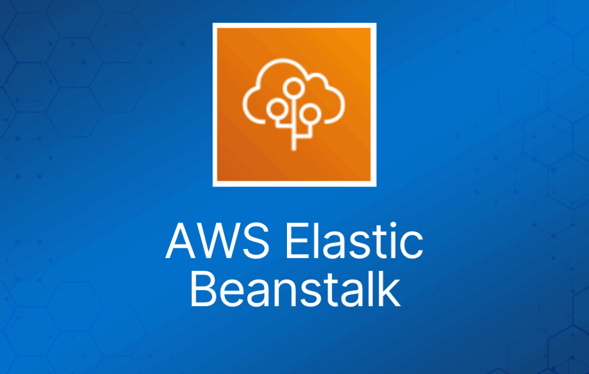
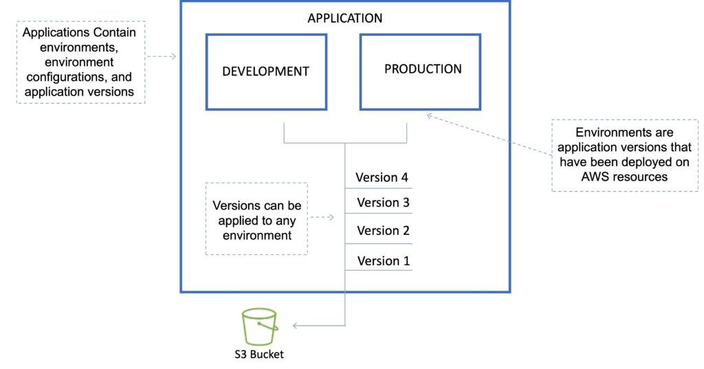
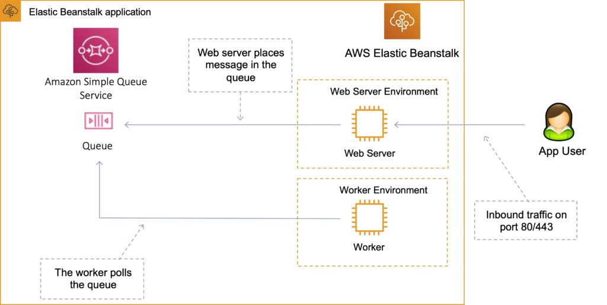
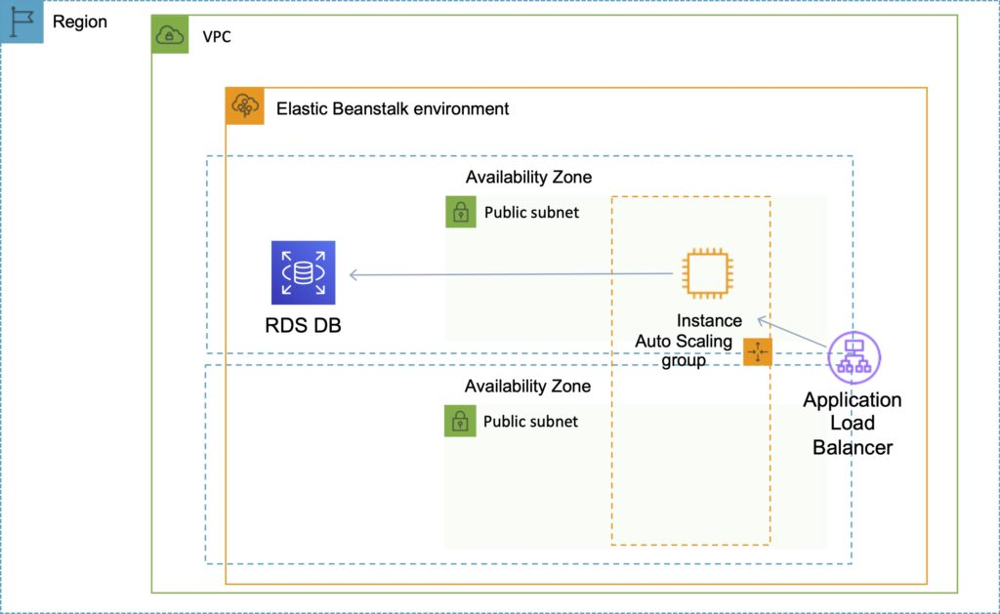
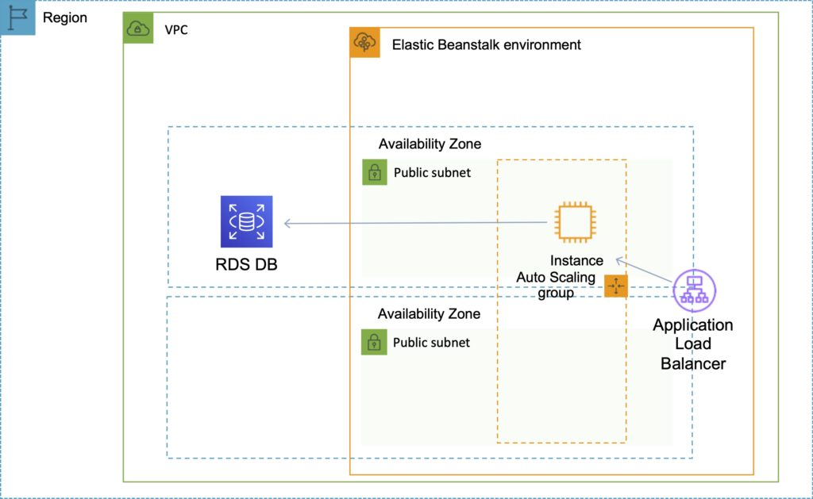

AWS Elastic Beanstalk 可用于在 AWS 云中快速部署和管理应用。

开发者上传应用，Elastic Beanstalk 负责处理容量预置、负载均衡、auto-scaling 和应用健康监控等部署细节。

可以使用多个可用区来提升应用的可靠性和可用性。

被视为一种 Platform as a Service（PaaS）解决方案。

支持以下平台：

- [Docker](https://docs.aws.amazon.com/elasticbeanstalk/latest/platforms/platforms-supported.html#platforms-supported.docker)
- [Multicontainer Docker](https://docs.aws.amazon.com/elasticbeanstalk/latest/platforms/platforms-supported.html#platforms-supported.mcdocker)
- [Preconfigured Docker](https://docs.aws.amazon.com/elasticbeanstalk/latest/platforms/platforms-supported.html#platforms-supported.dockerpreconfig)
- [Go](https://docs.aws.amazon.com/elasticbeanstalk/latest/platforms/platforms-supported.html#platforms-supported.go)
- [Java SE](https://docs.aws.amazon.com/elasticbeanstalk/latest/platforms/platforms-supported.html#platforms-supported.javase)
- [Tomcat](https://docs.aws.amazon.com/elasticbeanstalk/latest/platforms/platforms-supported.html#platforms-supported.java)
- [.NET Core on Linux](https://docs.aws.amazon.com/elasticbeanstalk/latest/platforms/platforms-supported.html#platforms-supported.dotnetlinux)
- [.NET on Windows Server](https://docs.aws.amazon.com/elasticbeanstalk/latest/platforms/platforms-supported.html#platforms-supported.net)
- [Node.js](https://docs.aws.amazon.com/elasticbeanstalk/latest/platforms/platforms-supported.html#platforms-supported.nodejs)
- [PHP](https://docs.aws.amazon.com/elasticbeanstalk/latest/platforms/platforms-supported.html#platforms-supported.PHP)
- [Python](https://docs.aws.amazon.com/elasticbeanstalk/latest/platforms/platforms-supported.html#platforms-supported.python)
- [Ruby](https://docs.aws.amazon.com/elasticbeanstalk/latest/platforms/platforms-supported.html#platforms-supported.ruby)

开发者可以专注于编写代码，无需担心基础设施部署。

你只需为预置的资源付费，Elastic Beanstalk 本身不收费。

Elastic Beanstalk 会自动扩缩你的应用。

可以选择最适合你应用的 EC2 实例类型。

可以保留完全的管理控制权，也可以交给 Elastic Beanstalk 处理。

Managed Platform Updates 功能会自动应用操作系统和平台的更新。

Elastic Beanstalk 监控和管理应用健康状况，信息可通过 dashboard 查看。

与 CloudWatch 和 X-Ray 集成，提供性能数据和指标。

与 Amazon VPC 和 AWS IAM 集成。

可以预置大多数数据库实例。

将你的应用文件以及（可选的）服务器日志文件存储在 Amazon S3 中。

应用数据也可以存储在 S3 上。

支持多环境以实现版本管理。

来自 Git 仓库的变更会被复制。

支持 Linux 和 Windows AMI。

代码通过 WAR 文件或 Git 仓库部署。

可以使用 AWS toolkit for Visual Studio 和 AWS toolkit for Eclipse 来部署 Elastic Beanstalk。

在单个区域内实现容错。

默认情况下应用是公开可访问的。

无需登录应用服务器即可访问日志。

提供 ISO、PCI、SOC 1、SOC 2 和 SOC 3 合规性，并满足 HIPAA 适用条件。

支持基于 arm64 的 AWS Graviton 处理器。

## Elastic Beanstalk 的层次结构

Elastic Beanstalk 由多个层次组成，各层说明如下：

**Application（应用）**：

- 在 Elastic Beanstalk 中，application 是不同元素的集合，例如 environment、environment configuration 和 application version。
- 一个 application 中可以包含多个 application version。

**Application version（应用版本）**：

- application version 是对一段可部署代码的特定引用。
- application version 通常指向存放代码的 Amazon S3 bucket。

**Environment（环境）**：

- environment 指已部署到 AWS 资源上的某个 application version。
- 这些资源由 AWS Elastic Beanstalk 配置和预置。
- environment 由 Elastic Beanstalk 创建的所有资源组成，而不仅仅是运行你上传代码的 EC2 实例。

**Environment tier（环境层）**：

- 根据应用的用途决定 Elastic Beanstalk 如何预置资源。
- **Web server** 是标准应用，监听并处理 HTTP 请求，通常在 80 端口。
- **Worker** 是专用应用，带有后台处理任务，监听 Amazon SQS 队列中的消息。

**Environment configuration（环境配置）**：

- environment configuration 是一组参数和设置的集合，决定 Elastic Beanstalk 如何为环境预置资源以及这些资源的行为方式。

**Configuration template（配置模板）**：

- 这是一个模板，为创建新的、唯一的环境配置提供基线。

## 部署选项

AWS Elastic Beanstalk 提供了多种处理[**部署**](https://docs.aws.amazon.com/elasticbeanstalk/latest/dg/using-features.deploy-existing-version.html)的选项，包括部署策略，以及让你在部署期间配置批次大小和健康检查行为的选项。

### 部署选项

单实例：适合开发环境。

带负载均衡器的高可用：适合生产环境。

### 部署策略

部署策略包括：All at once、Rolling、Rolling with additional batch 和 Immutable。

All at once：

- 同时将新版本部署到所有实例。
- 部署期间所有实例都会停止服务。
- 部署速度最快。
- 适合开发环境中快速迭代。
- 部署期间会出现服务中断——不适合关键业务系统。
- 如果更新失败，需要通过向所有实例重新部署原始版本来回滚。
- 无额外成本。

Rolling：

- 一次更新少量实例（一个批次），第一批健康后再进行下一批（每次只有一个批次停机）。
- 应用同时运行新旧两个版本。
- 部署期间每个批次的实例会停止服务。
- 部署期间环境容量会减少一个批次的实例数量。
- 不适合性能敏感的系统。
- 如果更新失败，需要再执行一次 rolling update 来回滚。
- 无额外成本。
- 部署时间较长。

Rolling with additional batch：

- 类似 Rolling，但会先启动一个新批次实例，确保完全可用。
- 应用以满容量运行。
- 可以设置批次大小。
- 应用同时运行新旧两个版本。
- 有少量额外成本。
- 部署结束后移除额外批次。
- 部署时间较长。
- 适合生产环境。

Immutable：

- 在新的 ASG 中启动新实例，将版本更新部署到这些实例，健康后再将流量切换过去。
- 零停机。
- 新代码通过 ASG 部署到新实例。
- 成本较高，因为更新期间运行的实例数量翻倍。
- 部署时间最长。
- 失败时可快速回滚。
- 非常适合生产环境。

此外，Elastic Beanstalk 支持 blue/green 部署。

Blue / Green 部署：

- 这不是 Elastic Beanstalk 的内置功能。
- 你创建一个新的“staging”环境并在其中部署更新。
- 新环境（green）可以独立验证，如有问题可以回滚。
- 可以使用 Route 53 的 weighted policy 将一定比例的流量导向 staging 环境。
- 使用 Elastic Beanstalk，测试完成后可以“swap URL”。
- 零停机。

下表总结了不同的部署策略：

|  |  |  |  |  |  |
| --- | --- | --- | --- | --- | --- |
| **部署策略** | **部署时间** | **零停机** | **回滚方式** | **额外成本** | **容量减少** |
| All at once | Clock | 否 | 手动重新部署 | 无 | 是（全部） |
| Rolling | Clock Clock | 是 | 手动重新部署 | 无 | 是（批次大小） |
| Rolling with additional batch | Clock Clock Clock | 是 | 手动重新部署 | 是（批次大小） | 否 |
| Immutable | Clock Clock Clock Clock | 是 | 终止新实例 | 是（全部） | 否 |
| Blue/green | Clock Clock Clock Clock | 是 | 交换 URL | 是（视情况而定） | 否 |

## Golden AMI

使用 Beanstalk 向 Amazon EC2 部署代码时，Elastic Beanstalk 必须解析应用依赖，这可能耗时较长。

golden AMI 通过在部署前将所有依赖、配置和软件打包进 AMI 来缩短这一时间。

## Elastic Beanstalk CLI

有一个额外的 CLI 叫做 “eb cli”。

EB CLI 是 AWS Elastic Beanstalk 的命令行界面，提供交互式命令，简化从本地仓库创建、更新和监控环境的操作。

你可以在日常开发和测试周期中使用 EB CLI，作为 Elastic Beanstalk 控制台的替代。

## 生命周期策略

Elastic Beanstalk 最多可以存储 1000 个应用版本。

要淘汰旧版本，可以使用生命周期策略：

- 基于时间 —— 指定最大保留时长。
- 基于数量 —— 指定最大保留数量。

正在使用中的版本不会被删除。

可以选择不删除 S3 中的源包，以防止数据丢失。

## Worker 环境

如果应用执行的任务耗时较长（长时间运行的任务），可以将其卸载到 worker 环境。

它允许你解耦应用的各个层。

可以在 cron.yaml 文件中定义周期性任务。

## Elastic Beanstalk 扩展

你可以将 AWS Elastic Beanstalk 配置文件（.ebextensions）添加到 Web 应用的源代码中，以配置环境并自定义其中包含的 AWS 资源。

自定义内容包括定义要安装的软件包、创建 Linux 用户和组、运行 shell 命令、指定要启用的服务、配置负载均衡器等。

配置文件是 YAML 或 JSON 格式的文档，扩展名为 .config，放置在名为 .ebextensions 的文件夹中，并随应用源包一起部署。

.ebextensions 文件夹必须包含在应用源代码包的顶层目录中。

UI 中设置的所有参数都可以在代码中配置。

要求：

- 必须位于源代码的 .ebextensions/ 目录中。
- YAML 或 JSON 格式。
- 可以使用 .config 扩展名（例如 logging.config）。
- 可以使用 “option\_settings” 修改某些默认设置。
- 可以添加 RDS、ElastiCache 和 DynamoDB 等资源。

如果环境被终止，由 .ebextensions 管理的资源也会被删除。

## Elastic Beanstalk 与 Amazon Relational Database Service（RDS）

你可以在 Elastic Beanstalk 环境内部署 Amazon RDS，如下图所示：

但是，如果终止 Elastic Beanstalk 环境，数据库也会一并丢失。

这种方式只适用于开发环境，通常不适合生产环境。

对于生产环境，最好在 Elastic Beanstalk 之外创建 Amazon RDS 数据库，如下图所示：

从 Beanstalk 环境内的 RDS 迁移到独立 RDS 的步骤：

- 为 RDS DB 拍摄快照。
- 在 RDS DB 上启用删除保护。
- 创建一个不带 RDS DB 的新环境，并将应用指向现有 RDS DB。
- 执行 blue/green 部署，交换新旧环境。
- 终止旧环境（由于终止保护，RDS 不会被删除）。
- 删除 CloudFormation stack（会处于 DELETE\_FAILED 状态）。

### 连接 Amazon RDS 数据库

环境更新完成后，DB 实例的主机名和其他连接信息会通过以下环境属性提供给应用：

- RDS\_HOSTNAME —— DB 实例的主机名。
- RDS\_PORT —— DB 实例接受连接的端口。默认值因数据库引擎而异。
- RDS\_DB\_NAME —— 数据库名称，ebdb。
- RDS\_USERNAME —— 你为数据库配置的用户名。
- RDS\_PASSWORD —— 你为数据库配置的密码。

## 自定义域名

如果你使用 AWS Elastic Beanstalk 在 AWS 云中部署和管理应用，可以使用 Amazon Route 53 将你域名（如 example.com）的 DNS 流量路由到新的或现有的 Elastic Beanstalk 环境。

你需要创建 *CNAME 记录*或*alias 记录*，具体取决于环境的域名是否包含部署区域的名称（如 **us-east-2**）。新环境的域名包含区域名称；2016 年初之前创建的环境则不包含。

如果域名不包含区域：创建 CNAME 记录。

如果域名包含区域：创建 alias 记录。

## 安全

Elastic Beanstalk 支持 HTTPS：

- 将 SSL 证书加载到负载均衡器上。
- 可以通过控制台或代码完成（.ebextensions/securelistener-alb.config）。
- SSL 证书可以使用 ACM 或 CLI 申请。

将 HTTP 重定向到 HTTPS：

- 在应用中配置。
- 在 ALB 上配置规则。
- 确保健康检查不被重定向。

## 监控与报告

Elastic Beanstalk 自动使用 [**Amazon CloudWatch**](https://digitalcloud.training/amazon-cloudwatch/) 帮助你监控应用和环境状态。

你可以进入 Amazon CloudWatch 控制台查看 dashboard，总览所有资源以及告警。

你还可以选择查看更多指标或添加自定义指标。

## 日志与审计

借助 CloudWatch Logs，你可以监控和归档来自环境中 Amazon EC2 实例的 Elastic Beanstalk 应用日志、系统日志和自定义日志文件。

你还可以配置告警，以便对 metric filter 提取的特定日志流事件做出响应。

环境中每个 Amazon EC2 实例上安装的 CloudWatch Logs agent，会针对你配置的每个 log group 向 CloudWatch 服务发布指标数据点。

每个 log group 应用自己的 filter pattern，以决定将哪些日志流事件作为数据点发送到 CloudWatch。

属于同一 log group 的日志流共享相同的保留、监控和访问控制设置。

除了实例日志之外，如果你为环境启用了[**增强型健康监控**](https://docs.aws.amazon.com/elasticbeanstalk/latest/dg/health-enhanced.html)，还可以配置环境将健康信息流传输到 CloudWatch Logs。

## 授权与访问控制

AWS Elastic Beanstalk 支持[**identity-based**](https://docs.aws.amazon.com/elasticbeanstalk/latest/dg/AWSHowTo.iam.html) policy。

AWS Elastic Beanstalk 不支持 [**resource-based**](https://docs.aws.amazon.com/IAM/latest/UserGuide/access_policies_identity-vs-resource.html) policy。

AWS Elastic Beanstalk 对[**resource-level**](https://docs.aws.amazon.com/IAM/latest/UserGuide/reference_aws-services-that-work-with-iam.html)权限提供部分支持。

创建环境时，AWS Elastic Beanstalk 会提示你提供两个 AWS Identity and Access Management（IAM）role：service role 和 instance profile。

[**service role**](https://docs.aws.amazon.com/elasticbeanstalk/latest/dg/concepts-roles-service.html) 由 Elastic Beanstalk 扮演，用于代表你使用其他 AWS 服务。

[**instance profile**](https://docs.aws.amazon.com/elasticbeanstalk/latest/dg/concepts-roles-instance.html) 应用于环境中的实例，允许它们从 Amazon Simple Storage Service（Amazon S3）检索[**application version**](https://docs.aws.amazon.com/elasticbeanstalk/latest/dg/concepts.html#concepts-version)、向 Amazon S3 上传日志，以及执行其他因环境类型和平台而异的任务。

你还可以创建[**user policy**](https://docs.aws.amazon.com/elasticbeanstalk/latest/dg/concepts-roles-user.html)，并将其应用到账户中的 IAM 用户和组，以允许用户创建和管理 Elastic Beanstalk 应用与环境。Elastic Beanstalk 提供完全访问和只读访问的托管策略。

## 让你的技术职业生涯更上一层楼

[**按需培训**](https://digitalcloud.training/plans/) —— 通过我们的点播视频课程和模拟考试轻松拿下云认证。按自己的节奏学习，通过月度或年度订阅访问我们庞大的云培训资源库！

[**Cloud Mastery Bootcamp**](https://digitalcloud.training/cloud-mastery-bootcamp/) —— 通过我们的直播培训项目构建面向职场的云技能，解锁云职业机会。在经验丰富的讲师带领下，你将在 AWS、Linux、Python、Kubernetes 和 IaC 的真实项目中积累动手经验！

[**Challenge Labs**](https://digitalcloud.training/hands-on-challenge-labs/) —— 在安全沙箱环境中进行基于场景的动手练习，学习、构建、测试并在失败中前进——彻底消除意外云账单的风险。探索涵盖 AWS、Azure、Linux、VMware、容器和网络安全的 1000+ 实验！
