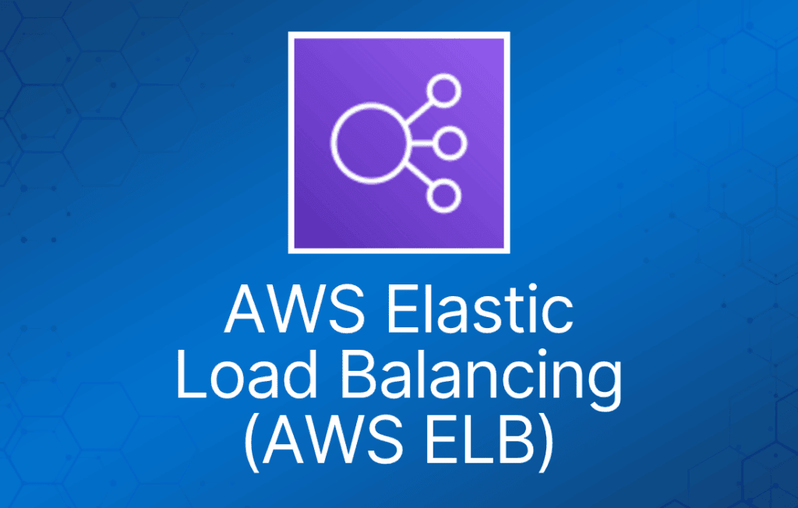
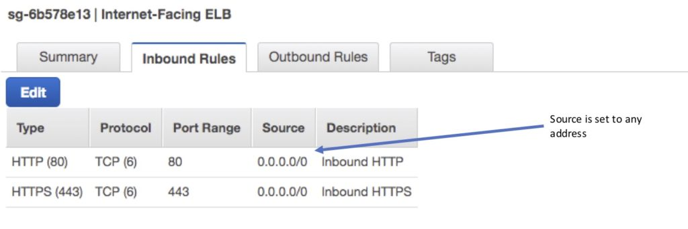
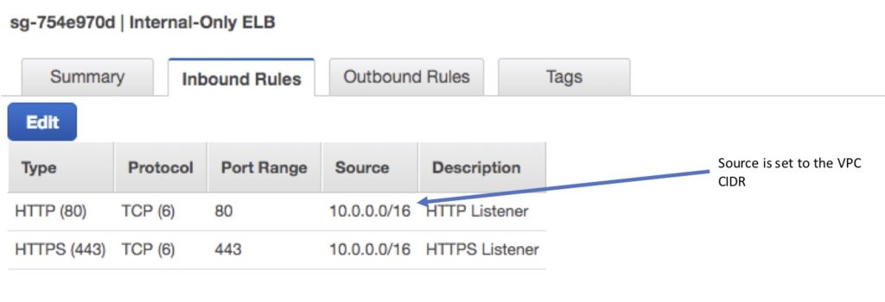
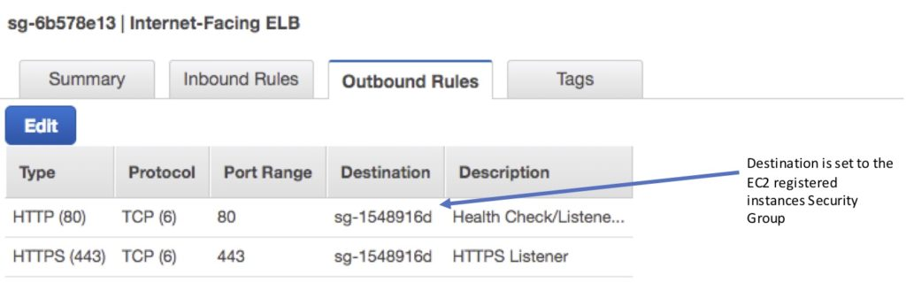
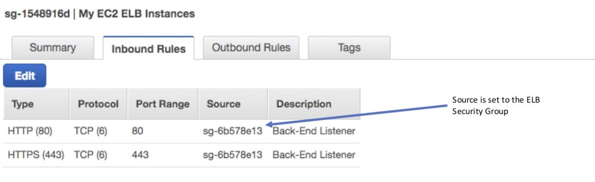
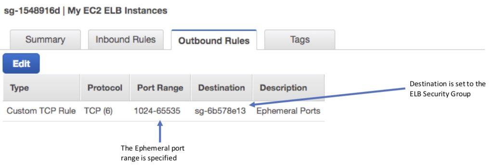
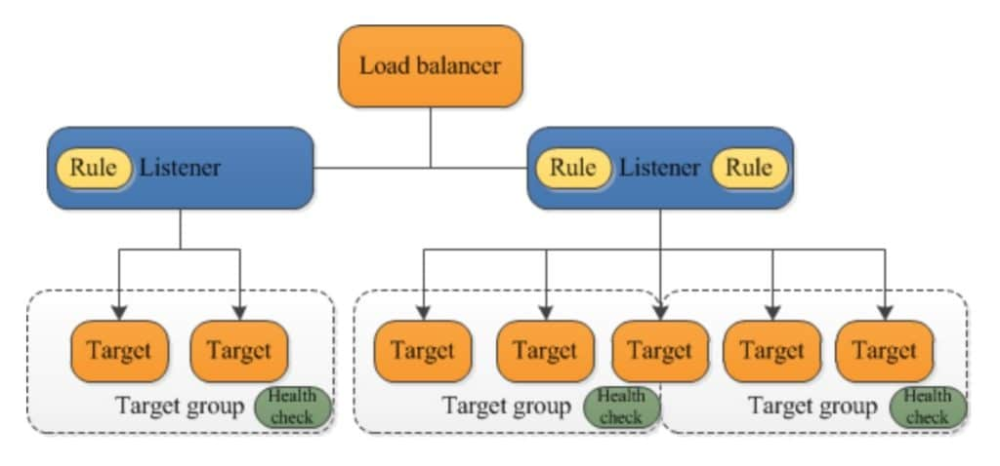
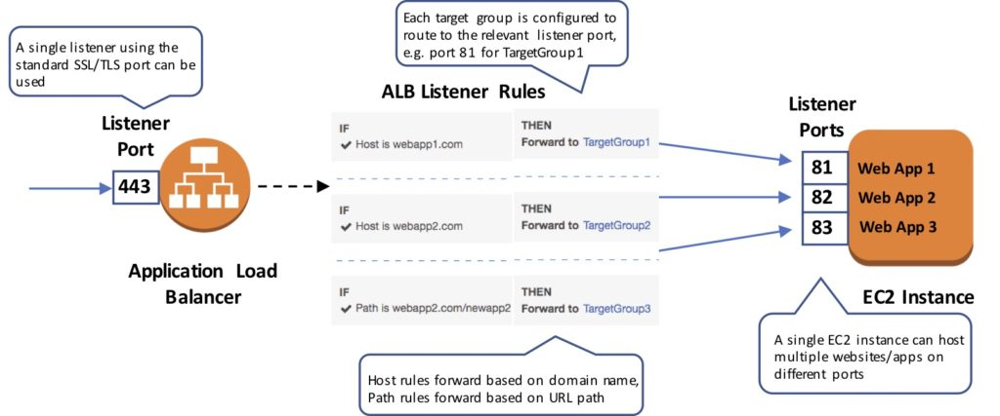
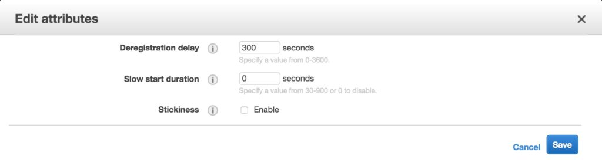
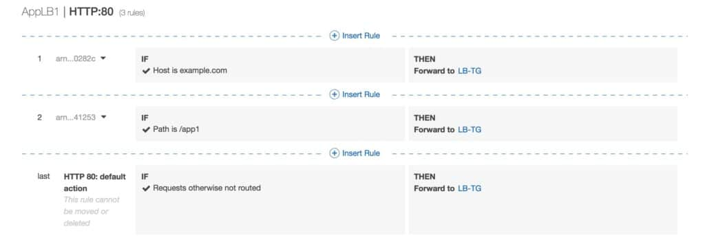

Elastic Load Balancing 自动将传入的应用流量分发到多个目标，例如 Amazon EC2 实例、容器和 IP 地址。

网络流量可以分发到 AWS 区域内的一个或多个 Availability Zone（AZ）。

AWS 上有四种类型的 Elastic Load Balancer（ELB）：

- **Classic Load Balancer（CLB）**—— 最老的一代，在第四层和第七层提供基本的负载均衡。
- **Application Load Balancer（ALB）**—— 第七层负载均衡器，根据请求内容路由连接。
- **Network Load Balancer（NLB）**—— 第四层负载均衡器，根据 IP 协议数据路由连接。
- **Gateway Load Balancer（GLB）**—— 第三/四层负载均衡器，用于防火墙和 IDS/IPS 系统等虚拟设备前端。

***注意：****本页不详细介绍 CLB，因为它是上一代负载均衡器，大多数 AWS 考试已不再涉及。*

下表对比了与 AWS 考试相关的一些关键特性：

|  |  |  |  |  |
| --- | --- | --- | --- | --- |
| **特性** | **Application Load Balancer** | **Network Load Balancer** | **Classic Load Balancer** | **Gateway Load Balancer** |
| **OSI 层级** | 第 7 层 | 第 4 层 | 第 4/7 层 | 第 3 层网关 + 第 4 层负载均衡 |
| **目标类型** | IP、Instance、Lambda | IP、Instance、ALB | N/A | IP、Instance |
| **协议** | HTTP、HTTPS | TCP | TCP、SSL、HTTP、HTTPS | IP |
| **WebSockets** | ✔ | ✔ |  | ✔ |
| **IP 地址作为目标** | ✔ | ✔ |  |  |
| **基于 HTTP header 的路由** | ✔ |  |  |  |
| **HTTP/2/gRPC** | ✔ |  |  |  |
| **可配置的空闲连接超时** | ✔ |  | ✔ |  |
| **跨区域负载均衡（cross-zone）** | ✔ | ✔ | ✔ | ✔ |
| **SSL 卸载** | ✔ | ✔ | ✔ |  |
| **Server Name Indication（SNI）** | ✔ | ✔ | ✔ |  |
| **粘性会话（sticky session）** | ✔ | ✔ | ✔ | ✔ |
| **静态 / Elastic IP 地址** |  | ✔ |  |  |
| **自定义安全策略** |  |  | ✔ |  |

Elastic Load Balancing 通过在多个目标之间自动均衡流量，为应用提供容错能力——

目标可以是 Amazon EC2 实例、容器、IP 地址和 Lambda 函数。

ELB 跨 Availability Zone 分发流量，同时确保只有健康的目标接收流量。

每个 ELB 在每个 AZ 只能启用一个子网。

可以使用 Amazon Route 53 配合在每个区域配置的 ELB 实现区域级负载均衡。

ELB 可以是**面向 Internet** 的，也可以是**仅内部**的。

面向 Internet 的 ELB：

- ELB 节点拥有公有 IP。
- 将流量路由到 EC2 实例的私有 IP 地址。
- 在定义 ELB 的每个 AZ 中需要一个公有子网。
- ELB DNS 名称格式：<name>-<id-number>.<region>.elb.amazonaws.com。

仅内部的 ELB：

- ELB 节点拥有私有 IP。
- 将流量路由到 EC2 实例的私有 IP 地址。
- ELB DNS 名称格式：**internal**-<name>-<id-number>.<region>.elb.amazonaws.com。

仅内部的负载均衡器不需要 Internet gateway。

EC2 实例和容器可以注册到 ELB。

ELB 节点使用你子网中的 IP 地址，确保子网至少为 /27，并确保至少有 8 个可用 IP 地址供 ELB 扩展。

ELB 将流量转发到 eth0（主 IP 地址）。

ELB listener 是检查连接请求的进程：

- CLB listener 支持 TCP 和 HTTP/HTTPS 协议。
- ALB listener 支持 HTTP 和 HTTPS 协议。
- NLB listener 支持 TCP、UDP 和 TLS 协议。
- GLB listener 支持 IP 协议。

删除 ELB 不会影响注册到它的实例（实例不会被删除，只是不再接收请求）。

ALB 必须指定至少 2 个子网。

NLB 只需指定一个子网（建议至少添加 2 个）。

ELB 使用 60 秒的 DNS 记录 TTL，以确保客户端使用新的 ELB 节点 IP 地址。

默认情况下 ELB 的空闲连接超时为 60 秒，应用的空闲超时建议设置为至少 60 秒。

Perfect Forward Secrecy（PFS）通过使用唯一的随机会话密钥，为加密数据提供额外的防窃听保护。

Server Order Preference 允许你配置负载均衡器强制按 cipher 顺序执行，从而更好地控制客户端连接负载均衡器时使用的安全级别。

ELB 不支持客户端证书认证（API Gateway 支持）。

## ELB 安全组

安全组控制可以到达前端 listener 的端口和协议。

在非默认 VPC 中，你可以选择要分配的安全组。

你必须为前端 listener 上的端口和协议分配安全组。

你还需要放行健康检查端口和后端 listener 的端口和协议。

ELB 的安全组配置：

ELB 入站（允许）。

- 面向 Internet 的 ELB：
  - 来源：0.0.0.0/0。
  - 协议：TCP。
  - 端口：ELB listener 端口。

- 仅内部的 ELB：
  - 来源：VPC CIDR。
  - 协议：TCP。
  - 端口：ELB listener 端口。

出站（允许，两种类型的 ELB 均适用）：

- 目标：EC2 注册实例的安全组。
- 协议：TCP。
- 端口：健康检查/Listener。

注册实例的安全组配置：

注册实例的入站（允许，两种类型的 ELB 均适用）。

- 来源：ELB 安全组。
- 协议：TCP。
- 端口：健康检查/Listener。

出站（允许，两种类型的 ELB 均适用）。

- 目标：ELB 安全组。
- 协议：TCP。
- 端口：Ephemeral（临时端口）。

同样重要的是确保 NACL 设置正确。

## 分布式拒绝服务（DDoS）防护：

ELB 自动将传入的应用流量分发到多个目标（如 EC2 实例、容器和 IP 地址）以及多个 Availability Zone，从而最大限度地降低单个资源过载的风险。

ELB 仅支持有效的 TCP 请求，因此 UDP 和 SYN flood 等 DDoS 攻击无法到达 EC2 实例。

ELB 还提供单一管理点，可以作为 Internet 与后端私有 EC2 实例之间的一道防线。

你还可以将 AWS Web Application Firewall（WAF）Web ACL 附加到 Application Load Balancer，以防范 Web 漏洞利用。

## ELB 监控

监控方式包括：

- CloudWatch —— 每 1 分钟一次。
  - ELB 服务仅在有活动请求时发送信息。
  - 可用于触发 SNS 通知。
- 访问日志（Access Log）。
  - 默认禁用。
  - 包含客户端信息（CloudWatch 指标中不包含）。
  - 可识别请求方、IP、请求类型等。
  - 可选择存储并保留在 S3 中。
- CloudTrail。
  - 可用于捕获对 ELB 的 API 调用。
  - 可存储在 S3 bucket 中。

## Target group（目标组）

Target group 是目标的逻辑分组，与 ALB、NLB 和 GLB 配合使用。

目标是端点，可以是 EC2 实例、ECS 容器、IP 地址、Lambda 函数和其他负载均衡器。

Target group 可以独立于 ELB 存在。

一个目标可以属于多个 target group。

每个 target group 只能定义一种协议和一个端口。

不能使用公有 IP 地址作为目标。

不能在同一个 target group 中混用实例 ID 和 IP 地址目标。

一个 target group 只能与一个负载均衡器关联。

下图展示了基本组成部分。注意每个 listener 包含一条默认规则，其中一个 listener 包含另一条将请求路由到不同 target group 的规则。有一个目标注册到了两个 target group。

Target group 用于向 ALB、NLB 或 GLB 注册实例。

Target group 是区域级资源（ELB 也是）。

下图展示了 target group 如何与 ALB 配合，使用基于 host 和基于 path 的路由，将流量分发到单个 EC2 实例上运行在多个端口的多个网站：

可以定义以下属性：

- Deregistration delay —— Elastic Load Balancing 在注销目标之前等待的时间。
- Slow start duration —— 负载均衡器向新注册的目标线性增加流量份额的时间（秒）。
- Stickiness —— 指示是否启用粘性会话。

属性的默认设置如下所示：

Auto Scaling 组可以单独扩展每个 target group。

只有当 target group 中使用实例 ID 时，才能将 Auto Scaling 与负载均衡器配合使用。

健康检查按 target group 定义。

ALB/NLB/GLB 可以路由到多个 target group。

你可以使用不同端口将同一个 EC2 实例或 IP 地址多次注册到同一个 target group（用于将请求路由到微服务）。

如果按实例 ID 注册，流量将通过主网络接口的主私有 IP 地址路由。

如果按 IP 地址注册，可以使用一个或多个网络接口上的任意私有地址将流量路由到实例。

不能在 target group 中混合不同类型（EC2、ECS、IP、Lambda 函数）。

IP 地址可用于注册：

- 对等 VPC 中的实例。
- 可通过 IP 地址和端口寻址的 AWS 资源。
- 通过 Direct Connect 或 VPN 连接到 AWS 的本地资源。

## Application Load Balancer（ALB）

Application Load Balancer 工作在请求级别（第 7 层），根据请求内容将流量路由到目标——EC2 实例、容器和 IP 地址。

可以对 HTTP/HTTPS 应用进行负载均衡，并使用第 7 层特有的功能，如 X-Forwarded-For header。

ALB 支持在客户端与负载均衡器之间终止 HTTPS。

ALB 支持通过 AWS IAM 和 AWS Certificate Manager 管理 SSL 证书，并提供预定义的安全策略。

ALB 支持 Server Name Indication（SNI），允许多个安全网站共用一个安全 listener。

通过 Server Name Indication（SNI），客户端指明它想要连接的主机名。

可以将 IP 地址配置为目标，从而使用后端实例/服务器的 IP 地址作为目标，对托管在 AWS 或本地的应用进行负载均衡。

至少需要两个 Availability Zone，并且可以将传入流量分发到多个 Availability Zone 中的目标。

ALB 会根据传入的应用流量自动扩展其请求处理能力。

你可以将 ALB 配置为面向 Internet，或创建不带公有 IP 地址的负载均衡器作为内部（非面向 Internet）负载均衡器。

ALB 支持基于内容的路由，即根据请求内容将请求路由到某个服务。例如：

- **基于 host 的路由**根据 HTTP header 中的 Host 字段路由客户端请求，允许你从同一个负载均衡器路由到多个域。
- **基于 path 的路由**根据 HTTP header 中的 URL 路径路由客户端请求（例如 /images 或 /orders）。

支持微服务和容器，可在单个 EC2 实例上跨多个端口进行负载均衡。

与 Amazon Cognito 集成实现用户认证。

slow start 模式允许目标在爬坡期内“预热”。

健康检查：

- 健康检查可以自定义响应码（200-399）。
- API 和管理控制台中提供健康检查失败的详细信息。
- 健康检查失败时会返回原因码。
- 健康检查不支持 WebSockets。
- Fail open 指当没有任何 AZ 包含健康目标时，负载均衡器节点会将请求路由到所有目标。

提供详细的访问日志信息，每 5 或 6 分钟保存到 S3 bucket。

支持删除保护。

Deregistration delay 类似于 connection draining。

**粘性会话（Sticky Session）：**

- 使用 cookie 确保客户端在 cookie 有效期内绑定到单个后端实例。
- ALB 支持基于时长的 cookie 和基于应用的 cookie。
- 对于基于应用的 cookie，每个 target group 指定 cookie 名称。
- 对于基于时长的 cookie，cookie 名称始终为 AWSALB。
- 粘性会话在 target group 级别启用。
- WebSockets 连接本质上是粘性的（在 upgrade 过程之后）。

### Listener 与规则

Listener：

- 每个 ALB 至少需要一个 listener，最多可有 10 个。
- Listener 定义监听的端口和协议。
- 可以添加一个或多个 listener。
- 多个 listener 不能使用相同的端口。

**Listener 规则：**

- 规则决定负载均衡器如何将请求路由到一个或多个 target group 中的目标。
- 每条规则由优先级、一个或多个动作、可选的 host 条件和可选的 path 条件组成。
- 每条规则只能配置一个动作。
- 需要一条或多条规则。
- 每个 listener 有一条默认规则，你可以选择性地定义其他规则。
- 规则决定当规则匹配客户端请求时采取什么动作。
- 规则定义在 listener 上。
- 你可以添加规则，根据请求内容指定不同的 target group（基于内容的路由）。
- 如果没有匹配的规则，将遵循默认规则，将流量导向默认 target group。

下图展示了一个包含基于 host 和基于 path 条目、末尾为默认规则的规则集：

**默认规则：**

- 创建 listener 时，你需要为默认规则定义一个动作。
- 默认规则不能有条件。
- 你可以随时删除 listener 的非默认规则。
- 你不能删除 listener 的默认规则。
- 删除 listener 时，其所有规则都会被删除。
- 如果 listener 的所有规则条件都不满足，则执行默认规则的动作。

**规则优先级：**

- 每条规则都有一个优先级，按从低到高的顺序进行评估。
- 默认规则最后评估。
- 你可以随时更改非默认规则的优先级值。
- 你不能更改默认规则的优先级值。

**规则动作：**

- 每个动作只能对应一个 target group。
- 每条规则有一个类型和一个 target group。
- 唯一支持的动作类型是 forward，即将请求转发到 target group。
- 你可以随时更改规则的 target group。

**规则条件：**

- 规则条件有两种类型：host 和 path。
- 当满足规则的条件时，执行相应动作。
- 每条规则最多可有 2 个条件：1 个 path 条件和 1 个 host 条件。
- 可选条件是你希望 ALB 评估的 path 模式，用于路由请求。

**请求路由：**

- 负载均衡器收到请求后，按优先级顺序评估 listener 规则以确定应用哪条规则，然后使用轮询（round robin）路由算法从该规则动作的 target group 中选择一个目标。
- 即使一个目标注册了多个 target group，每个 target group 的路由也是独立进行的。
- 你可以配置 listener 规则，根据应用流量的内容将请求路由到不同的 target group。

**基于内容的路由：**

- ALB 可以根据请求中 host 字段的内容路由请求：基于 host 或基于 path。
- 基于 host 是基于域名的路由，例如 example.com 或 app1.example.com。
- host 字段包含域名以及可选的端口号。
- 基于 path 是基于 URL 的路由，例如 example.com/images、example.com/app1。
- 你还可以创建结合基于 host 和基于 path 路由的规则。
- 任何不匹配内容路由规则的请求都会被发送到默认 target group。
- ALB 还可以根据 HTTP header 中的[其他信息](https://docs.aws.amazon.com/elasticloadbalancing/latest/application/load-balancer-listeners.html)进行路由，包括查询字符串参数、请求方法和源 IP 地址。

### ALB 与 ECS

ECS service 维护实例的“期望数量（desired count）”。

可以选择使用负载均衡器在任务之间分发流量。

单个 task definition 中的所有容器都放置在单个 EC2 容器实例上。

ECS service 只能使用一个负载均衡器。

ALB 不支持在单个 task definition 中使用多个 listener。

ALB 支持动态 host 端口映射，这意味着同一容器主机上允许来自同一服务的多个端口。

ALB 支持基于 path 的路由和优先级规则。

ALB 通过 service load balancing 与 EC2 container service 集成。

联合认证（federated authentication）：

- ALB 支持来自符合 OIDC 的身份提供商（如 Google、Facebook 和 Amazon）的认证。
- 通过 listener 规则上的认证动作实现，并与 Amazon Cognito 集成以创建 user pool。
- AWS SAM 也可以与 Amazon Cognito 配合使用。

## Network Load Balancer

Network Load Balancer 工作在连接级别（第 4 层），根据 IP 协议数据将连接路由到目标——Amazon EC2 实例、容器和 IP 地址。

NLB 旨在处理每秒数百万个请求，并以极低延迟支持突发的剧烈流量模式。

NLB 可以为每个 Availability Zone 配置一个静态/Elastic IP 地址。

你可以使用应用后端的 IP 地址作为目标，对托管在 AWS 或本地的任何应用进行负载均衡。

NLB 支持客户端连接到跨不同 AWS 区域的对等 VPC 中基于 IP 的目标。

NLB 同时支持网络级和应用级目标健康检查。

NLB 支持长时间运行的连接（非常适合 WebSocket 应用）。

NLB 支持在 AWS 区域内和跨区域之间的 IP 地址故障切换（使用 Amazon Route 53 健康检查）。

与 Amazon Route 53 的集成使得可以将故障的负载均衡器 IP 地址从服务中移除，并将流量重定向到另一个区域中的备用 NLB。

NLB 支持跨区域负载均衡（cross-zone），但通过控制台创建 NLB 时默认不启用。

NLB 的 target group 支持以下协议和端口：

- **协议：**TCP、TLS、UDP、TCP\_UDP。
- **端口：**1-65535。

下表总结了支持的 listener 与协议组合以及 target group 设置：

|  |  |  |  |
| --- | --- | --- | --- |
| **Listener 协议** | **Target Group 协议** | **Target Group 类型** | **健康检查协议** |
| TCP | TCP | TCP\_UDP | instance | ip | HTTP | HTTPS | TCP |
| TLS | TCP | TLS | Instance | ip | HTTP | HTTPS | TCP |
| UDP | UDP | TCP\_UDP | instance | HTTP | HTTPS | TCP |
| TCP\_UDP | TCP\_UDP | instance | HTTP | HTTPS | TCP |

Amazon CloudWatch 报告 Network Load Balancer 指标。

你可以使用 VPC Flow Logs 记录发送到负载均衡器的所有请求。

## 监控

AWS CloudTrail 捕获 API 调用用于审计。

你只需支付 S3 存储费用。

CloudTrail 仅监控 API 调用。

访问日志可用于监控其他操作，例如收到请求的时间、客户端 IP 地址、请求路径等。

访问日志是可选的，默认禁用。

使用访问日志时你只需支付 S3 存储费用。

启用访问日志后，ALB 会记录发送到负载均衡器的请求，包括从未到达目标的请求。

ALB 不记录健康检查请求。
