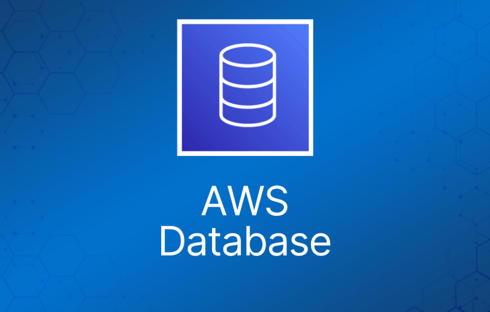
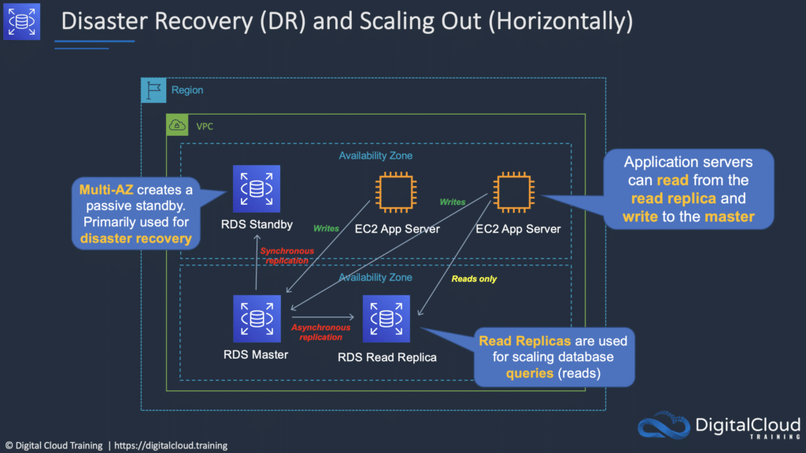
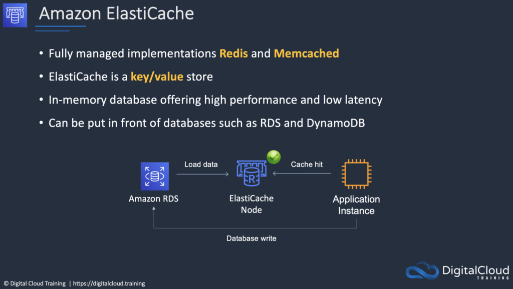

本文介绍 AWS Cloud Practitioner 考试涉及的 AWS 数据库服务，这是考试蓝图中的关键技术领域之一。

## 不同数据库类型的使用场景

下表给出了几种 AWS 数据库/数据存储服务的典型使用场景：

|  |  |
| --- | --- |
| **数据存储** | **何时使用** |
| EC2 上的数据库 | - 需要完全控制实例和数据库 - 想要的数据库在 RDS 中不可用 |
| Amazon RDS | - 需要用于 OLTP 的传统关系型数据库 - 数据结构良好、格式规整 - 现有应用依赖 RDBMS |
| Amazon DynamoDB | - 键值对数据 - 数据结构不可预测 - 需要内存级性能且要持久化 - 高 I/O 需求 - 需要动态扩展 |
| Amazon RedShift | - 用于大量聚合数据的数据仓库 - 主要是 OLAP 工作负载 |
| Amazon Neptune | - 对象之间的关系具有很高价值 |
| Amazon ElastiCache | - 为少量数据提供快速的临时存储 - 高度易变的数据（非持久化） |
| Amazon S3 | - 二进制大对象（BLOB） - 静态网站 |

接下来介绍考试中可能涉及的几种数据库类型。

## Amazon Relational Database Service（RDS）

Amazon Relational Database Service（Amazon RDS）是一项托管服务，让你在云中轻松搭建、运维和扩展关系型数据库。

关系型数据库也称为 Structured Query Language（SQL）数据库。

非关系型数据库称为 NoSQL 数据库。

RDS 属于联机事务处理（OLTP）类型的数据库。

RDS 的功能与优势：

- SQL 类型的数据库。
- 可用于执行复杂查询和 join。
- 易于搭建、高可用、容错、可扩展。
- 适用于数据定义清晰的场景。
- 常见使用场景包括在线商店和银行系统。

Amazon RDS 支持以下数据库引擎：

- SQL Server。
- Oracle。
- MySQL Server。
- PostgreSQL。
- Aurora。
- MariaDB。

Aurora 是 Amazon 自研的数据库。

RDS 是完全托管的服务，你无法访问底层 EC2 实例（没有 root 权限）。

RDS 服务包括以下内容：

- 数据库实例的安全与补丁管理。
- 数据库实例的自动备份。
- 数据库引擎的软件更新。
- 存储和计算的轻松扩展。
- 带同步复制的 Multi-AZ 选项。
- Multi-AZ 选项的自动故障转移。
- 面向读密集型工作负载的只读副本（read replica）选项。

数据库实例（DB instance）是云中的数据库环境，使用你指定的计算和存储资源。

加密：

- 为 Amazon RDS 数据库实例启用加密选项后，可以对 RDS 实例和快照进行静态加密。
- 所有数据库类型都支持静态加密，使用 AWS KMS。
- 无法直接加密已有数据库——需要先创建快照，复制快照并加密副本，然后从该快照构建加密的数据库。

数据库子网组（DB Subnet Group）：

- DB subnet group 是你在 VPC 中创建并指定给数据库实例使用的一组子网（通常是私有子网）。
- 每个 DB subnet group 应在每个区域的至少两个可用区中拥有子网。
- 建议在子网组中为每个 AZ 配置子网（即使对于独立实例也是如此）。

AWS 对以下项目收费：

- 数据库实例小时数（不足一小时按一小时计）。
- 存储 GB/月。
- I/O 请求/月 —— 针对磁性存储（magnetic storage）。
- 预置 IOPS/月 —— 针对 RDS 预置 IOPS SSD。
- 出站数据传输。
- 备份存储（数据库备份和手动快照）。

可扩展性：

- RDS 只能向上扩展（计算和存储）。
- 不能减少 RDS 实例已分配的存储。
- 除 MS SQL 外，所有数据库引擎都可以扩展存储并更改存储类型。

RDS 提供用于灾难恢复的 Multi-AZ 能力，实现跨可用区的容错：

- Multi-AZ RDS 在另一个 AZ 创建副本，并进行同步复制（仅用于 DR）。
- 启动向导中可以选择 Multi-AZ 选项。
- AWS 建议 Multi-AZ RDS 数据库实例使用预置 IOPS 存储。
- 每个 AZ 运行在物理上独立的基础设施上，设计上具备高可靠性。
- 无法选择在该区域的哪个 AZ 创建备用数据库实例。

只读副本（Read Replica）—— 提升读取性能：

- 只读副本用于读密集型数据库，复制是异步的。
- 只读副本用于分担和卸载工作负载。
- 只读副本提供只读的 DR 能力。
- 只读副本从主实例的快照创建。
- 主实例必须启用自动备份（保留期 > 0）。

## Amazon DynamoDB

Amazon DynamoDB 是一项完全托管的 NoSQL 数据库服务，提供快速、可预测的性能和无缝的可扩展性。

DynamoDB 的功能与优势：

- NoSQL 类型数据库（非关系型）。
- 快速、高可用、完全托管。
- 适用于数据多变、结构不固定的场景。
- 常见使用场景包括社交网络和 Web 分析。

一键扩展（push button scaling）意味着你可以随时扩展数据库而不产生停机时间。

基于 SSD，并在属性上使用有限的索引来提升性能。

DynamoDB 是一项 Web 服务，使用 HTTPS（HTTP over SSL）作为传输协议，JSON 作为消息序列化格式。

Amazon DynamoDB 为每张表存储三个地理上分布的副本，以实现高可用和数据持久性。

数据在一个区域内的 3 个设施（AZ）之间同步复制。

跨区域复制让你可以跨区域复制数据：

- Amazon DynamoDB 全局表（global tables）提供了部署多区域、多主数据库的完全托管方案。
- 创建全局表时，你指定希望表可用的 AWS 区域。
- DynamoDB 会完成所有必要工作：在这些区域创建相同的表，并将持续的数据变更传播到所有区域。

提供低读写延迟。

可按需上下扩展存储和吞吐，无需修改代码或停机。

DynamoDB 是无 schema 的。

DynamoDB 可用于存储会话状态（session state）。

提供两种读取模型。

最终一致性读（默认）：

- 最终一致性选项最大化读吞吐（最佳读取性能）。
- 最终一致性读可能无法反映刚刚完成的写入结果。
- 所有副本在 1 秒内达到一致。

强一致性读：

- 强一致性读返回的结果反映在读之前所有已收到成功响应的写入（一致性更快）。

Amazon DynamoDB Accelerator（DAX）是完全托管、高可用的 DynamoDB 内存缓存，可将性能提升最高 10 倍——从毫秒级降到微秒级——即使在每秒数百万请求的情况下也是如此。

## Amazon RedShift

Amazon Redshift 是快速、完全托管的数据仓库，让你能够用标准 SQL 和现有的商业智能（BI）工具简单、经济地分析所有数据。

RedShift 是基于 SQL 的数据仓库，用于**分析型**应用。

RedShift 是用于联机分析处理（OLAP）场景的关系型数据库。

RedShift 用于对 PB 级结构化数据运行复杂分析查询，采用复杂的查询优化、高性能本地磁盘上的列式存储，以及大规模并行查询执行。

RedShift 非常适合为商业智能**处理**大量数据。

RedShift 比传统 SQL 数据库快 10 倍。

RedShift 使用列式数据存储：

- 数据按列（而非按行）顺序存储。
- 列式数据库非常适合数据仓库和分析。
- 所需 I/O 更少，极大提升性能。

RedShift 提供高级压缩：

- 数据按列顺序存储，带来更好的性能和更少的存储空间。
- RedShift 自动选择压缩方案。

RedShift 使用复制和持续备份来增强可用性、提高持久性，并能从组件和节点故障中自动恢复。

RedShift 始终保留数据的三份拷贝：

- 原始数据。
- 计算节点上的副本（在集群内）。
- S3 上的备份副本。

RedShift 提供持续/增量备份：

- 集群内的多份拷贝。
- 到 S3 的持续增量备份。
- 跨区域的持续增量备份。
- 流式恢复（streaming restore）。

RedShift 对以下故障提供容错能力：

- 磁盘故障。
- 节点故障。
- 网络故障。
- AZ/区域级灾难。

## Amazon ElastiCache

ElastiCache 是一项 Web 服务，让你可以轻松在云中部署和运行兼容 Memcached 或 Redis 协议的服务器节点。

ElastiCache 提供的内存缓存可以显著提升许多读密集型或计算密集型应用工作负载的延迟和吞吐表现。

最适合数据库负载基于联机分析处理（OLAP）事务的场景。

下表介绍了 ElastiCache 的几个典型使用场景：

|  |  |
| --- | --- |
| **使用场景** | **好处** |
| Web 会话存储 | 在负载均衡的 Web 服务器场景中，将 Web 会话信息存入 Redis，这样即使某台服务器丢失，会话信息也不会丢失，其他 Web 服务器可以接管 |
| 数据库缓存 | 在 AWS RDS 前面使用 Memcached 缓存热门查询，卸载 RDS 的工作，更快地向用户返回结果 |
| 排行榜 | 使用 Redis 为移动应用的数百万用户提供实时排行榜 |
| 流数据仪表盘 | 为工厂车间的流式传感器数据提供落地点，实现实时仪表盘展示 |

ElastiCache 的 EC2 节点无法从互联网访问，也无法被其他 VPC 中的 EC2 实例访问。

同样支持按需或预留实例（但不支持竞价实例）。

ElastiCache 可用于存储会话状态。

ElastiCache 有两种引擎：

- Memcached —— 最简单的模型，可运行多核/多线程的大节点，可横向扩缩容，可缓存数据库等对象。
- Redis —— 较复杂的模型，支持加密、主/从复制、跨 AZ（HA）、自动故障转移和备份/恢复。

## Amazon EMR

Amazon EMR 是一项 Web 服务，让企业、研究人员、数据分析师和开发者能够轻松、经济地处理海量数据。

EMR 使用运行在 Amazon EC2 和 Amazon S3 上的托管 Hadoop 框架。

用于处理海量数据的托管 Hadoop 框架。

同时支持 Apache Spark、HBase、Presto 和 Flink。

最常用于日志分析、金融分析，或提取、转换和加载（ETL）工作。
