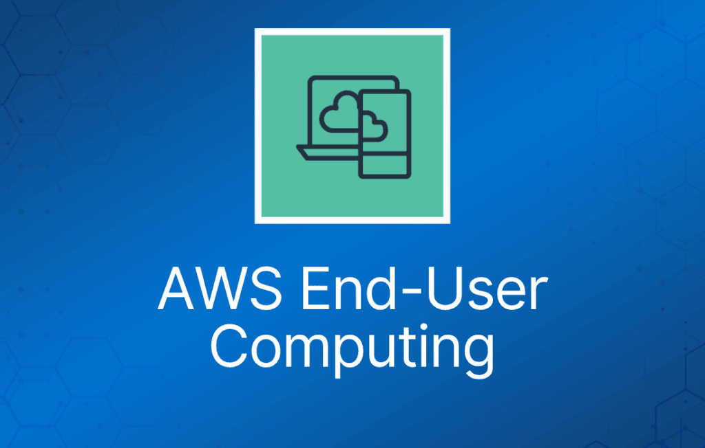

AWS End-User Computing 服务使员工能够从各种受支持的设备安全地访问桌面和应用。使用场景包括远程办公团队、临时员工团队和呼叫中心坐席。

## AWS Workspaces

Amazon WorkSpaces 是一种托管的、安全的 Desktop-as-a-Service（DaaS）解决方案。

你可以使用 Amazon WorkSpaces 在几分钟内预置 Windows 或 Linux 桌面，并快速扩展，为全球员工提供数千个桌面。

你可以按月或按小时付费，只为启动的 WorkSpaces 付费，与传统桌面和本地 VDI 解决方案相比可以节省成本。

Amazon WorkSpaces 帮助你消除管理硬件库存、操作系统版本和补丁以及 Virtual Desktop Infrastructure（VDI）的复杂性，从而简化桌面交付策略。

借助 Amazon WorkSpaces，用户可以获得快速、响应灵敏的桌面，随时随地从任何受支持的设备访问。

## Amazon AppStream 2.0

Amazon AppStream 2.0 是一种全托管的非持久化应用和桌面流式传输服务。

你在 AppStream 2.0 上集中管理桌面应用，并将其安全地交付到任何计算机。

你可以轻松扩展到全球任意数量的用户，而无需采购、预置和运维硬件或基础设施。AppStream 2.0 构建在 AWS 之上，因此你可以受益于为安全要求最高的组织设计的数据中心和网络架构。

每位最终用户都能获得流畅、响应灵敏的体验，因为你的应用运行在针对特定使用场景优化的虚拟机上，并且每个流式会话会自动适应网络状况。
