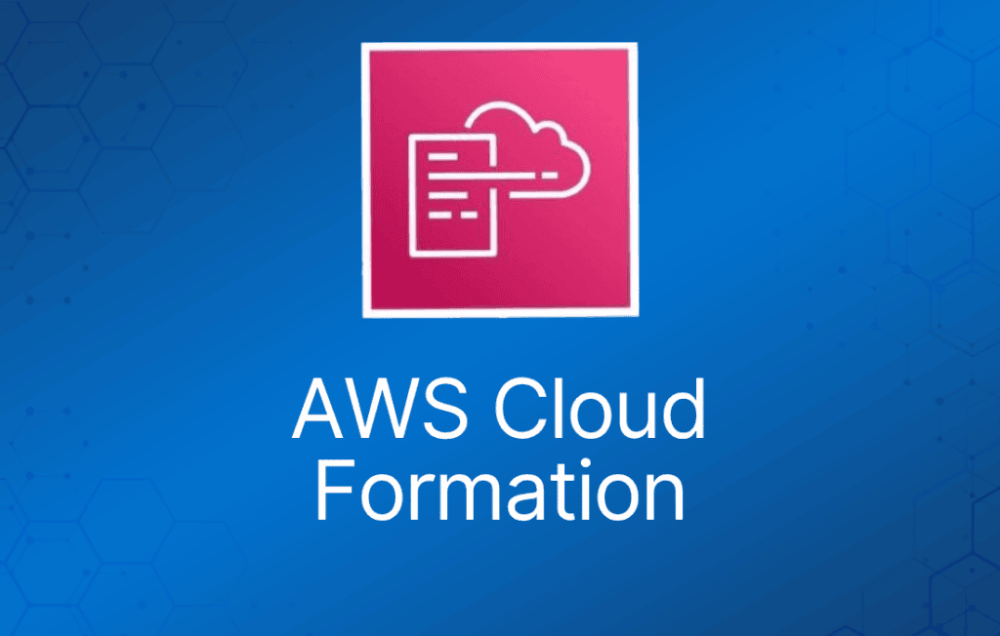

AWS CloudFormation 是一项让你以代码形式（Infrastructure as Code）管理、配置和预置 AWS 基础设施的服务。

AWS CloudFormation 提供了一种通用语言，用于描述和预置云环境中的所有基础设施资源。

资源通过 CloudFormation 模板（template）来定义。

CloudFormation 解析模板，并发起相应的 API 调用来创建你定义的资源。

支持 YAML 或 JSON 格式。

CloudFormation 可用于预置范围广泛的 AWS 资源。

可以把 CloudFormation 理解为以代码方式部署基础设施。

CloudFormation 与 AWS Elastic Beanstalk 有一些相似之处，但两者也有明显区别，详见下表：

|  |  |
| --- | --- |
| **CloudFormation** | **Elastic Beanstalk** |
| “模板驱动的资源预置” | “让 Web 应用部署变简单” |
| 使用代码部署基础设施 | 在 EC2 上部署应用（PaaS） |
| 几乎可部署任何 AWS 服务 | 部署基于 Java、.NET、PHP、Node.js、Python、Ruby、Go 和 Docker 的 Web 应用 |
| 使用 JSON 或 YAML 模板文件 | 使用 ZIP 或 WAR 文件 |
| 类似 Terraform | 类似 Google App Engine |

## 主要优势

基础设施以一致的方式预置，减少（人为）错误。

相比手动配置资源，节省时间和精力。

CloudFormation 模板可以使用版本控制和同行评审（peer review）。

免费使用（只对预置的资源收费）。

可用于管理更新和依赖关系。

也可以用于回滚和删除整个 stack。

## 核心概念

下表介绍与 AWS CloudFormation 相关的核心概念：

|  |  |
| --- | --- |
| **组件** | **说明** |
| Templates（模板） | 包含构建 AWS 环境指令的 JSON 或 YAML 文本文件 |
| Stacks（堆栈） | 由模板描述的整个环境，作为单个单元进行创建、更新和删除 |
| StackSets | AWS CloudFormation StackSets 扩展了 stack 的功能，让你能够通过单次操作跨多个账户和区域创建、更新或删除 stack |
| Change Sets（变更集） | 对 stack 拟做变更的摘要，让你在实施之前看到这些变更可能对现有资源产生的影响 |
| Templates（模板） | 包含构建 AWS 环境指令的 JSON 或 YAML 文本文件 |

## 模板（Templates）

模板是用于描述你要预置或变更的基础设施最终状态的 YAML 或 JSON 文件。

创建模板后，可以直接上传到 CloudFormation，或通过 Amazon S3 上传。

CloudFormation 读取模板并代替你发起 API 调用。

最终创建出来的资源集合称为一个“Stack”。

逻辑 ID（Logical ID）用于在模板内部引用资源。

物理 ID（Physical ID）用于在 AWS CloudFormation 模板之外标识资源，但只有在资源创建之后才存在。

### 模板元素

必需项：

- 资源列表及相关的配置值。

非必需项：

- 模板参数（上限 60 个）。
- 输出值（上限 60 个）。
- 数据表列表。

### 模板组成部分

**Resources** —— *必需的* Resources 段声明你想包含在 stack 中的 AWS 资源，例如 Amazon EC2 实例或 Amazon S3 bucket。

- 必需。
- 表示将要创建的 AWS 组件。
- 资源声明后可以互相引用。

下面的 YAML 示例将一台 EC2 实例声明为资源：

```
 Resources:
  MyEC2Instance:
    Type: "AWS::EC2::Instance"
    Properties:
      ImageId: "ami-0ff8a91507f77f867"
```

### 参数（Parameters）

使用*可选的* Parameters 段来自定义模板。参数让你在每次创建或更新 stack 时向模板传入自定义值。

- 为 CloudFormation 模板提供输入。
- 有利于模板复用。

下面的示例声明了一个名为 InstanceTypeParameter 的参数。该参数让你在创建或更新 stack 时指定要使用的 Amazon EC2 实例类型。

***注意：****InstanceTypeParameter 的默认值是 t2.micro。除非提供其他值，否则 AWS CloudFormation 会使用该值来预置 stack。*

```
Parameters: 
  InstanceTypeParameter: 
    Type: String
    Default: t2.micro
    AllowedValues: 
      - t2.micro
      - m1.small
      - m1.large
    Description: Enter t2.micro, m1.small, or m1.large. Default is t2.micro.
```

### 伪参数（Pseudo Parameters）

伪参数是由 AWS CloudFormation 预定义的参数，无需在模板中声明。用法与普通参数相同，可作为 Ref 函数的参数。

例如：

- AWS::AccountId —— 返回正在创建 stack 的 AWS 账户 ID。
- AWS::NotificationARNs —— 返回当前 stack 的通知 Amazon Resource Name（ARN）列表。
- AWS::Region —— 返回表示当前资源所在 AWS 区域的字符串。
- AWS::StackId —— 返回通过 aws cloudformation create-stack 命令指定的 stack ID。

### 映射（Mappings）

*可选的* Mappings 段将键映射到一组对应的命名值。

- 固定变量。
- 适合区分不同区域、环境、AMI 等。
- 需要提前知道这些值。
- 对于用户特定的值，请改用参数（Parameters）。

下面的示例以区域为键，映射到两组值：一组名为 HVM64，另一组名为 HVMG2。

```
RegionMap:

    us-east-1:

      HVM64: ami-0ff8a91507f77f867

      HVMG2: ami-0a584ac55a7631c0c

    us-west-1:

      HVM64: ami-0bdb828fd58c52235

      HVMG2: ami-066ee5fd4a9ef77f1
```

***考试提示：****使用映射时，你可以根据区域设置值。例如创建一个以区域名为键的映射，包含你想为每个特定区域指定的值。*

### 输出（Outputs）

*可选的* Outputs 段声明输出值，这些值可以被导入到其他 stack（用于创建跨 stack 引用）、在响应中返回（用于描述 stack 调用），或在 AWS CloudFormation 控制台中查看。

- 输出可以被导入到其他 stack。
- 可以在控制台或使用 AWS CLI 查看输出。
- 如果一个 Stack 的输出被另一个 CloudFormation Stack 引用，则无法删除该 Stack。

在下面的 YAML 示例中，名为 StackVPC 的输出返回一个 VPC 的 ID，然后以 stack 名称加上 VPCID 后缀作为名称导出该值，供跨 stack 引用：

```
Outputs:

  StackVPC:

    Description: The ID of the VPC

    Value: !Ref MyVPC

    Export:

      Name: !Sub "${AWS::StackName}-VPCID"
```

### 条件（Conditions）

*可选的* Conditions 段包含一些语句，用于定义在什么情况下创建或配置实体。

- 根据条件控制资源的创建。
- 可应用于资源和输出。

在下面的 YAML 示例中，只有当 EnvType 参数等于 prod 时才会创建资源：

```
Conditions:

  CreateProdResources: !Equals [ !Ref EnvType, prod ]
```

### 转换（Transform）

可选的 Transform 段指定一个或多个宏（macro），AWS CloudFormation 用它们来处理你的模板。

Transform 段可用于引用存储在 S3 中的额外代码，例如 Lambda 代码或可复用的 CloudFormation 代码片段。

AWS::Serverless 转换是由 AWS CloudFormation 托管的宏，它接收用 AWS Serverless Application Model（AWS SAM）语法编写的整个模板，并将其转换、展开为合规的 AWS CloudFormation 模板。

在下面的示例中，模板使用 AWS SAM 语法简化了 Lambda 函数及其执行角色的声明：

```
Transform: AWS::Serverless-2016-10-31

Resources:

  MyServerlessFunctionLogicalID:

    Type: AWS::Serverless::Function

    Properties:

      Handler: index.handler

      Runtime: nodejs8.10

      CodeUri: 's3://testBucket/mySourceCode.zip'
```

### 内置函数（Intrinsic Functions）

AWS CloudFormation 提供了若干内置函数，帮助你管理 stack。在模板中使用内置函数，可以为那些直到运行时才可知的属性赋值。

***考试提示：****至少要掌握下面列出的内置函数。完整列表见：https://docs.aws.amazon.com/AWSCloudFormation/latest/UserGuide/intrinsic-function-reference.html*

**Ref**

- Fn::Ref（YAML 中写作 !Ref）。
- 内置函数 Ref 返回指定参数或资源的值。
- 指定参数的逻辑名时，返回该参数的值。
- 指定资源的逻辑名时，返回通常可用于引用该资源的值，例如物理 ID。

下面对 Elastic IP 地址的资源声明需要一个 EC2 实例的实例 ID，并使用 Ref 函数来指定 MyEC2Instance 资源的实例 ID：

```
MyEIP:

  Type: "AWS::EC2::EIP"

  Properties:

    InstanceId: !Ref MyEC2Instance
```

**Fn::GetAtt**

- Fn::GetAtt 内置函数返回模板中某个资源的属性值。
- 完整语法（YAML）：Fn::GetAtt: [ logicalNameOfResource, attributeName ]
- 简写形式（YAML）：!GetAtt logicalNameOfResource.attributeName

下面的示例模板返回逻辑名为 myELB 的负载均衡器的 SourceSecurityGroup.OwnerAlias 和 SourceSecurityGroup.GroupName。

```
AWSTemplateFormatVersion: 2010-09-09

Resources:

  myELB:

    Type: AWS::ElasticLoadBalancing::LoadBalancer

    Properties:

      AvailabilityZones:

        - eu-west-1a

      Listeners:

        - LoadBalancerPort: '80'

          InstancePort: '80'

          Protocol: HTTP

  myELBIngressGroup:

    Type: AWS::EC2::SecurityGroup

    Properties:

      GroupDescription: ELB ingress group

      SecurityGroupIngress:

        - IpProtocol: tcp

          FromPort: '80'

          ToPort: '80'

          SourceSecurityGroupOwnerId: !GetAtt myELB.SourceSecurityGroup.OwnerAlias

          SourceSecurityGroupName: !GetAtt myELB.SourceSecurityGroup.GroupName
```

**Fn::FindInMap**

- 内置函数 Fn::FindInMap 返回在 Mappings 段中声明的两级映射中对应键的值。
- 完整语法（YAML）：Fn::FindInMap: [ MapName, TopLevelKey, SecondLevelKey ]
- 简写形式（YAML）：!FindInMap [ MapName, TopLevelKey, SecondLevelKey ]

下面的示例展示了如何在一个模板中使用 Fn::FindInMap：该模板的 Mappings 段包含一个名为 RegionMap 的映射，将 AMI 与 AWS 区域关联起来：

```
Mappings:

  RegionMap:

    us-east-1:

      HVM64: "ami-0ff8a91507f77f867"

      HVMG2: "ami-0a584ac55a7631c0c"

    us-west-1:

      HVM64: "ami-0bdb828fd58c52235"

      HVMG2: "ami-066ee5fd4a9ef77f1"

Resources:

  myEC2Instance:

    Type: "AWS::EC2::Instance"

    Properties:

      ImageId: !FindInMap

        - RegionMap

        - !Ref 'AWS::Region'

        - HVM64

      InstanceType: m1.small
```

**Fn::ImportValue**

- 内置函数 Fn::ImportValue 返回由另一个 stack 导出的输出值。
- 通常用该函数创建跨 stack 引用。

```
Fn::ImportValue:

  !Sub "$-SecurityGroupID"
```

**Fn::Join**

- 完整语法（YAML）：Fn::Join: [ delimiter, [ comma-delimited list of values ] ]
- 简写形式（YAML）：!Join [ delimiter, [ comma-delimited list of values ] ]

下面的示例使用 Fn::Join 构造一个字符串值，其中用 Ref 函数引用了 Partition 参数和 AWS::AccountId 伪参数。

```
!Join

  - ''

  - - 'arn:'

    - !Ref Partition

    - ':s3:::elasticbeanstalk-*-'

    - !Ref 'AWS::AccountId'
```

**Fn::Sub**

- 内置函数 Fn::Sub 将输入字符串中的变量替换为你指定的值。
- 在模板中，可以用该函数构造命令或输出，其中包含直到创建或更新 stack 时才可知的值。

下面的示例使用映射，将 $ 变量替换为 Ref 函数返回的值：

```
Name: !Sub

  - www.$

  - { Domain: !Ref RootDomainName }
```

## Stack 与 Stack Set

### Stack

基于模板部署的资源集合。

使用模板创建、更新和删除 stack。

可通过 Management Console、CLI 或 API 部署。

Stack 创建出错时：

- 出错自动回滚默认开启。
- 即使出错，已预置的资源仍会收费。

更新 stack：

- AWS CloudFormation 提供两种更新 stack 的方式：直接更新（direct update），或创建并执行变更集（change set）。
- 直接更新 stack 时，你提交变更，AWS CloudFormation 会立即部署。
- 想快速部署更新时使用直接更新。
- 使用变更集时，你可以预览 AWS CloudFormation 将对 stack 做的变更，然后再决定是否应用。

### Stack Set

AWS CloudFormation StackSets 扩展了 stack 的功能，让你能够通过单次操作跨多个账户和区域创建、更新或删除 stack。

使用管理员账户定义和管理一个 AWS CloudFormation 模板，并以该模板为基础，在指定区域的选定目标账户中预置 stack。

管理员账户（administrator account）是你创建 stack set 的 AWS 账户。

stack set 通过登录创建它的 AWS 管理员账户来管理。

目标账户（target account）是你在其中创建、更新或删除 stack set 中一个或多个 stack 的账户。

在使用 stack set 向目标账户创建 stack 之前，必须在管理员账户和目标账户之间建立信任关系（trust relationship）。

### 嵌套 Stack（Nested Stacks）

嵌套 stack 允许对常见场景的 CloudFormation 代码进行复用。

例如负载均衡器、Web 服务器、应用服务器等的标准配置。

不必每次复制代码，而是为每个常见场景创建一个标准模板，然后在你的 CloudFormation 模板中引用它。

## 最佳实践

AWS 提供了 Python“辅助脚本（helper scripts）”，可帮助你在 EC2 实例上安装软件和启动服务。

- 通过 CloudFormation 对环境做变更，而不是直接操作资源。
- 使用变更集（Change Set）识别更新中的潜在问题点。
- 使用 Stack Policy 明确保护 stack 中的敏感部分。
- 使用 CodeCommit 或 GitHub 等版本控制系统跟踪模板变更。

## Serverless Application Model（SAM）

使用 SAM 通过 CloudFormation 部署无服务器（serverless）应用。

SAM 是 CloudFormation 的扩展，用于定义无服务器应用。

用简化的语法定义无服务器资源：API、Lambda 函数、DynamoDB 表等。

使用 SAM CLI 打包部署代码、上传到 S3 并部署你的无服务器应用。

## EC2 的 User Data

User data 可以包含在 CloudFormation 中。

脚本通过 Fn::Base64 传入。

user data 脚本日志存储在 /var/log/cloud-init-output.log。

在 Amazon EC2 上，二进制文件位于 /opt/aws/bin/cfn-init。

## CloudFormation 辅助脚本

cfn-init：

- cfn-init 辅助脚本读取 AWS::CloudFormation::Init 键中的模板元数据，并据此执行以下操作：
- 从 AWS CloudFormation 获取并解析元数据
- 安装软件包
- 向磁盘写入文件
- 启用/禁用、启动/停止服务
- cfn-init 不需要凭证，因此无需使用 –access-key、–secret-key、–role 或 –credential-file 选项。
- 日志输出到 /var/log/cfn-init.log

cfn-signal：

- cfn-signal 辅助脚本向 AWS CloudFormation 发送信号，表明 Amazon EC2 实例是否已成功创建或更新。
- 如果你在实例上安装并配置了软件，可以在软件就绪时向 AWS CloudFormation 发送信号。
- cfn-signal 脚本通常与 [**CreationPolicy**](https://docs.aws.amazon.com/AWSCloudFormation/latest/UserGuide/aws-attribute-creationpolicy.html) 或带有 [**WaitOnResourceSignals**](https://docs.aws.amazon.com/AWSCloudFormation/latest/UserGuide/aws-attribute-updatepolicy.html) 更新策略的 Auto Scaling 组配合使用。
- 当 AWS CloudFormation 使用这些策略创建或更新资源时，会暂停 stack 的工作，直到资源收到所需数量的信号或超过超时时间。
- 你可以向创建策略（[**CreationPolicy**](https://docs.aws.amazon.com/AWSCloudFormation/latest/UserGuide/aws-attribute-creationpolicy.html)）或等待条件句柄（[**WaitOnResourceSignals**](https://docs.aws.amazon.com/AWSCloudFormation/latest/UserGuide/aws-attribute-updatepolicy.html)）发送信号。

错误排查：

- 确保 AMI 中包含 CloudFormation 辅助脚本。
- 检查 cfn-init 和 cfn-signal 命令是否已成功运行。
- 验证互联网连通性。

## 创建策略与等待条件（Creation Policies and Wait Conditions）

- CreationPolicy 属性：
- 当你希望在 stack 创建继续之前等待资源配置操作完成时，使用 CreationPolicy 属性。
- 可以将 CreationPolicy 属性与资源关联，防止其状态在 AWS CloudFormation 收到指定数量的成功信号或超时之前变为 create complete。
- 要向资源发送信号，可以使用 [**cfn-signal**](https://docs.aws.amazon.com/AWSCloudFormation/latest/UserGuide/cfn-signal.html) 辅助脚本或 [**SignalResource**](https://docs.aws.amazon.com/AWSCloudFormation/latest/APIReference/API_SignalResource.html) API。
- AWS CloudFormation 会将有效信号发布到 stack 事件中，方便你跟踪已发送的信号数量。

以下 CloudFormation 资源支持创建策略：

- [**AWS::AutoScaling::AutoScalingGroup**](https://docs.aws.amazon.com/AWSCloudFormation/latest/UserGuide/aws-properties-as-group.html)
- [**AWS::EC2::Instance**](https://docs.aws.amazon.com/AWSCloudFormation/latest/UserGuide/aws-properties-ec2-instance.html)
- [**AWS::CloudFormation::WaitCondition**](https://docs.aws.amazon.com/AWSCloudFormation/latest/UserGuide/aws-properties-waitcondition.html)

DeletionPolicy 属性：

- 使用 DeletionPolicy 属性，可以在 stack 被删除时保留资源或（在某些情况下）备份资源。
- 为每个你想控制的资源指定 DeletionPolicy 属性。
- 如果资源没有 DeletionPolicy 属性，AWS CloudFormation 默认会删除该资源。

DependsOn 属性：

- 使用 DependsOn 属性，可以指定某个资源必须在另一个资源之后创建。
- 给资源添加 DependsOn 属性后，该资源只有在 DependsOn 指定的资源创建完成后才会被创建。

WaitCondition：

- 注意：对于 Amazon EC2 和 Auto Scaling 资源，AWS 建议使用 CreationPolicy 属性而不是等待条件。
- 等待条件适用于以下场景：
- 将 stack 资源创建与 stack 创建之外的配置操作进行协调。
- 跟踪配置过程的状态。

UpdatePolicy 属性（WaitOnResourceSignals）

使用 UpdatePolicy 属性指定 AWS CloudFormation 如何处理以下资源的更新：

- [**AWS::AutoScaling::AutoScalingGroup**](https://docs.aws.amazon.com/AWSCloudFormation/latest/UserGuide/aws-properties-as-group.html)，
- [**AWS::ElastiCache::ReplicationGroup**](https://docs.aws.amazon.com/AWSCloudFormation/latest/UserGuide/aws-resource-elasticache-replicationgroup)
- [**AWS::Elasticsearch::Domain**](https://docs.aws.amazon.com/AWSCloudFormation/latest/UserGuide/aws-resource-elasticsearch-domain.html)
- [**AWS::Lambda::Alias**](https://docs.aws.amazon.com/AWSCloudFormation/latest/UserGuide/aws-resource-lambda-alias.html)

UpdateReplacePolicy 属性：

- 使用 UpdateReplacePolicy 属性，可以在 stack 更新操作期间资源被替换时，保留或（在某些情况下）备份资源的现有物理实例。

## 回滚与创建失败

[**Stack 创建失败**](https://docs.aws.amazon.com/AWSCloudFormation/latest/UserGuide/troubleshooting.html)：

- 默认情况下所有内容都会被删除。
- 可以选择禁用回滚（便于排查失败原因）。

Stack 更新失败：

- stack 会自动回滚到上一个已知的正常状态。
- 日志可以帮助你理解发生了什么问题。

## 监控与报告

你可以通过查看 stack 事件来监控 stack 更新的进度。控制台的 **Events** 标签页按事件时间排序显示 stack 创建和更新过程中的每个主要步骤，最新的事件排在最上面。

对于由 CloudFormation 创建的资源，使用适用于对应服务的 AWS 监控和报告工具。

## 授权与访问控制

你可以将 IAM 与 AWS CloudFormation 结合使用，控制用户对 AWS CloudFormation 可以执行的操作，例如是否可以查看 stack 模板、创建 stack 或删除 stack。

除了 AWS CloudFormation 的操作外，你还可以管理每个用户可以使用哪些 AWS 服务和资源。

这样，你就可以控制用户在使用 AWS CloudFormation 时能访问哪些资源。

例如，你可以指定哪些用户可以创建 Amazon EC2 实例、终止数据库实例或更新 VPC。当他们通过 AWS CloudFormation 执行这些操作时，会应用相同的权限。

## 计费

AWS CloudFormation 本身不额外收费。

通过 AWS CloudFormation 创建的 AWS 资源（如 Amazon EC2 实例、Elastic Load Balancing 负载均衡器等）按你手动创建时相同的方式计费。

你只需按实际用量付费；没有最低费用，也不需要预付款承诺。

## 代码片段

<https://docs.aws.amazon.com/AWSCloudFormation/latest/UserGuide/CHAP_TemplateQuickRef.html>
