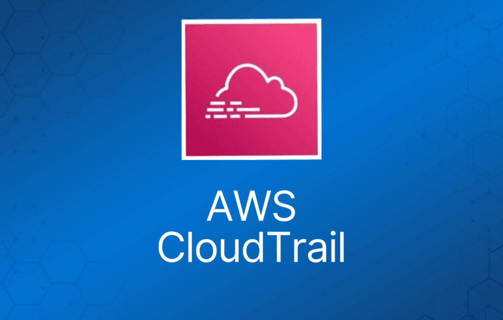

AWS CloudTrail 是一项记录你账户上所发生操作的 Web 服务。

你可以创建一个 CloudTrail trail，将日志文件投递到 Amazon S3 bucket。

CloudTrail 的核心是日志记录，它会保存你 AWS 账户的 API 调用历史。

CloudTrail 让你能够对 AWS 账户进行治理、合规检查以及运营和风险审计。

记录的事件包括在 AWS Management Console、AWS Command Line Interface 以及 AWS SDK 和 API 中执行的操作。

CloudTrail 通过记录账户上执行的操作，让你可以看清用户活动。

API 历史记录可用于安全分析、资源变更跟踪和合规审计。

记录通过以下方式发起的 API 调用：

- AWS Management Console。
- AWS SDK。
- 命令行工具。
- 更上层的 AWS 服务（如 CloudFormation）。

CloudTrail 记录来自大多数 AWS 服务的账户活动和服务事件，日志中包含以下记录：

- API 调用者的身份。
- API 调用的时间。
- API 调用者的来源 IP 地址。
- 请求参数。
- AWS 服务返回的响应元素。

创建 AWS 账户时，CloudTrail 默认已在账户上启用。

CloudTrail 是按 AWS 账户划分的。

你可以为一个 AWS 账户创建两种类型的 trail：

- 应用于所有区域的 trail —— 记录所有区域的事件，并投递到一个 S3 bucket。
- 应用于单个区域的 trail —— 记录单个区域的事件，并投递到一个 S3 bucket。额外的单区域 trail 可以使用同一个或不同的 S3 bucket。

trail 可以配置为记录数据事件（data events）和管理事件（management events）：

- **数据事件（Data events）：**这类事件让你了解在资源上或资源内部执行的资源操作，也称为数据面（data plane）操作。
- **管理事件（Management events）：**管理事件让你了解在 AWS 账户中对资源执行的管理操作，也称为控制面（control plane）操作。管理事件还可以包括账户中发生的非 API 事件。

数据事件示例：

- Amazon S3 对象级 API 活动（例如 GetObject、DeleteObject 和 PutObject 等 API 操作）。
- AWS Lambda 函数执行活动（Invoke API）。

管理事件示例：

- 配置安全（例如 IAM AttachRolePolicy API 操作）。
- 注册设备（例如 Amazon EC2 CreateDefaultVpc API 操作）。
- 配置数据路由规则（例如 Amazon EC2 CreateSubnet API 操作）。
- 设置日志记录（例如 AWS CloudTrail CreateTrail API 操作）。
- CloudTrail 日志文件使用 S3 服务器端加密（SSE）进行加密。

你还可以启用 SSE KMS 加密以获得更高的安全性。

对于应用于所有区域的 trail，可以使用同一个 KMS key 来加密其日志文件。

你可以使用一个 S3 bucket 汇总多个账户的日志：

1. 在付款账户（payer account）中开启 CloudTrail。
2. 创建一个允许跨账户访问的 bucket policy。
3. 在其他账户中开启 CloudTrail，并使用付款账户中的那个 bucket。

你可以将 CloudTrail 与 CloudWatch Logs 集成，把 CloudTrail 捕获的数据事件投递到 CloudWatch Logs 的日志流中。

CloudTrail 的日志文件完整性校验功能，可以让你判断某个 CloudTrail 日志文件自投递到指定 Amazon S3 bucket 之后，是否被改动、删除或修改过。

CloudWatch 与 CloudTrail 对比：

|  |  |
| --- | --- |
| **CloudWatch** | **CloudTrail** |
| 性能监控 | 审计 |
| 记录跨 AWS 服务的日志事件——关注运营 | 记录跨 AWS 服务的 API 活动——关注操作行为 |
| 更上层的综合监控与事件 | 更底层、粒度更细 |
| 支持多账户日志 | 支持多账户日志 |
| 日志无限期保存 | 日志无限期保存到 S3 或 CloudWatch |
| 告警历史保留 14 天 | 无原生告警能力，可配合 CloudWatch 告警使用 |
