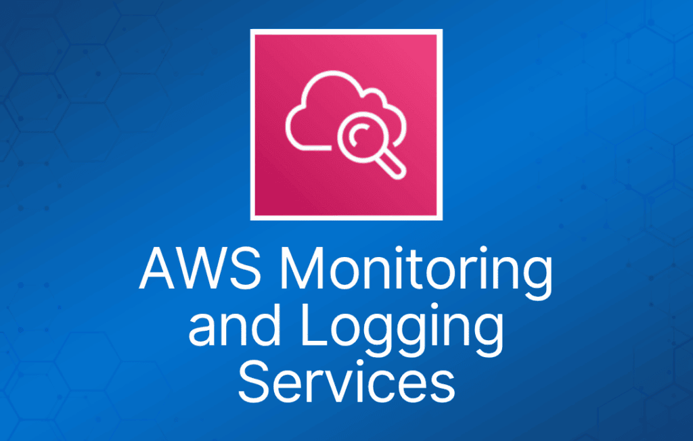

这一类 AWS 服务包括为运行在 AWS 上的应用程序提供日志记录、监控和审计的服务。

## Amazon CloudWatch

Amazon CloudWatch 是针对 AWS 云资源及你在 AWS 上运行的应用程序的监控服务。

CloudWatch 用于性能监控（CloudTrail 用于审计）。

用于收集和跟踪指标、收集和监控日志文件，以及设置告警。

自动响应 AWS 资源的变化。

可监控的资源包括：

- EC2 实例。
- DynamoDB 表。
- RDS 数据库实例。
- 应用程序和服务生成的自定义指标。
- 应用程序生成的任何日志文件。

获得资源利用率的系统级全局视图。

CloudWatch 监控涵盖应用程序性能。

监控运行健康状况。

CloudWatch 可通过 API、命令行界面、AWS SDK 和 AWS Management Console 访问。

CloudWatch 与 IAM 集成。

Amazon CloudWatch Logs 让你能够使用现有的系统、应用程序和自定义日志文件来监控和排查系统及应用程序问题。

CloudWatch Logs 可用于实时应用程序和系统监控，也可用于长期日志保留。

CloudWatch Logs 默认无限期保留日志。

CloudTrail 日志可以发送到 CloudWatch Logs 进行实时监控。

CloudWatch Logs 指标筛选器可以针对特定术语、短语或值评估 CloudTrail 日志。

CloudWatch 按如下方式保留指标数据：

- 周期小于 60 秒的数据点保留 3 小时。这些数据点是高分辨率自定义指标。
- 周期为 60 秒（1 分钟）的数据点保留 15 天。
- 周期为 300 秒（5 分钟）的数据点保留 63 天。
- 周期为 3600 秒（1 小时）的数据点保留 455 天（15 个月）。

控制面板（Dashboards）允许你创建、自定义、交互并保存 AWS 资源和自定义指标的图表。

告警（Alarms）可用于监控账户中的任何 Amazon CloudWatch 指标。

事件（Events）是描述 AWS 资源变化的系统事件流。

日志（Logs）帮助你聚合、监控和存储日志。

基本监控 = 5 分钟粒度（EC2 实例、EBS 卷、ELB 和 RDS 数据库免费）。

详细监控 = 1 分钟粒度（收费）。

多个 AWS 产品和服务会自动提供指标。

EC2 实例没有内存使用率的标准指标。

自定义指标是你提供给 Amazon CloudWatch 的任何指标（例如网页加载时间或应用程序性能）。

存储日志的选项：

- CloudWatch Logs。
- 集中式日志系统（如 Splunk）。
- 自定义脚本并存储在 S3 上。

不要将日志存储在非持久性磁盘上：

最佳实践是将日志存储在 CloudWatch Logs 或 S3 中。

CloudWatch Logs 订阅可跨多个 AWS 账户使用（使用跨账户访问）。

Amazon CloudWatch 使用 Amazon SNS 发送电子邮件。

## AWS CloudTrail

AWS CloudTrail 是一项 Web 服务，记录账户上的活动并将日志文件传送到 Amazon S3 存储桶。

CloudTrail 用于审计（CloudWatch 用于性能监控）。

CloudTrail 的核心是日志记录，保存 AWS 账户的 API 调用历史。

通过记录账户上执行的操作，提供对用户活动的可见性。

API 历史记录支持安全分析、资源变更跟踪和合规审计。

记录通过以下方式发起的 API 调用：

- AWS Management Console。
- AWS SDK。
- 命令行工具。
- 高级别 AWS 服务（如 CloudFormation）。

CloudTrail 记录来自大多数 AWS 服务的账户活动和服务事件，并记录以下内容：

- API 调用者的身份。
- API 调用的时间。
- API 调用者的源 IP 地址。
- 请求参数。
- AWS 服务返回的响应元素。

CloudTrail 默认启用。

CloudTrail 按 AWS 账户划分。

你可以使用 S3 存储桶整合多个账户的日志：

1. 在付款账户中开启 CloudTrail。
2. 创建允许跨账户访问的存储桶策略。
3. 在其他账户中开启 CloudTrail，并使用付款账户中的存储桶。

你可以将 CloudTrail 与 CloudWatch Logs 集成，将 CloudTrail 捕获的数据事件传送到 CloudWatch Logs 日志流。

CloudTrail 日志文件完整性验证功能让你能够确定 CloudTrail 日志文件在传送到指定 Amazon S3 存储桶后是否被更改、删除或修改。
