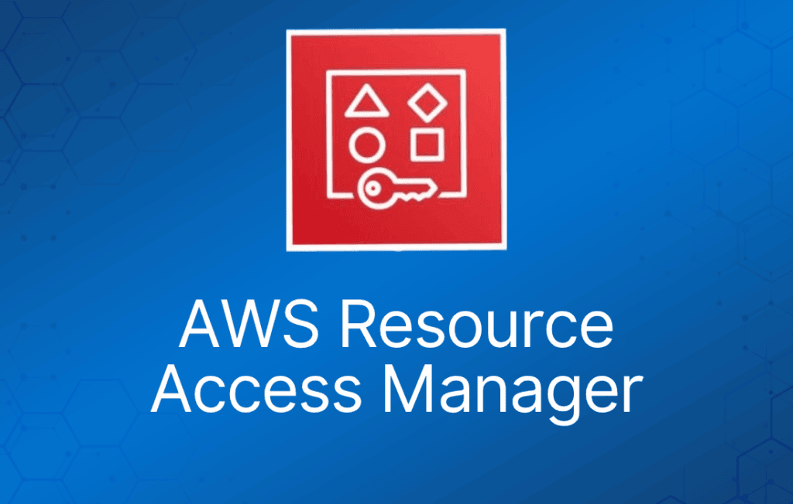

AWS Resource Access Manager (RAM) 是一项让你能够轻松、安全地与任何 AWS 账户或 AWS Organization 内的账户共享 AWS 资源的服务。

你可以使用 RAM 共享 AWS Transit Gateway、subnet、AWS License Manager 配置以及 Amazon Route 53 Resolver 规则等资源。

RAM 让你无需在多个账户中创建重复的资源，减少了在你拥有的每个账户中管理这些资源的运维开销。

你可以在多账户环境中集中创建资源，并通过三个简单的步骤使用 RAM 将这些资源跨账户共享：

1. 创建 Resource Share。
2. 指定资源。
3. 指定账户。

RAM 免费提供，不收取额外费用。

## **核心优势：**

- **降低运维开销 –** 集中开通 AWS 资源，并使用 RAM 将 subnet 或 License Manager 配置等资源与其他账户共享。这样就不用在多账户环境中的每个账户里开通重复的资源。
- **提升安全性与可见性 –** RAM 利用 AWS Identity and Access Management (IAM) 中已有的策略和权限来管控共享资源的使用。RAM 还通过与 Amazon CloudWatch 和 AWS CloudTrail 集成，提供对共享资源的全面可见性，可设置告警并可视化日志。
- **优化成本 –**跨账户共享 AWS License Manager 配置等资源，让你能在公司的多个部门之间复用 license，提高利用率并优化成本。
