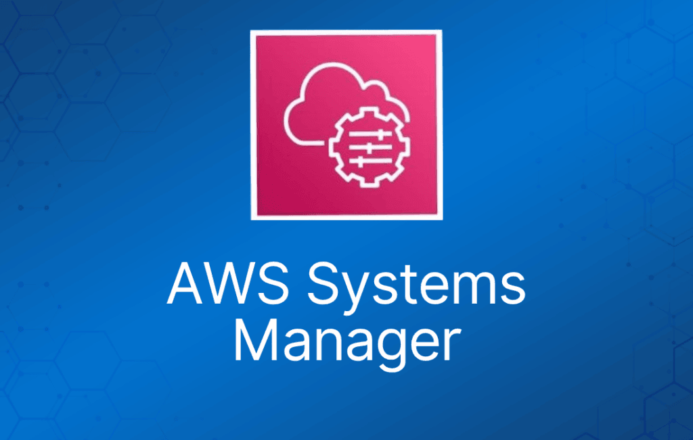

AWS Systems Manager 是一项 AWS 服务，提供对 AWS 上基础设施的可见性和控制能力。

AWS Systems Manager 提供统一的界面，让你可以查看来自多个 AWS 服务的运维数据。

AWS Systems Manager 允许你跨 AWS 资源自动化运维任务。

AWS Systems Manager 曾用名 SSM，是控制和查看整个 AWS 基础设施的中央枢纽。

它可以提升账户内的安全性，并帮助自动化补救任务，确保你的环境尽可能合规。

AWS Systems Manager 是一项强大的服务，让你能够全面查看用于管理和控制 AWS 基础设施的所有服务。

AWS Systems Manager 提供统一的界面，让你可以查看来自多个 AWS 服务的运维数据。

借助 AWS Systems Manager，你可以按应用对资源进行分组，例如 Amazon EC2 实例、Amazon S3 bucket 或 Amazon RDS 实例，查看用于监控和故障排查的运维数据，并对这些资源组执行操作。

借助 AWS Systems Manager，你可以选择一个资源组并查看其近期的 API 活动、资源配置变更、相关通知、运维告警、软件清单和补丁合规状态。

你还可以根据运维需求对每个资源组执行操作。

AWS Systems Manager 简化了资源和应用管理，缩短了发现和解决运维问题的时间，让你能够轻松地大规模安全地运维和管理基础设施。

## Systems Manager 组件

AWS Systems Manager Inventory Manager 自动从托管实例收集软件清单。

你只需指定要收集的元数据类型、从哪些实例收集元数据，以及收集元数据的计划。

AWS Systems Manager 收集有关实例及其实装软件的信息，帮助你了解系统配置和已安装的应用。

收集到的数据让你能够管理应用资产、跟踪 license、监控文件完整性、发现未通过传统安装程序安装的应用等。

#### Configuration Compliance

AWS Systems Manager 让你可以扫描托管实例，检查补丁合规性和配置不一致的情况。

你可以从多个 AWS 账户和区域收集并聚合数据，然后下钻到不合规的具体资源。

默认情况下，AWS Systems Manager 显示有关补丁和关联（association）的数据。你也可以根据自己的需求自定义该服务并创建自己的合规类型。

#### AWS Systems Manager Automation

AWS Systems Manager 让你能够安全地自动化跨 AWS 资源的常见、重复性 IT 运维和管理任务。

借助 Systems Manager，你可以创建指定特定任务列表的 JSON/YAML 文档，也可以使用社区发布的文档。

这些文档可以直接通过 AWS Management Console、CLI 和 SDK 执行，可以安排在维护窗口中执行，也可以通过 Amazon CloudWatch Events 基于 AWS 资源的变更触发。

你可以跟踪文档中每个步骤的执行情况，并要求每个步骤经过审批。

你还可以增量推出变更，并在出现错误时自动停止。

#### AWS Systems Manager Run Command

使用 Run Command，你可以以企业级规模批量自动化常见管理任务并进行一次性配置更改。

这实际上避免了你必须逐台登录实例、数百次重复运行同一条命令。

一切都在控制台中集中管理，提供易用的控制台来管理你的命令，也可以通过 CLI 或 AWS SDK 操作。

任务示例包括：停止、重启、终止和调整实例大小；附加和分离 EBS 卷、创建快照；还可以安装或引导应用、构建部署流水线等。

命令可以基于 AWS 实例标签或手动选择应用到一组系统。

命令和参数在 AWS Systems Manager 文档（document）中定义。

可以使用 AWS 控制台、AWS CLI、AWS Tools for Windows PowerShell、AWS Systems Manager API 或 AWS SDK 发出命令。

#### AWS Systems Manager Session Manager

AWS Systems Manager 提供安全、受控的实例远程管理能力，无需登录服务器即可大规模管理实例，取代了 bastion host、SSH 或远程 PowerShell 的需求。

它提供了一种简单的方式，可以跨实例组自动化常见管理任务，例如注册表编辑、用户管理、软件和补丁安装。

Session Manager 为 Linux 实例提供命令终端，为 Windows 实例提供 Windows PowerShell 终端。

Session Manager 不仅提供完全可审计的终端环境，而且无需开放任何端口即可管理 SSH 会话的访问，大大增强了你的安全态势。你只需为 Session Manager 控制台启用最小权限的 IAM 权限，即可让开发人员最大化效率和效果。

使用 AWS Systems Manager 执行的所有操作都会被 AWS CloudTrail 记录，让你能够审计整个环境中的变更。

CloudTrail 可以拦截 Session Manager 的 StartSession 事件。

与 SSH 相比：

• 无需开放 22 端口。

• 无需 bastion host 进行管理。

• 所有命令都会记录到 S3 / CloudWatch。

• 安全 shell 访问使用 IAM 用户账户进行身份验证，而非 key pair。

#### Incident Manager

你可以在 Incident Manager 控制台中自动化解决方案，让合适的内部资源及时介入。

AWS Chatbot 将指定的聊天频道连接到 AWS Incident Manager，Automation runbook 通过 Incident Manager 为 AWS Systems Manager 执行。

响应人员会通过预定义响应计划中的短信和电话被召集。

通过基于 Amazon 事后分析模板给出行动建议，Incident Manager 帮助你提升服务可靠性。例如，你可以在事件后自动化某个 runbook 步骤或添加新的告警。

#### Systems Manager Patch Manager

Patch Manager 实现 EC2 实例的自动化补丁。它既包括安全补丁，也包括应用和操作系统的其他补丁。

Patch Manager 使用所谓的 patch baseline，其中包含自动批准补丁和拒绝补丁的规则定义。通过在 Systems Manager 中将补丁任务安排为维护窗口任务，你可以轻松地定期安装补丁。

了解 Systems Manager 托管节点队列中服务器的状态，对于让应用和服务器工作负载保持合规和安全至关重要。

端到端的流程包括获取托管 Systems Manager 节点（本地、EC2 等）的元数据。无论你是在云端还是本地使用 Systems Manager，都要将这些元数据存储在集中式存储库（S3 bucket）中。之后你可以使用原生工具查询元数据，从多个维度洞察节点的趋势。

这种元数据聚合可以跨多个区域和多个账户集中在一处，对该子服务的访问权限可以通过 IAM 以及 AWS Organizations 的 Service Control Policy 进行细粒度分配。

#### AWS Systems Manager Parameter Store

AWS Systems Manager 提供集中式存储来管理你的配置数据，无论是数据库字符串之类的明文数据，还是密码之类的密钥。

这让你能够将密钥和配置数据与代码分离。参数可以打标签并组织成层级结构，帮助你更轻松地管理参数。

例如，你可以使用相同的参数名 "db-string"，配合不同的层级路径 "dev/db-string" 或 "prod/db-string" 来存储不同的值。

AWS Systems Manager 与 AWS Key Management Service (KMS) 集成，让你可以自动加密存储的数据。

你可以以一种无需管理任何服务器的方式存储这些密钥，让整个过程更加轻松。

如果你的数据也与代码分离，你在安全性上会处于更有利的位置，因为实现了隔离。

你还可以使用 AWS Identity and Access Management (IAM) 控制用户和资源对参数的访问。

参数可以被其他 AWS 服务引用，例如 Amazon Elastic Container Service、AWS Lambda 和 AWS CloudFormation。

#### AWS Systems Manager Distributor

Distributor 是 AWS Systems Manager 的一项功能，让你能够在组织中安全地存储和分发软件包。

你可以将 Distributor 与 Run Command、State Manager 等现有 Systems Manager 功能结合使用，控制实例上运行的软件包的生命周期。

#### AWS Systems Manager State Manager

如果你需要管理 AWS EC2 资源的状态，AWS Systems Manager State Manager 让你能够将实例保持在你希望的任何状态。

使用 Systems Manager State Manager 有三个步骤：

1. 决定要应用到资源的状态

2. 你也许可以使用预配置的 SSM 文档为 AWS 资源创建所需的状态——你需要确认这一点。

3. 然后在实例和你定义的状态之间创建关联（association）。

你可以随时查询 AWS Systems Manager 查看实例配置的状态，按需了解你的合规状态。

#### AWS Systems Manager OpsCenter

如果你遇到与 AWS 资源相关的运维问题——可以使用 OpsCenter，它提供一个中心位置，运维工程师和 IT 专业人员可以在这里查看、调查和解决与 AWS 资源相关的运维工作项（OpsItem）。

#### AWS Systems Manager Maintenance Windows

AWS Systems Manager 让你能够安排时间窗口，跨实例运行管理和维护任务。

这确保你可以选择一个方便且安全的时间来安装补丁和更新或进行其他配置变更，从而提高服务和应用的可用性和可靠性。

#### AWS Systems Manager Resource Groups

你可以使用 resource group 来组织 AWS 资源。Resource group 让你可以轻松地一次性管理、监控大量资源并对其自动化任务。

AWS Resource Groups 提供两种定义资源组的通用方法。两种方法都通过查询来确定组的成员。

第一种方法依赖于应用到 AWS 资源的标签。使用这种方法，你为账户中各种类型的资源应用相同的键/值对标签，然后使用 AWS Resource Groups 服务基于该标签对创建分组。

第二种方法基于单个 AWS CloudFormation 堆栈中的资源。使用这种方法，你选择一个 AWS CloudFormation 堆栈，然后选择堆栈中希望加入分组的资源类型。

AWS Systems Manager Resource Groups 允许创建资源的逻辑分组，你可以对这些分组执行操作（例如打补丁）。

Resource group 是区域级别的。

#### Systems Manager 文档（Document）

AWS Systems Manager 文档（SSM document）定义了 Systems Manager 在托管实例上执行的操作。

Systems Manager 包含十几个预配置文档，你可以通过在运行时指定参数来使用它们。

文档使用 JSON 或 YAML 格式，包含你指定的步骤和参数。

## 监控与报告

#### Insights Dashboard

AWS Systems Manager 通过仪表盘自动聚合和展示每个资源组的运维数据。

Systems Manager 让你无需在多个 AWS 控制台之间来回切换即可查看运维数据。

借助 Systems Manager，你可以按资源组查看来自 AWS CloudTrail 的 API 调用日志、来自 AWS Config 的资源配置变更、软件清单和补丁合规状态。

你还可以轻松地将 AWS CloudWatch Dashboard、AWS Trusted Advisor 通知以及 AWS Personal Health Dashboard 的性能和可用性告警集成到 Systems Manager 仪表盘中。

Systems Manager 集中了所有相关的运维数据，让你能够清晰地了解基础设施的合规性和性能。

#### Amazon CloudWatch

你可以配置并使用 Amazon CloudWatch agent 从实例收集指标和日志，而不必使用 SSM Agent 完成这些任务。CloudWatch agent 能让你在 EC2 实例上收集比 SSM Agent 更多的指标。此外，你还可以使用 CloudWatch agent 从本地服务器收集指标。

#### 日志与审计

Systems Manager 与 AWS CloudTrail 集成，CloudTrail 记录了用户、角色或 AWS 服务在 Systems Manager 中执行的操作。CloudTrail 将 Systems Manager 的所有 API 调用捕获为事件，包括来自 Systems Manager 控制台的调用和代码对 Systems Manager API 的调用。

SSM Agent 将有关执行、命令、计划操作、错误和健康状态的信息写入每个实例上的日志文件。你可以手动连接到实例查看日志文件，也可以自动将日志发送到 Amazon CloudWatch Logs。

## 授权与访问控制

AWS Systems Manager 支持 identity-based policy。

AWS Systems Manager 不支持 resource-based policy。

你可以为 Systems Manager 资源附加标签，或在向 Systems Manager 发起的请求中传递标签。

要基于标签控制访问，可以在策略的 condition 元素中使用 ssm:resourceTag/key-name、aws:ResourceTag/key-name、aws:RequestTag/key-name 或 aws:TagKeys 条件键提供标签信息。

## AWS Systems Manager 定价

Systems Manager 中的大多数组件不收费，你只需为作为 Systems Manager 服务一部分管理的资源付费。

但也有一些例外——OpsCenter 和 Parameter Store 会收取少量费用。

OpsCenter 定价如下：

|  |  |
| --- | --- |
| **OpsCenter 详情** | **定价** |
| OpsItem 数量 | 每 1,000 个 OpsItem $2.97 |
| Get、Describe、Update 和 GetOpsSummary API 请求 | 每 1,000 次请求 $0.039 |
|  |  |

Parameter Store 定价如下：

|  |  |
| --- | --- |
| **参数类型** | **定价** |
| Standard | 不额外收费 |
| Advanced | 每个 advanced 参数每月 $0.05（存储不足一个月时按小时折算） |

## AWS Systems Manager 常见问题

• 谁应该使用 Systems Manager？

如果你在多个账户中使用了许多不同的服务，并希望深入了解 AWS 资源的运维状况，可以使用 Systems Manager。如果你是 SysOps 管理员，使用 Systems Manager 会受益匪浅。

• Systems Manager 支持哪些操作系统？

Systems Manager 同时支持 Linux 和 Windows 操作系统。

• 我可以在哪些区域使用 Systems Manager？

有一份 Systems Manager 区域表（链接在此），你可以用它来确认自己所在的区域。

• 我可以如何使用 Systems Manager？

你可以通过 CLI、SDK 和 AWS 控制台使用 AWS Systems Manager。

感谢你阅读我们对 Systems Manager 的解析，了解这项服务的实用之处。

- 什么是托管实例（managed instance）？

托管实例是指任何可以使用 AWS Systems Manager 管理的本地服务器或 Amazon EC2 实例。
