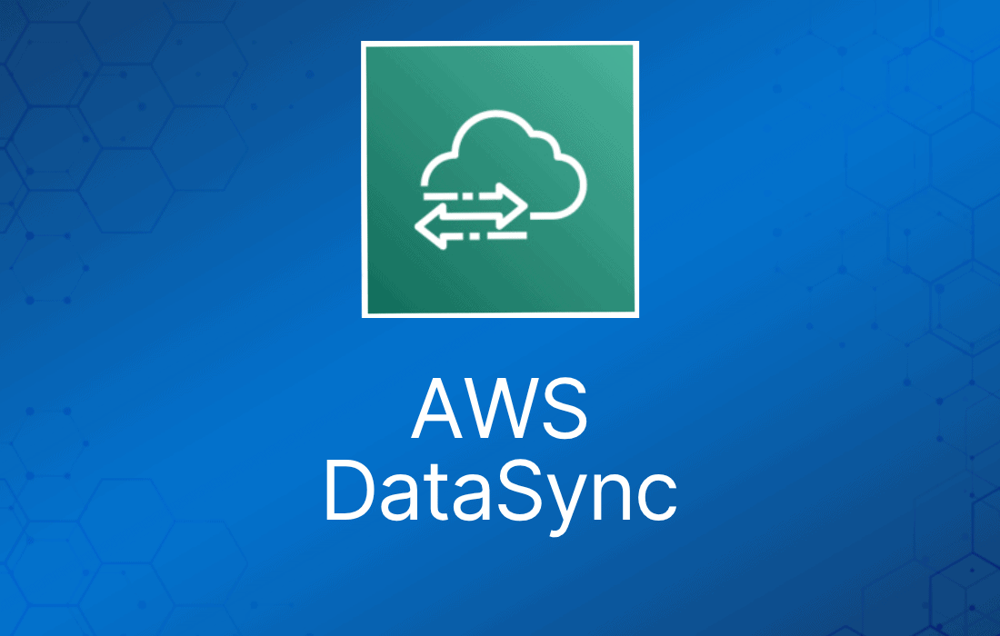

虽然很多公司是云原生的，或者已经完全迁离了自己的数据中心，但仍有大量 AWS 客户保留着本地（on-premises）环境——可能是出于合规原因，也可能只是还没完成迁移。

针对这些混合云（Hybrid Cloud）客户，AWS 提供了一系列工具和服务，AWS DataSync 就是其中之一。

## 什么是 AWS DataSync？

借助 AWS DataSync，AWS 让你能够以简单、安全的方式迁移数据。AWS DataSync 支持在本地环境与 AWS 之间、不同 AWS 存储服务之间，甚至不同云厂商之间传输数据。

AWS DataSync 是一项安全的在线数据传输服务，可以高效、自动地在众多不同位置之间移动大量数据。你可以在 DataSync 中原生地迁移和复制任意数据集。

这一切都无需自建方案，也不必把时间浪费在困难且重复的任务上。

AWS DataSync 支持多种不同的数据格式，涵盖文件系统、对象存储，既包括云环境也包括本地环境。  
  
DataSync 可以通过控制台或 AWS CLI（命令行界面）使用，能够在众多不同的源和目标之间移动数据。

如果你要进行任何类型的迁移，或者任何终点在 AWS 内的数据搬迁，AWS DataSync 很可能帮你达成目标。

## 功能特性

AWS DataSync 拥有多项功能，使其成为各类数据迁移场景中值得使用的工具。

与许多 AWS 服务一样，AWS 采用了自研的特性——在这里是自研的传输协议，用于决定数据如何以及何时通过网络发送。这些设计都是为了相比传统工具加快数据迁移速度。

你可以安排任务定期运行，检测源存储系统中的变更并将其复制到目标存储系统。

为了将文件直接传入你的 Amazon VPC，DataSync 支持 VPC endpoint（由 AWS PrivateLink 提供支持）。

你可以在 AWS DataSync 中基于计划创建任务，按时间周期在需要时执行迁移。

可以使用 AWS DataSync 将文件复制到 EFS，并且在指定时间内未被访问的文件可以迁移到不频繁访问（Infrequent Access，IA）存储层。

DataSync 是完全托管的服务，这意味着你无需自行准备任何基础设施。

DataSync 可与 Amazon EventBridge 无缝集成。你可以将其设置为在传输完成时触发事件，从而实现工作流自动化。

在传输过程中和存储时，DataSync 都会执行完整性校验，确保数据完好到达。

静态数据加密由 SSE-S3 或 Key Management Service（KMS）完成；传输过程中使用 TLS 1.2 加密。

当 DataSync 与 S3 配合使用时，支持将数据直接存入任意 S3 存储类别，无需使用生命周期策略或手动从 S3 转移数据。

## 使用场景

可以将数据迁移到 Amazon S3、Amazon EFS 或 Amazon FSx for Windows File Server。

你可以使用 AWS DataSync 将昂贵的归档存储转移到 S3 Glacier Flexible Retrieval、Glacier Instant Retrieval，以及 Glacier 和 Glacier Deep Archive 等归档存储类别。

一些组织的 AWS 环境同时使用本地数据中心和云端方案。

本地环境中可能会产生大量数据，需要传输到 AWS 进行处理。

为确保数据安全，你可以使用 AWS DataSync 将本地方案备份到 AWS。

DataSync 可用于在 Amazon Web Services 中复制并保存一份数据副本。为确保数据静态存储安全，你可以在所有这些服务上开启加密设置。

DataSync Agent 让你能够以虚拟机的形式在本地运行 DataSync，支持混合云部署。

DataSync 的虚拟机镜像以 Amazon Machine Image（AMI）形式提供，运行在 EC2 实例上。

agent VM 需要访问特定端点才能与 AWS 通信，你必须配置防火墙以允许这些通信。

## 定价

DataSync 按每 GB 收取固定费用，涵盖网络加速技术、托管云基础设施、数据校验和自动化能力。

Amazon S3、Amazon EFS、Amazon FSx for Windows File Server 和 AWS Key Management Service（KMS）等 AWS 服务按标准的请求、存储和数据传输费率收费。

从 AWS 复制数据到本地存储系统时，按标准费率支付 AWS 数据传输费用。此外，Amazon CloudWatch Logs、Amazon CloudWatch Events 和 Amazon CloudWatch Metrics 也按标准费率收费。

AWS PrivateLink 会对你为管理和控制 agent 与 DataSync 服务之间流量而创建的接口型 VPC endpoint 收费。

## 限制

