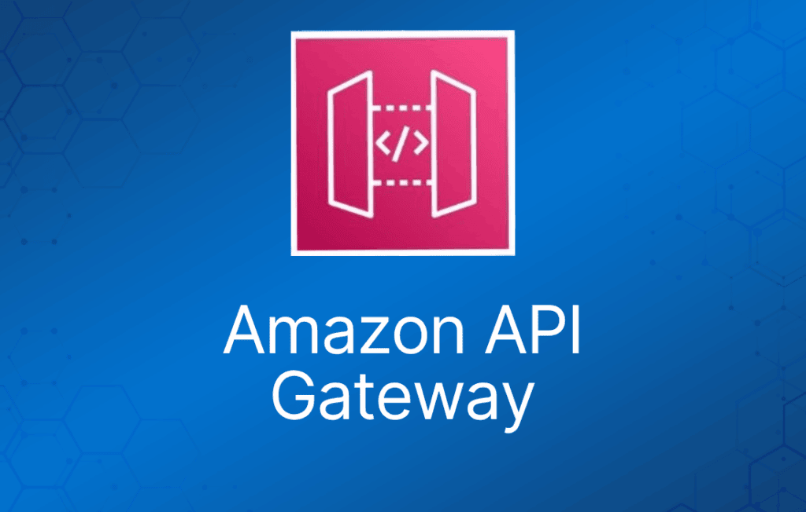

API Gateway 是一项完全托管的服务，让开发人员能够轻松发布、维护、监控和保护任意规模的 API。

API Gateway 支持以下功能：

- 创建、部署和管理 [**REST**](https://en.wikipedia.org/wiki/Representational_state_transfer) 应用程序接口（API），用于暴露后端 HTTP 端点、AWS Lambda 函数或其他 AWS 服务。
- 创建、部署和管理 [**WebSocket**](https://tools.ietf.org/html/rfc6455) API，用于暴露 AWS Lambda 函数或其他 AWS 服务。
- 通过前端 HTTP 和 WebSocket 端点调用已暴露的 API 方法。

API Gateway 与 Lambda 一起构成了 AWS 无服务器基础设施中面向应用的部分。

后端服务包括 Amazon EC2、AWS Lambda 或任何 Web 应用（公有或私有端点）。

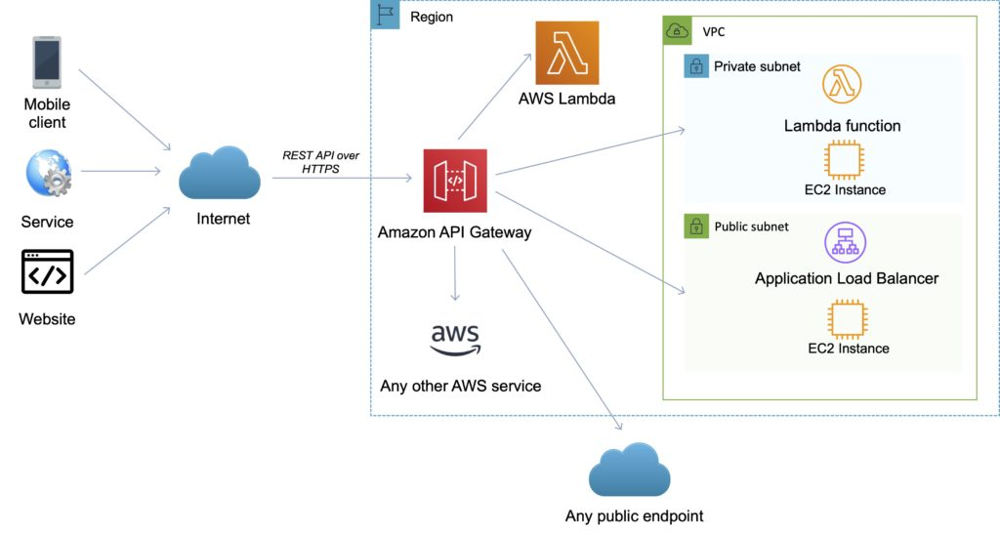

API Gateway 处理接受和处理多达数十万个并发 API 调用所涉及的所有任务。

API 调用包括流量管理、授权和访问控制、监控以及 API 版本管理。

API Gateway 提供使用 JSON 的 REST API。

API Gateway 暴露 HTTPS 端点来定义 RESTful API。

使用 Amazon API Gateway 创建的所有 API 仅暴露 HTTPS 端点（不支持未加密的端点）。

API 可以出示证书以供后端进行身份验证。

可以将每个 API 端点发送到不同的目标。

CloudFront 用作 API Gateway 的公共端点。

借助底层使用的 CloudFront，支持自定义域名和 SNI。

支持 API key 和使用计划（Usage Plan），用于用户识别、限流或配额管理。

调用方法的权限通过 IAM role 和 policy 或 API Gateway 自定义授权器（custom authorizer）授予。

默认情况下，API Gateway 会分配一个自动使用 API Gateway 证书的内部域名。

当配置 API 在自定义域名下运行时，你可以提供自己的证书。

## Amazon API Gateway 功能特性

下表描述了 Amazon API Gateway 的一些核心功能。

|  |  |
| --- | --- |
| **API Gateway 功能** | **优势** |
| 支持 RESTful API 和 WebSocket API | 使用 API Gateway，你可以通过 HTTP API 或 REST API 创建 RESTful API |
| 与 AWS ELB 和 AWS Cloud Map 的私有集成 | 使用 API Gateway，你可以将请求路由到 VPC 中的私有资源。使用 HTTP API，你可以为位于私有 ALB、私有 NLB 之后的服务以及注册在 AWS Cloud Map 中的基于 IP 的服务（如 ECS task）构建 API。 |
| 计量（Metering） | 定义计划来计量和限制第三方开发者对 API 的访问。 |
| 安全性 | API Gateway 提供多种工具来授权对 API 的访问并控制服务操作的访问。 |
| 弹性（Resiliency） | 通过限流管理流量，使后端操作能够承受流量高峰。 |
| 运维监控 | API Gateway 提供指标仪表板来监控对服务的调用。 |
| 生命周期管理 | 同时运行多个 API 版本以及每个版本的多个阶段，以便在发布新 API 版本后，现有应用可以继续调用旧版本。 |
| AWS 授权 | 支持 REST API 和 WebSocket API 的签名版本 4、IAM 访问策略，以及使用 Lambda 函数通过 bearer token（如 JWT、SAML）进行授权。 |

## 端点（Endpoints）

[**API 端点**](https://docs.aws.amazon.com/apigateway/latest/developerguide/api-gateway-basic-concept.html#apigateway-definition-api-endpoints)类型是部署到特定区域的 API Gateway 中 API 的主机名。

主机名的形式为 .execute-api..amazonaws.com。

API 端点类型可以是边缘优化（edge-optimized）、区域（regional）或私有（private），具体取决于你的大部分 API 流量来自哪里。

### 边缘优化端点（Edge-Optimized Endpoint）

- 边缘优化 API 端点最适合地理分布的客户端。API 请求会被路由到最近的 CloudFront 接入点（POP）。这是 API Gateway REST API 的默认端点类型。
- 边缘优化 API 会将 HTTP header 名称首字母大写（例如 Cookie）。
- CloudFront 在将请求转发到源站之前，会按 cookie 名称以自然顺序对 HTTP cookie 排序。有关 CloudFront 处理 cookie 方式的更多信息，请参阅"基于 Cookie 缓存内容"。
- 你为边缘优化 API 使用的任何自定义域名都适用于所有区域。

### 区域端点（Regional Endpoint）

- 区域 API 端点面向同一区域内的客户端。
- 当运行在 EC2 实例上的客户端调用同一区域中的 API，或者当 API 旨在服务少量但要求高的客户端时，区域 API 可以减少连接开销。
- 对于区域 API，你使用的任何自定义域名都特定于部署该 API 的区域。
- 如果你在多个区域部署区域 API，它可以在所有区域使用相同的自定义域名。
- 你可以将自定义域名与 Amazon Route 53 结合使用，以执行基于延迟的路由等任务。
- 区域 API 端点会原样传递所有 header 名称。

### 私有端点（Private Endpoint）

- 私有 API 端点是一种只能使用接口 VPC 端点从你的 Amazon Virtual Private Cloud (VPC) 访问的 API 端点，接口 VPC 端点是你在 VPC 中创建的端点网络接口（ENI）。
- 私有 API 端点会原样传递所有 header 名称。

下图展示了三种不同的 Amazon API Gateway 端点类型：

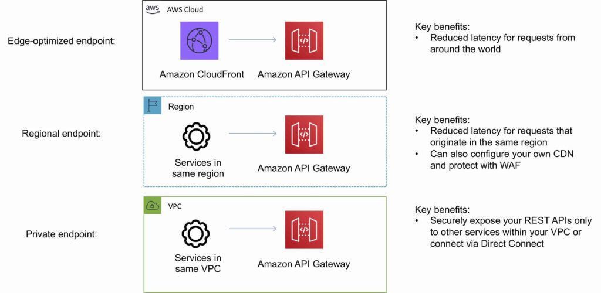

## Amazon API Gateway 的 API

### API Gateway REST API

- 一组与后端 HTTP 端点、Lambda 函数或其他 AWS 服务集成的 HTTP 资源和方法。
- 这组资源可以部署到一个或多个阶段（stage）。
- 通常，API 资源会根据应用逻辑组织成资源树。
- 每个 API 资源可以暴露一个或多个 API 方法，这些方法具有 API Gateway 支持的特定 HTTP 动词。

下图展示了一个 API 的结构：

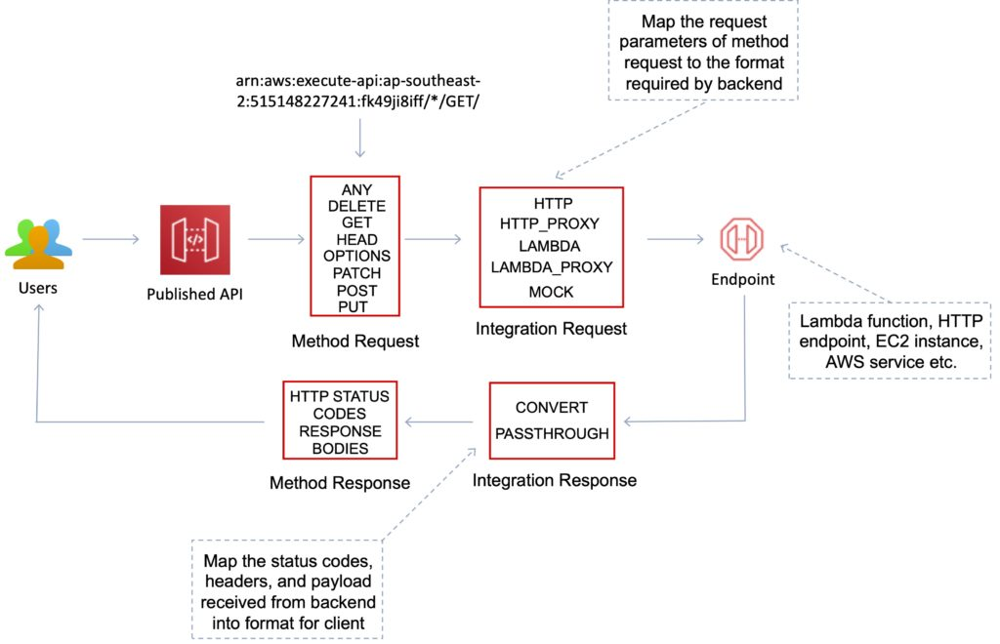

### API Gateway WebSocket API

- 一组与后端 HTTP 端点、Lambda 函数或其他 AWS 服务集成的 WebSocket 路由和路由键。
- 这组资源可以部署到一个或多个阶段。
- API 方法通过前端 WebSocket 连接调用，这些连接可以与注册的自定义域名关联。

## 方法（Methods）

API Gateway 方法是与 API Gateway 资源关联的 HTTP 方法。

每个资源 URL 可以拥有 GET、PUT、POST 和 DELETE 等 HTTP 方法。

AWS 还提供 "ANY" 方法作为通配方式。

## 部署（Deployments）

部署是 API 资源和方法的快照。

必须创建部署并将其与阶段关联，任何人才能访问该 API。

## 阶段与阶段变量（Stages and Stage variables）

阶段是对 REST 或 WebSocket API 生命周期状态的逻辑引用（例如 'dev'、'prod'、'beta'、'v2'）。

API 阶段通过 API ID 和阶段名称标识。

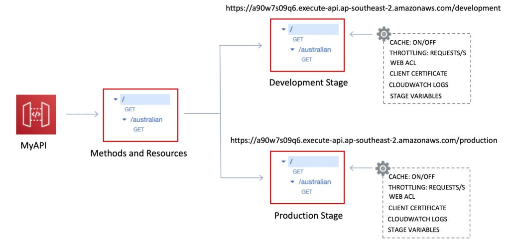

阶段变量类似于 API Gateway 的环境变量。

阶段变量可用于：

- Lambda 函数 ARN。
- HTTP 端点。
- 参数映射模板。

阶段变量的使用场景：

- 配置各阶段要对接的 HTTP 端点（dev、test、prod 等）。
- 通过映射模板向 AWS Lambda 传递配置参数。

阶段变量会传递到 Lambda 中的 "context" 对象。

阶段变量与 Lambda 别名（alias）配合使用。

你可以创建阶段变量来指示对应的 Lambda 别名。

你可以为任何阶段创建金丝雀部署（canary deployment）——选择金丝雀通道接收的流量百分比。

## 映射模板（Mapping templates）

映射模板可用于修改请求/响应。

重命名参数。

修改 body 内容。

添加 header。

将 JSON 映射为 XML，以发送到后端或返回给客户端。

使用 Velocity Template Language (VTL)。

过滤输出结果（移除不必要的数据）。

## 缓存（Caching）

你可以通过预置 Amazon API Gateway 缓存并指定其大小（以 GB 为单位）来为 API 调用添加缓存。

缓存允许你缓存端点的响应。

缓存可以减少对后端的调用次数，并改善 API 请求的延迟。

API Gateway 会将响应缓存一段特定时间（time to live，TTL）。

默认 TTL 为 300 秒（最小 0，最大 3600）。

缓存按阶段定义。

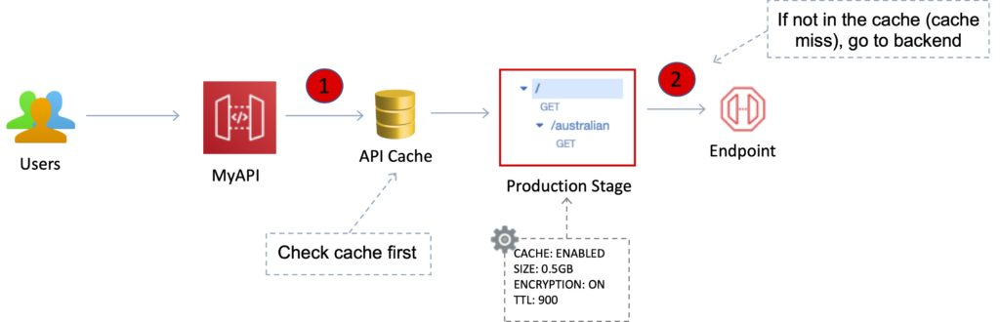

你可以加密缓存。

缓存容量在 0.5GB 到 237GB 之间。

可以为特定方法覆盖缓存设置。

如果需要，你可以立即清空整个缓存（使其失效）。

客户端可以使用 header：Cache-Control: max-age=0 来使缓存失效。

## API 限流（API throttling）

API Gateway 针对你账户中的所有 API，对稳态请求速率和请求提交的突发量设置了限制。

限制如下：

- 默认情况下，API Gateway 将稳态请求速率限制为每秒 10,000 个请求。
- 一个 AWS 账户内所有 API 的最大并发请求数为 5,000。
- 如果超过每秒 10,000 个请求或 5,000 个并发请求，你将收到 429 Too Many Requests 错误响应。

捕获到此类异常后，客户端可以在遵守 API Gateway 限流限制的前提下，以限速的方式重新提交失败的请求。

Amazon API Gateway 提供两种基本的限流相关设置：

- **服务器端（Server-side）**限流限制应用于所有客户端。这些限制设置是为了防止你的 API 以及你的账户被过多请求淹没。
- **按客户端（Per-client）**限流限制应用于使用与你的使用策略关联的 API key 作为客户端标识符的客户端。

API Gateway 限流相关设置按以下顺序应用：

1. 你在使用计划中针对 API 阶段设置的按客户端、按方法的限流限制。
2. 你在使用计划中设置的按客户端限流限制。
3. 默认的按方法限制以及你在 API 阶段设置中单独设置的按方法限制。
4. 账户级限流。

## 集成与方法请求/响应（Integrations and Method Requests / Responses）

方法（method）代表面向客户端的接口，客户端通过它调用 API 来访问后端资源。

Method 资源与 Integration 资源相集成。

API 方法通过 API 集成与后端端点集成。

后端端点称为"集成端点"（integration endpoint）。

### 集成请求（Integration request）

API Gateway 中 WebSocket API 路由或 REST API 方法的内部接口，在其中你将路由请求的 body 或方法请求的参数和 body 映射为后端所需的格式。

### 集成响应（Integration response）

API Gateway 中 WebSocket API 路由或 REST API 方法的内部接口，在其中你将从后端接收到的状态码、header 和负载映射为返回给客户端应用的响应格式。

### 方法请求（Method request）

API Gateway 中 REST API 方法的公共接口，定义了应用开发者必须通过 API 发送的请求参数和 body 才能访问后端。

### 方法响应（Method response）

REST API 的公共接口，定义了应用开发者应在 API 响应中期望收到的状态码、header 和 body 模型。

### 映射模板（Mapping template）

一种使用 [**Velocity Template Language (VTL)**](http://velocity.apache.org/engine/devel/vtl-reference.html) 编写的脚本，将请求体从前端数据格式转换为后端数据格式，或将响应体从后端数据格式转换为前端数据格式。

映射模板可以在集成请求或集成响应中指定。它们可以引用运行时作为上下文和阶段变量提供的数据。

映射可以简单到[**恒等转换**](https://en.wikipedia.org/wiki/Identity_transform)，即在请求中将 header 或 body 原样通过集成从客户端传递到后端。

响应也是如此，负载从后端传递到客户端。

## 集成类型（Integration Type）

根据所使用的集成端点类型以及希望数据如何进出集成端点来选择 API 集成类型。

对于 Lambda 函数，可以使用 Lambda 代理集成（Lambda proxy integration）或 Lambda 自定义集成（Lambda custom integration）。

对于 HTTP 端点，可以使用 HTTP 代理集成（HTTP proxy integration）或 HTTP 自定义集成（HTTP custom integration）。

对于 AWS 服务操作，只有非代理类型的 AWS 集成。API Gateway 还支持 mock 集成，即 API Gateway 作为集成端点直接响应方法请求。

Lambda 自定义集成是 AWS 集成的一个特例，其中集成端点对应 Lambda 服务的[**函数调用操作**](https://docs.aws.amazon.com/lambda/latest/dg/API_Invoke.html)。

以编程方式选择集成类型时，通过设置 [**Integration**](https://docs.aws.amazon.com/apigateway/api-reference/resource/integration/) 资源上的 [**type**](https://docs.aws.amazon.com/apigateway/api-reference/resource/integration/#type) 属性来实现。

对于 Lambda 代理集成，该值为 AWS\_PROXY。

对于 Lambda 自定义集成和所有其他 AWS 集成，该值为 AWS。

对于 HTTP 代理集成和 HTTP 集成，该值分别为 HTTP\_PROXY 和 HTTP。

对于 mock 集成，type 值为 MOCK。

以下列表总结了支持的集成类型：

### AWS 集成

这种类型的集成让 API 可以暴露 AWS 服务操作。

在 AWS 集成中，你必须同时配置集成请求和集成响应，并设置从方法请求到集成请求、从集成响应到方法响应的必要数据映射。

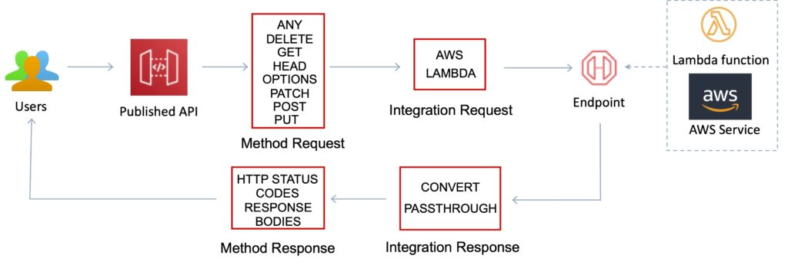

### AWS\_PROXY 集成

这种类型的集成让 API 方法能够以灵活、通用且精简的集成设置与 Lambda 函数调用操作集成。

这种集成依赖于客户端与被集成 Lambda 函数之间的直接交互。

使用这种集成类型（也称为 Lambda 代理集成）时，你无需设置集成请求或集成响应。

API Gateway 将来自客户端的传入请求作为输入传递给后端 Lambda 函数。

被集成的 Lambda 函数接收[**这种格式的输入**](https://docs.aws.amazon.com/apigateway/latest/developerguide/set-up-lambda-proxy-integrations.html#api-gateway-simple-proxy-for-lambda-input-format)，并从所有可用来源解析输入，包括请求 header、URL 路径变量、查询字符串参数和相应的 body。

函数按照此[**输出格式**](https://docs.aws.amazon.com/apigateway/latest/developerguide/set-up-lambda-proxy-integrations.html#api-gateway-simple-proxy-for-lambda-output-format)返回结果。

这是通过 API Gateway 调用 Lambda 函数的首选集成类型，不适用于任何其他 AWS 服务操作，包括除函数调用操作之外的 Lambda 操作。

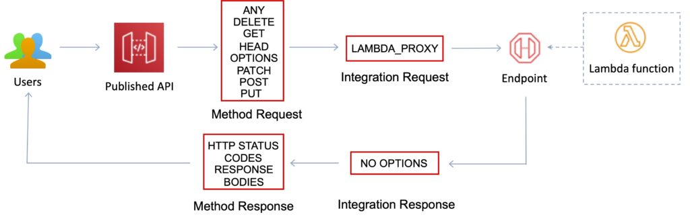

### HTTP 集成

这种类型的集成让 API 可以暴露后端的 HTTP 端点。

使用 HTTP 集成（也称为 HTTP 自定义集成）时，你必须同时配置集成请求和集成响应。

你必须设置从方法请求到集成请求、从集成响应到方法响应的必要数据映射。

### HTTP\_PROXY 集成

HTTP 代理集成允许客户端以精简的集成设置在单个 API 方法上访问后端 HTTP 端点。

你无需设置集成请求或集成响应。

API Gateway 将来自客户端的传入请求传递给 HTTP 端点，并将来自 HTTP 端点的响应传递给客户端。

### MOCK 集成

这种类型的集成让 API Gateway 无需将请求继续发送到后端即可返回响应。

这对于 API 测试很有用，因为它可用于测试集成设置而不会产生使用后端的费用，并能实现 API 的协作开发。

在协作开发中，团队可以使用 MOCK 集成来模拟其他团队拥有的 API 组件，从而隔离各自的开发工作。

它还用于返回 CORS 相关的 header，以确保 API 方法允许 CORS 访问。

实际上，API Gateway 控制台就是通过 mock 集成来集成 OPTIONS 方法以支持 CORS 的。

[**Gateway 响应（Gateway responses）**](https://docs.aws.amazon.com/apigateway/latest/developerguide/customize-gateway-responses.html)是 mock 集成的另一个例子。

## 使用计划和 API key（Usage plans and API keys）

使用计划（usage plan）指定谁可以访问一个或多个已部署的 API 阶段和方法——以及访问的量和速度。

你可以使用使用计划来配置限流和配额限制，这些限制针对单个客户端 API key 强制执行。

该计划使用 API key 来识别 API 客户端，并对每个 key 计量对关联 API 阶段的访问。

它还允许你配置针对单个客户端 API key 强制执行的限流限制和配额限制。

API key 是你分发给应用开发者客户以授予其 API 访问权限的字母数字字符串值。

你可以将 API key 与[**使用计划**](https://docs.aws.amazon.com/apigateway/latest/developerguide/api-gateway-api-usage-plans.html)或 [**Lambda 授权器**](https://docs.aws.amazon.com/apigateway/latest/developerguide/apigateway-use-lambda-authorizer.html)结合使用，以控制对 API 的访问。

API Gateway 可以代为生成 API key，你也可以从 [**CSV 文件**](https://docs.aws.amazon.com/apigateway/latest/developerguide/api-key-file-format.html)导入。

你可以在 API Gateway 中生成 API key，也可以从外部来源将其导入 API Gateway。

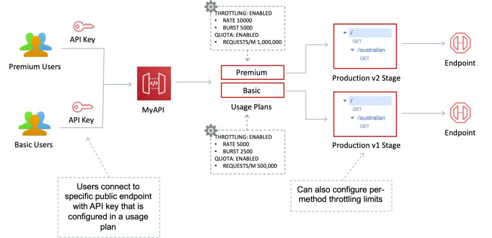

## 同源策略（Same origin policy）

用于防止跨站脚本攻击。

Web 浏览器允许第一个网页中的脚本访问第二个网页中的数据，但仅当两个网页具有相同的源（origin）时才可以。

这由 Web 浏览器强制执行。

## 跨源资源共享（CORS）

可以为使用 JavaScript/AJAX 的多域名场景启用跨源资源共享（CORS）。

CORS 是另一端的服务器（而非浏览器中的客户端代码）放宽同源策略的一种方式。

CORS 允许网页上受限的资源（例如字体）从最初共享资源的域名之外的其他域名被请求。

使用 CORS：

- 如果使用 JavaScript / AJAX，可以在 API Gateway 上启用 CORS。
- 可用于启用来自 API 所在域之外的其他域的请求。
- 允许在不同域之间共享资源。
- 在启用 CORS 之前，你要为其启用 CORS 的方法（GET、PUT、POST 等）必须已在 API Gateway API 中可用。
- 如果未启用 CORS，而某个 API 资源收到来自另一个域的请求，该请求将被阻止。
- 在 API Gateway 下使用选定的方法在 API 资源上启用 CORS。

## 身份与访问管理（Identity and Access Management）

有多种机制可用于控制和管理对 API 的访问。

这些机制包括：

- Resource-based policy。
- 标准 IAM Role 和 Policy（identity-based policy）。
- IAM Tag。
- 接口 VPC 端点的端点策略（endpoint policy）。
- Lambda 授权器（Lambda authorizer）。
- Amazon Cognito 用户池（user pool）。

### IAM Resource-Based Policy

Amazon API Gateway resource policy 是附加到 API 的 JSON 策略文档，用于控制指定的主体（通常是 IAM 用户或角色）是否可以调用该 API。

你可以使用 API Gateway resource policy 来允许你的 API 被以下主体安全调用：

- 来自指定 AWS 账户的用户。
- 指定的源 IP 地址范围或 CIDR 块。
- 指定的虚拟私有云（VPC）或 VPC 端点（任何账户中的）。
- 你可以将 resource policy 用于 API Gateway 中的所有 API 端点类型：私有、边缘优化和区域。

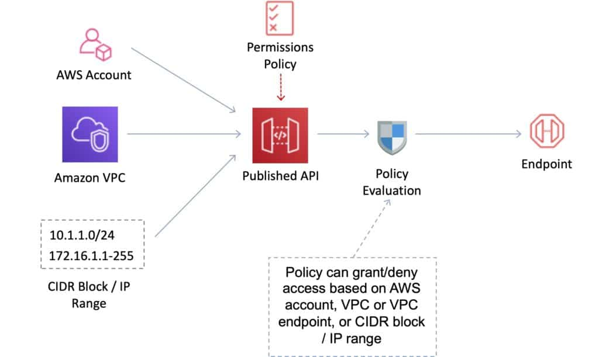

### IAM Identity-Based Policy

你需要创建 IAM policy 并附加到用户/角色。

API Gateway 验证调用应用传入的 IAM 权限。

利用 sigv4 能力，IAM 凭证通过 header 传递。

处理身份验证和授权。

非常适合你 AWS 账户内的用户/角色。

### Lambda 授权器（Lambda Authorizer）

使用 AWS Lambda 验证 header 中传递的 token。

可选择缓存身份验证结果。

Lambda 必须为用户返回一个 IAM policy。

按 Lambda 调用次数付费。

处理身份验证和授权。

适合使用 OAuth、SAML 或第三方身份验证。

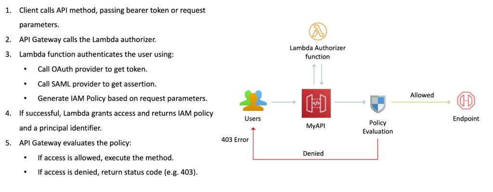

### Cognito 用户池（Cognito User Pools）

用户池（user pool）是 Amazon Cognito 中的用户目录。

借助用户池，用户可以通过 Amazon Cognito 登录 Web 或移动应用。

用户还可以通过 Google、Facebook、Amazon 或 Apple 等社交身份提供商以及 SAML 身份提供商登录。

无论用户直接登录还是通过第三方登录，用户池的所有成员都有一个目录配置文件，你可以通过软件开发工具包（SDK）访问。

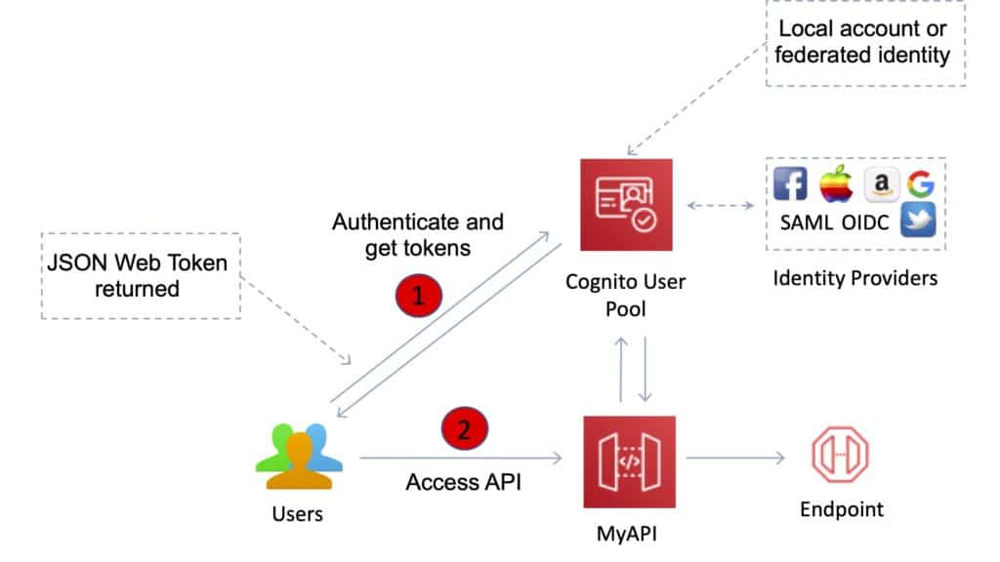

用户池提供：

- 注册和登录服务。
- 内置的可自定义 Web UI 用于用户登录。
- 支持 Facebook、Google、Login with Amazon 和 Sign in with Apple 的社交登录，以及使用用户池中 SAML 身份提供商的登录。
- 用户目录管理和用户配置文件。
- 多因素身份验证（MFA）等安全功能。

## 其他功能与优势

API Gateway 提供了多项有助于创建和管理 API 的功能：

- 计量（Metering）—— 定义计划来计量和限制第三方开发者对 API 的访问。
- 安全性 —— API Gateway 提供多种工具来授权对 API 的访问并控制服务操作的访问。
- 弹性（Resiliency）—— 通过限流管理流量，使后端操作能够承受流量高峰。
- 运维监控 —— API Gateway 提供指标仪表板来监控对服务的调用。
- 生命周期管理 —— 同时运行多个 API 版本以及每个版本的多个阶段，以便在发布新 API 版本后，现有应用可以继续调用旧版本。

API Gateway 提供对后端 API 的稳健、安全且可扩展的访问，并为你的 API 托管多个版本和发布阶段。

你可以创建 API key 并分发给开发者。

可选择使用 AWS Sig-v4 来授权对 API 的访问。

你可以限流和监控请求以保护后端。

API Gateway 允许你维护一个缓存来存储 API 响应。

支持 iOS、Android 和 JavaScript 的 SDK 生成。

借助 CloudFront 降低延迟并提供分布式拒绝服务防护。

请求/响应数据转换和 API mock。

通过基于每个 HTTP 方法（GET、PUT）每秒请求数的限流规则实现弹性。

限流可以在多个级别配置，包括全局（Global）和服务调用（Service Call）级别。

可以创建以 GB 为单位指定的缓存（默认不启用）。

缓存是为你的 API 的特定阶段预置的。

缓存功能包括可自定义的键和以秒为单位的生存时间（TTL），可以提升 API 数据的响应时间并减少后端服务的负载。

API Gateway 可以扩展到 API 接收的任何流量级别。

## 日志与监控

Amazon API Gateway 会将后端性能指标（如 API 调用次数、延迟和错误率）以近乎实时的方式记录到 CloudWatch。

你可以通过 API Gateway 仪表板（REST API）进行监控，从而直观地监控对服务的调用。

API Gateway 还会计量第三方开发者的使用情况，相关数据可在 API Gateway 控制台中查看，也可通过 API 获取。

Amazon API Gateway 与 AWS CloudTrail 集成，可提供对 REST API 所做更改的完整可审计历史记录。

所有针对 Amazon API Gateway API 进行的创建、修改、删除或部署 REST API 的调用都会记录到 CloudTrail。

理解以下指标对考试很有帮助：

- 监控 IntegrationLatency 指标以衡量后端的响应能力。
- 监控 Latency 指标以衡量 API 调用的整体响应能力。
- 监控 CacheHitCount 和 CacheMissCount 指标，以优化缓存容量从而达到期望的性能。

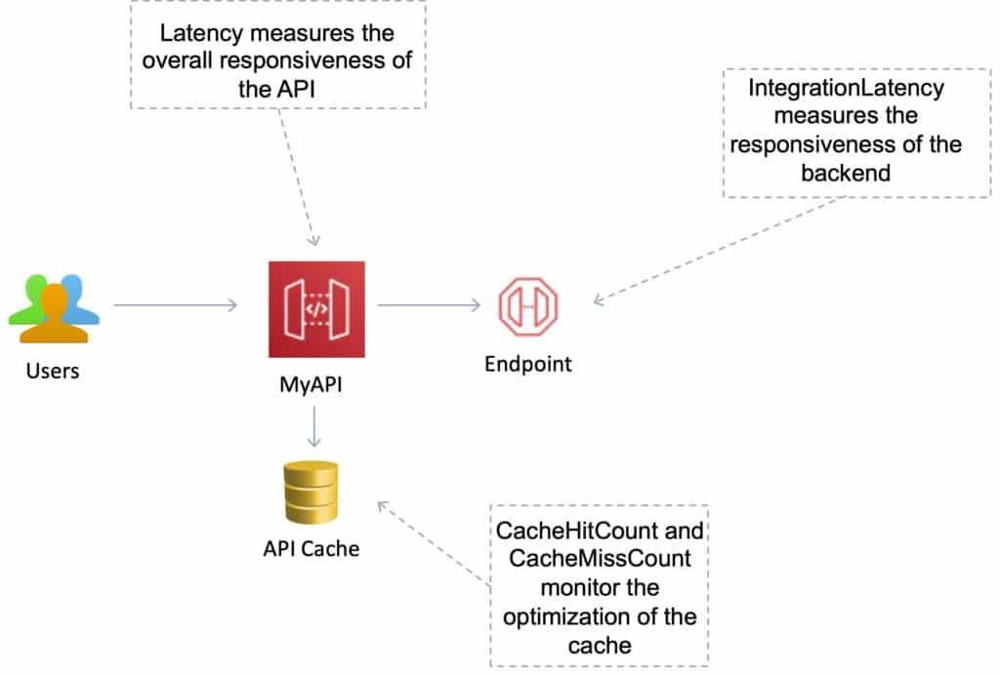

## Open API / Swagger

可以将现有的 Swagger / Open API 3.0 定义（以 YAML 或 JSON 编写）导入 API Gateway。

这是使用 API 定义即代码（API definition as code）来定义 REST API 的常见方式。

也可以将当前 API 导出为 Swagger / Open API 3.0 定义。

使用 API Gateway 的 Import API 功能从外部定义导入 API。

使用 Import API，你可以通过提交包含 Swagger 定义和端点配置的 POST 请求来创建新 API，也可以使用包含 Swagger 定义的 PUT 请求更新现有 API，或将定义与现有 API 合并。

你通过请求 URL 中的 mode 查询参数来指定这些选项。

## 费用

使用 Amazon API Gateway，你只需在 API 被使用时付费。

没有最低费用或预付费承诺。

你只需为收到的 API 调用以及传出的数据量付费。

私有 API（Private API）不收取数据传出费用（但是，在 Amazon API Gateway 中使用私有 API 时，AWS PrivateLink 费用照常收取）。

Amazon API Gateway 还提供可选的数据缓存，按小时费率收费，具体费率取决于你选择的缓存大小。

API Gateway 免费套餐包括每月 100 万次 API 调用，最长 12 个月。
