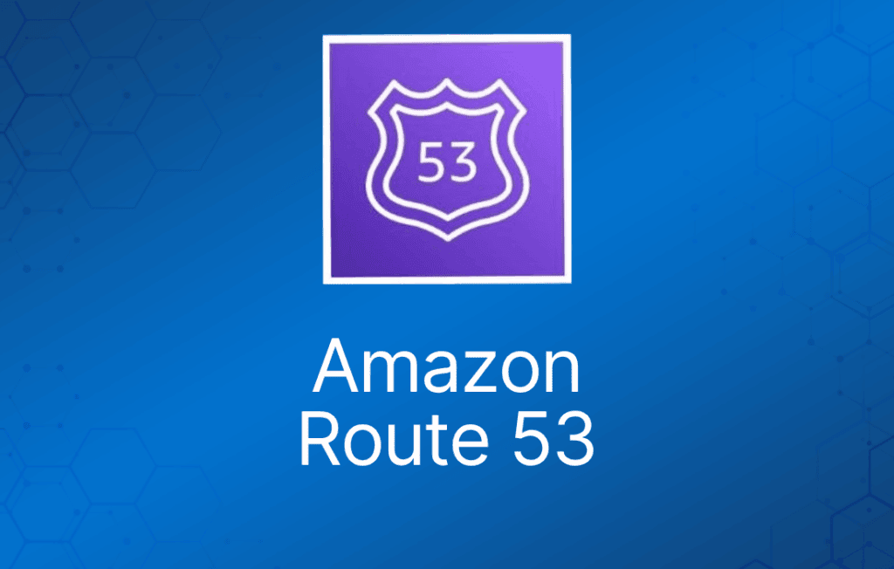
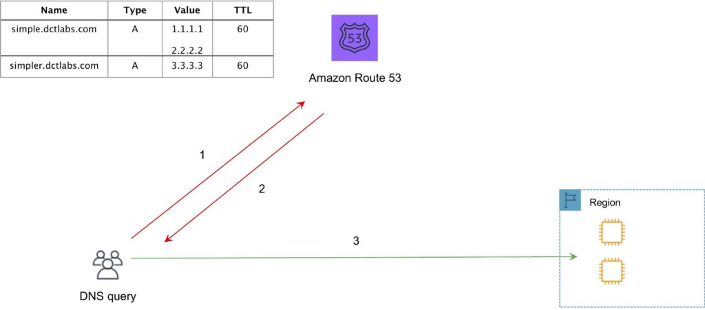
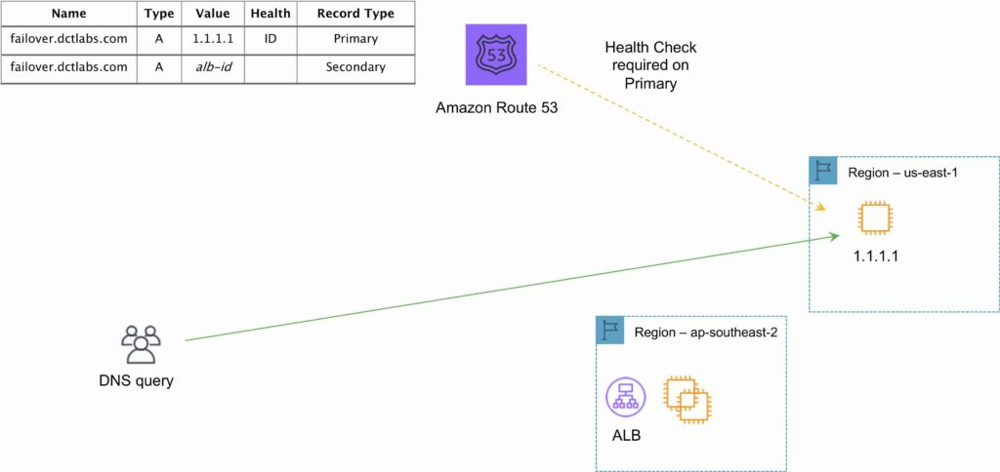
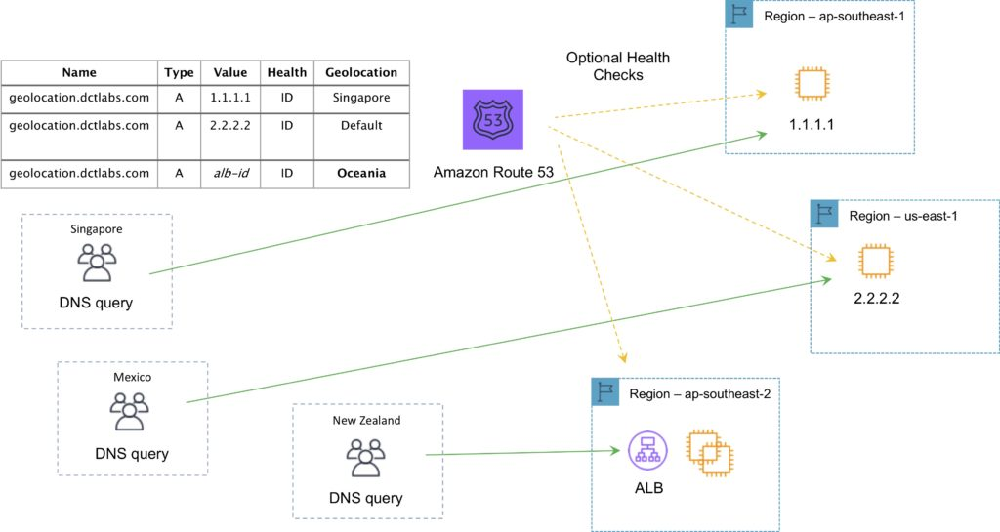
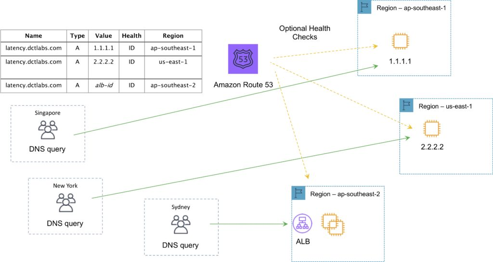
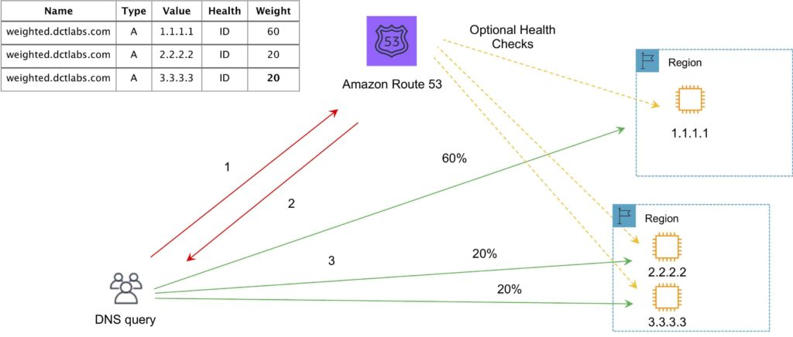
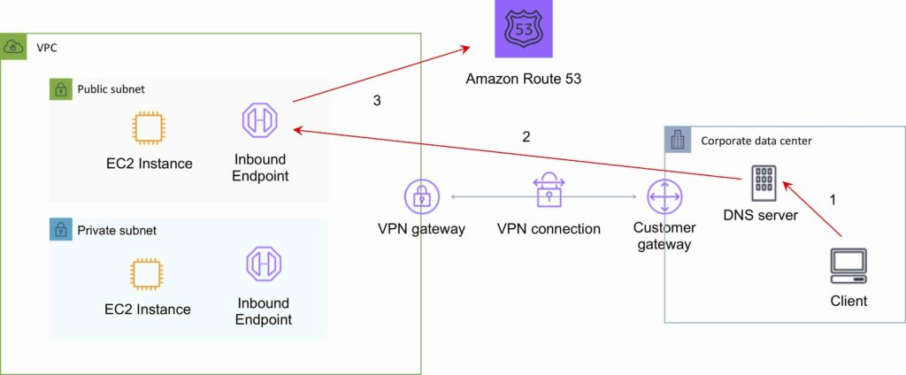
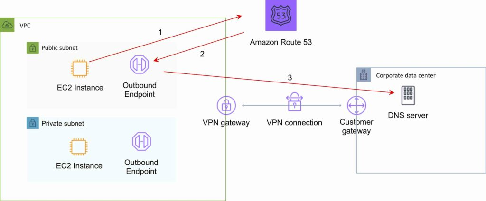

Amazon Route 53 是一个高可用、可扩展的域名系统（DNS）服务。

Amazon Route 53 提供以下功能：

- 域名注册。
- DNS 解析。
- 资源健康检查。

Route 53 可以执行这些功能的任意组合。

Route 53 提供全球分布式的 DNS 服务。

Route 53 部署在所有边缘站点（edge location）旁边。

健康检查用于验证联网资源是否可达、可用且功能正常。

Route 53 可用于为在其他域名注册商处注册的域名（任何域名）路由 Internet 流量。

当你在 Route 53 注册域名时，它就成为该域名的权威 DNS 服务器，并创建一个 public hosted zone。

要让 Route 53 成为现有域名的权威 DNS 而不转移域名，可以创建一个 Route 53 public hosted zone，并将现有提供商处的 DNS Name Server 更改为 Route 53 的 Name Server。

由于 DNS 记录的 TTL（Time To Live）值，Name Server 的更改最长可能需要 48 小时才能生效。

只有当顶级域名（TLD）受支持时，你才能将域名转移到 Route 53。

你可以通过联系 AWS support 将域名从 Route 53 转移到其他注册商。

你可以将域名转移到 AWS 中的另一个账户，但默认不会迁移 hosted zone（可选）。

可以让域名注册在一个 AWS 账户中，而 hosted zone 位于另一个 AWS 账户中。

主要使用 UDP 53 端口（也可以使用 TCP）。

AWS 为 Route 53 提供 100% 正常运行时间 SLA。

你可以使用 IAM 控制对 Amazon Route 53 hosted zone 的管理访问权限。

域名数量默认上限为 50 个，但可以通过联系 support 提升。

Private DNS 是 Route 53 的一项功能，让你可以在 VPC 内拥有权威 DNS，而无需将 DNS 记录（包括资源名称及其 IP 地址）暴露到 Internet。

你可以使用 AWS Management Console 或 API 在 Route 53 注册新域名。

## Hosted Zone

hosted zone 是指定域名的记录集合。

hosted zone 类似于传统的 DNS zone 文件；它代表一组可以一起管理的记录。

有两种类型的 zone：

- Public hosted zone——决定流量在 Internet 上如何路由。
- 面向 VPC 的 Private hosted zone——决定流量在 VPC 内如何路由（资源在 VPC 之外不可访问）。

Amazon Route 53 会自动为 hosted zone 创建 Name Server (NS) 和 Start of Authority (SOA) 记录。

Amazon Route 53 会在每个 hosted zone 中创建一组 4 个唯一的 name server（一个 delegation set）。

你可以创建多个同名但记录不同的 hosted zone。

NS 服务器以完全限定域名（FQDN）指定，但你可以从命令行获取其 IP 地址（例如 dig 或 nslookup）。

对于 private hosted zone，你可以看到每个区域的 VPC 列表，并且必须选择一个。

对于 private hosted zone，必须将以下 VPC 设置设为“true”：

- enableDnsHostname。
- enableDnsSupport。

你还需要创建一个 DHCP options set。

你可以将本地（on-premises）DNS 扩展到 VPC。

你无法将 Route 53 扩展到本地实例。

你无法自动向 private hosted zone 注册 EC2 实例（需要通过脚本实现）。

健康检查通过连接实例来检查其健康状况。

健康检查可以指向：

- 终端节点（endpoint）。
- 其他健康检查的状态。
- CloudWatch alarm 的状态。

终端节点可以是 IP 地址或域名。

你可以将一个账户中的 Route 53 private hosted zone 与另一个账户中的 VPC 关联。

要将一个 AWS 账户（账户 A）中的 Route 53 private hosted zone 与属于另一个 AWS 账户（账户 B）的 VPC 关联，请使用 AWS CLI 按以下步骤操作：

1. 在账户 A 中，授权账户 A 的 private hosted zone 与账户 B 的 VPC 之间的关联。
2. 在账户 B 中，创建账户 A 的 private hosted zone 与账户 B 的 VPC 之间的关联。
3. 关联创建完成后，删除关联授权。

## 健康检查

健康检查通过连接实例来检查其健康状况。

健康检查可以指向：

- 终端节点（endpoint）。
- 其他健康检查的状态。
- CloudWatch alarm 的状态。

终端节点可以是 IP 地址或域名。

你可以创建以下类型的健康检查：

- **HTTP**：Route 53 尝试建立 TCP 连接。如果成功，Route 53 会提交一个 HTTP 请求，并等待返回大于等于 200 且小于 400 的 HTTP 状态码。
- **HTTPS**：Route 53 尝试建立 TCP 连接。如果成功，Route 53 会提交一个 HTTPS 请求，并等待返回大于等于 200 且小于 400 的 HTTP 状态码。
- **HTTP\_STR\_MATCH**：Route 53 尝试建立 TCP 连接。如果成功，Route 53 会提交一个 HTTP 请求，并在响应体的前 5,120 字节中搜索你在 SearchString 中指定的字符串。
- **HTTPS\_STR\_MATCH**：Route 53 尝试建立 TCP 连接。如果成功，Route 53 会提交一个 HTTPS 请求，并在响应体的前 5,120 字节中搜索你在 SearchString 中指定的字符串。
- **TCP**：Route 53 尝试建立 TCP 连接。
- **CLOUDWATCH\_METRIC**：健康检查与一个 CloudWatch alarm 关联。如果 alarm 状态为 OK，则健康检查视为健康。如果状态为 ALARM，则健康检查视为不健康。如果 CloudWatch 没有足够的数据来判断状态是 OK 还是 ALARM，则健康检查状态取决于 InsufficientDataHealthStatus 的设置：Healthy、Unhealthy 或 LastKnownStatus。
- **CALCULATED**：对于监控其他健康检查状态的健康检查，Route 53 会统计 Route 53 health checker 认为健康的健康检查数量，并将该数量与 HealthThreshold 的值进行比较。

## 记录（Record）

Amazon Route 53 目前支持以下 DNS 记录类型：

- A（地址记录）。
- AAAA（IPv6 地址记录）。
- CNAME（规范名称记录）。
- CAA（证书颁发机构授权）。
- MX（邮件交换记录）。
- NAPTR（名称权威指针记录）。
- NS（name server 记录）。
- PTR（指针记录）。
- SOA（start of authority 记录）。
- SPF（sender policy framework）。
- SRV（service locator）。
- TXT（文本记录）。
- Alias（Amazon Route 53 特有的虚拟记录）。

Alias 记录是 Route 53 特有的记录类型。

Alias 记录用于将 hosted zone 中的资源记录集映射到 Amazon Elastic Load Balancing 负载均衡器、Amazon CloudFront 分配、AWS Elastic Beanstalk 环境，或配置为网站的 Amazon S3 bucket。

你可以使用 Alias 记录将自定义域名（例如 api.example.com）同时映射到 API Gateway 的自定义区域 API 和边缘优化 API，以及 Amazon VPC interface endpoint。

Alias 指向服务的 DNS 名称。

你无法为指向 ELB、S3 或 Elastic Beanstalk 环境的 Alias 记录设置 TTL（使用服务的默认值）。

Alias 记录的工作方式与 CNAME 记录类似，你可以将一个 DNS 名称（例如 example.com）映射到另一个“目标”DNS 名称（例如 elb1234.elb.amazonaws.com）。

Alias 记录可用于解析 apex/裸域名（例如 example.com 而非 sub.example.com）。

CNAME 记录不能用于解析 apex/裸域名。

一般来说，应尽可能使用 Alias 记录。

除 NS 记录外，Route 53 对所有记录类型都支持通配符条目。

下表详细说明了 Alias 与 CNAME 记录之间的区别：

|  |  |
| --- | --- |
| **CNAME 记录** | **Alias 记录** |
| Route 53 对 CNAME 查询收费 | Route 53 对指向 AWS 资源的 alias 查询不收费 |
| 你无法在 DNS 命名空间的顶层节点（zone apex）创建 CNAME 记录 | 你可以在 zone apex 创建 alias 记录（但不能在 zone apex 路由到 CNAME） |
| CNAME 记录会重定向对某个域名的查询，无论记录类型如何 | Route 53 仅在记录类型也匹配时才跟随 alias 记录中的指针 |
| CNAME 可以指向托管在任何地方的任何 DNS 记录 | alias 记录只能指向 CloudFront 分配、Elastic Beanstalk 环境、ELB、配置为静态网站的 S3 bucket，或你在其中创建 alias 记录的同一 hosted zone 中的另一条记录 |
| CNAME 记录会显示在 Route 53 DNS 服务器应答的 answer 部分中 | alias 记录仅在 Route 53 控制台或 Route 53 API 中可见 |
| CNAME 记录会被递归解析器跟随 | alias 记录仅在 Route 53 内部被跟随。这意味着 alias 记录及其目标都必须存在于 Route 53 中 |

## 路由策略

路由策略决定 Route 53 如何响应查询。

下表列出了每种路由策略的关键功能：

|  |  |
| --- | --- |
| **策略** | **功能** |
| Simple（简单） | 简单的 DNS 响应，提供与名称关联的 IP 地址 |
| Failover（故障转移） | 如果主资源宕机（基于健康检查），则路由到备用目标 |
| **Geolocation（地理位置）** | 根据你所在的地理位置（例如欧洲）将你路由到最近的区域 |
| **Geoproximity（地理邻近）** | 将你路由到某个地理区域内最近的区域 |
| **Latency（延迟）** | 根据到资源延迟最低的路由进行定向 |
| **Multivalue answer（多值应答）** | 返回多个 IP 地址，起到基本负载均衡器的作用 |
| **Weighted（加权）** | 根据分配给资源的相对权重决定路由到哪个资源 |

### Simple 路由策略

- 一条 A 记录关联一个或多个 IP 地址。
- 使用轮询（round robin）。
- 不支持健康检查。

下图展示了 Amazon Route 53 Simple 路由策略的配置：

Failover（故障转移）：

- 故障转移到备用 IP 地址。
- 与健康检查关联。
- 用于主动-被动（active-passive）架构。
- 仅在资源健康时才进行路由。
- 可以与 ELB 一起使用。
- 与 Alias 记录一起使用时，将 Evaluate Target Health 设置为“Yes”，且不使用健康检查。

下图展示了 Amazon Route 53 Failover 路由策略的配置：

### Geo-location 路由策略

- 面向不同国家、不同语言的用户提供服务。
- 将用户限定在特定地理区域内，并根据其特定需求为其提供定制版本的工作负载。
- Geolocation 可用于内容本地化，以用户的语言呈现部分或全部网站。
- 还可用于保护分发权。
- 可用于在区域之间均匀分配负载。
- 如果有多条记录对应重叠的区域，Route 53 将路由到最小的地理区域。
- 你可以为无法映射到地理位置的 IP 地址创建一条 default 记录。

下图展示了 Amazon Route 53 Geolocation 路由策略的配置：

Geo-proximity 路由策略（需要 Route Flow）：

- 用于根据资源位置路由流量，并且可选地将流量从一个位置的资源转移到另一个位置的资源。

### Latency 路由策略

AWS 维护着一个来自世界各地不同位置的延迟数据库。

- 专注于通过路由到延迟最低的区域来提升性能。
- 你可以为位于多个 EC2 区域的资源创建延迟记录。

下图展示了 Amazon Route 53 基于延迟的路由策略的配置：

### Multi-value Answer 路由策略

- 用于以随机选出的最多八条健康记录响应 DNS 查询。

下图展示了 Amazon Route 53 Multivalue 路由策略的配置：

### Weighted 路由策略

- 与 simple 类似，但你可以为每个 IP 地址指定权重。
- 创建具有相同名称和类型的记录，并为每条记录分配一个相对权重。
- 用数值来表示更倾向于某个 IP。
- 要停止向某个资源发送流量，可以将该记录的权重改为 0。

下图展示了 Amazon Route 53 Weighted 路由策略的配置：

## Traffic Flow

Route 53 Traffic Flow 提供全局流量管理（GTM）服务。

Traffic flow 策略允许你使用 failover 和 geolocation 等路由类型为资源创建路由配置。

创建基于特定约束（包括延迟、终端节点健康状况、负载、地理邻近和地理位置）路由流量的策略。

场景包括：

- 为网站在 Amazon S3 中添加一个简单的备份页面。
- 构建复杂的路由策略，综合考虑最终用户的地理位置、与 AWS 区域的距离以及每个终端节点的健康状况。

Amazon Route 53 Traffic Flow 还包含版本控制功能，允许你维护路由策略的变更历史，并可以使用控制台或 API 轻松回滚到先前的策略版本。

## Route 53 Resolver

Route 53 Resolver 是一组功能，可通过私有连接实现本地（on-premises）与 AWS 之间的双向查询。

用于实现混合云的 DNS 解析。

Route 53 Resolver Endpoint。

- 入站查询能力由 Route 53 Resolver Endpoint 提供，允许源自本地的 DNS 查询解析 AWS 托管的域名。
- 需要通过 Direct Connect (DX) 或 Virtual Private Network (VPN) 在本地 DNS 基础设施与 AWS 之间建立连接。
- Endpoint 通过在希望提供 resolver 的每个 subnet 中分配 IP 地址来配置。

条件转发规则（Conditional Forwarding Rule）：

- 出站 DNS 查询通过条件转发规则启用。
- 本地 DNS 基础设施中托管的域名可以在 Route 53 Resolver 中配置为转发规则。
- 当查询命中这些域名之一时，规则会触发，并尝试将 DNS 请求转发到随规则一起配置的你的 DNS 服务器。
- 与入站查询一样，这也需要通过 DX 或 VPN 建立私有连接。

有几种方法可以实现 Microsoft Active Directory 域控制器 DNS 区域与 AWS 记录的解析：

- 定义一个出站 Amazon Route 53 Resolver。为 Active Directory 域设置一个指向 Active Directory 服务器的条件转发规则。在 VPC 的 DHCP options set 中配置 DNS 设置以使用 AmazonProvidedDNS 服务器。
- 配置与 VPC 关联的 DHCP options set，将域控制器的 IP 地址指定为 DNS 服务器。更新 Active Directory 服务器上的 DNS 服务，将所有非权威查询转发到 VPC Resolver。

## 计费

按每个 hosted zone 每月收费（不满一个月也按整月计）。

创建后 12 小时内删除的 hosted zone 不收费（查询仍然收费）。

以下项目会额外收费：

- 查询。
- Traffic Flow。
- 健康检查。
- Route 53 Resolver ENI + 查询。
- 域名。

当 Alias 记录映射到以下目标之一时免费：

- Elastic Load Balancer。
- Amazon CloudFront 分配。
- AWS Elastic Beanstalk 环境。
- 配置为网站终端节点的 Amazon S3 bucket。

健康检查对 AWS 终端节点和非 AWS 终端节点收取不同的价格。

你无需为添加到 hosted zone 的记录付费。

基于延迟的路由查询价格更高。

Geo DNS 和 geo-proximity 的价格也更高。
