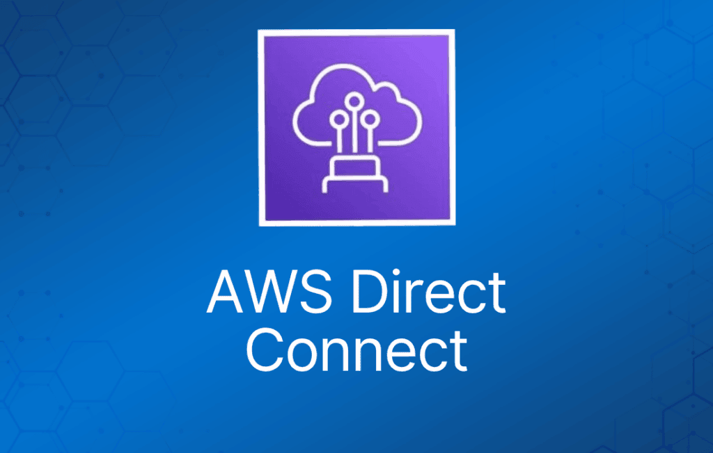
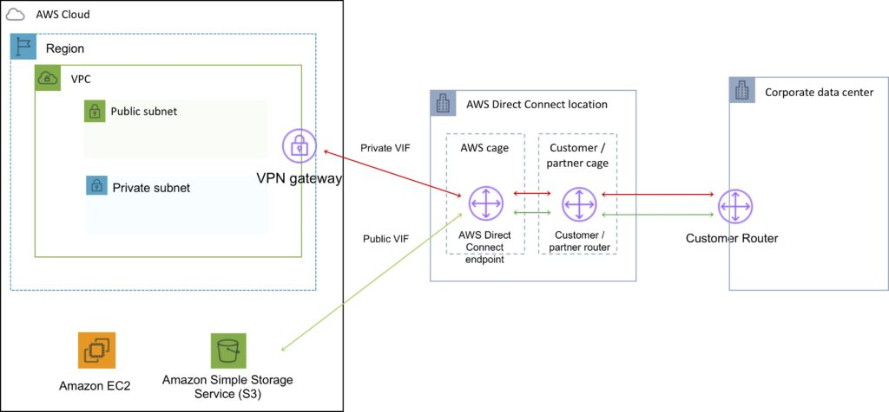
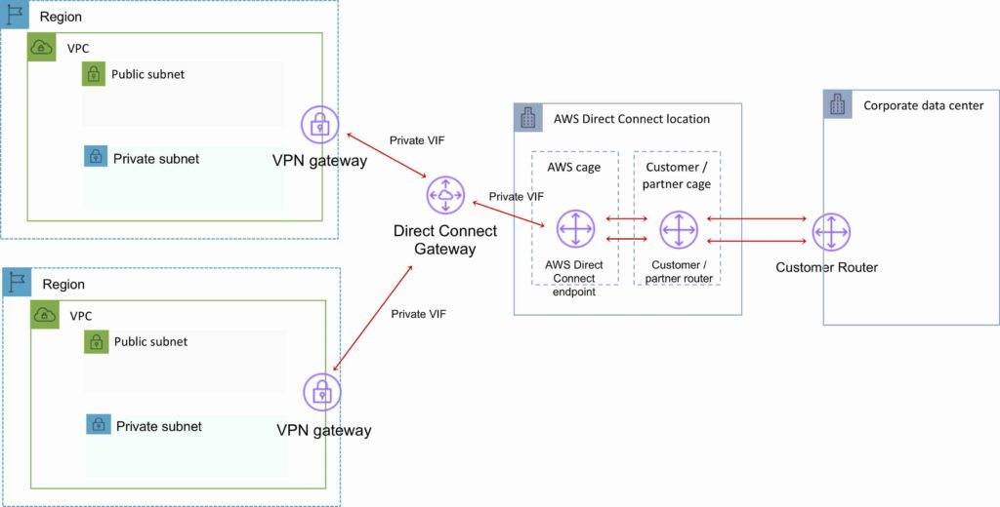

AWS Direct Connect 是一种网络服务，为通过 Internet 将客户本地站点连接到 AWS 提供了替代方案。

数据通过 AWS 与客户数据中心或企业网络之间的私有网络连接传输。

优势：

- 在大流量场景下降低成本。
- 提升可靠性（性能可预测）。
- 提升带宽（带宽可预测）。
- 降低延迟。

每条 AWS Direct Connect 连接可以配置一个或多个 virtual interface（VIF）。

Public VIF 允许访问公共服务，如 S3、EC2 和 DynamoDB。

Private VIF 允许访问你的 VPC。

Public VIF 上必须使用公有 IP 地址。

Private VIF 上必须使用私有 IP 地址。

Direct Connect 不支持二层（仅支持 L3）。

通过 Direct Connect 可以连接到**该区域内**的所有 AZ。

可以在 public VIF 上建立 IPSec 连接，连接到远端区域。

可以使用 route propagation 将客户端路由发送到 VPC。

每个路由表只能有一条 0.0.0.0/0（所有 IP 地址）条目。

可以绑定多个端口以获得更高带宽。

Virtual interface 可配置为连接 AWS 公共服务（如 EC2/S3）或私有服务（如 VPC 内资源）。

下图展示了 AWS Direct Connect 的组成部分：

Direct Connect 按端口小时数和数据传输量计费。

提供 1 Gbps、10 Gbps 和 100 Gbps（部分区域）规格。

50 Mbps、100 Mbps、200 Mbps、300 Mbps、400 Mbps 和 500 Mbps 的速率可通过 AWS Direct Connect Partner（APN Partner）购买。

使用 802.1q VLAN。

每条连接由客户路由器端口与 Amazon 路由器端口之间的单条专用连接组成。

要实现高可用，必须有 2 条 DX 连接——可以是 active/active 或 active/standby。

需要更新路由表，使其指向 Direct Connect 连接。

可以保留 VPN 作为备份，并设置更高的 BGP 优先级。

建议启用 Bidirectional Forwarding Detection（BFD）以加快故障检测和切换。

不能使用 Direct Connect 将本地 VLAN 扩展到 AWS 云中。

可以使用 Link Aggregation Group（LAG）将最多 4 个 Direct Connect 端口聚合为一条连接。

AWS Direct Connect 在 public 和 private VIF 上均支持单栈（IPv4）和双栈（IPv4/IPv6）配置。

连接 virtual interface 的技术要求：

- 一个公有或私有 ASN。如果使用公有 ASN，你必须拥有它。如果使用私有 ASN，必须在 64512 到 65535 范围内。
- 一个你选择的、未被使用的新 VLAN tag。
- 私有连接（VPC）—— VPC 的 Virtual Private Gateway（VGW）ID。
- 公有连接 —— 你为 BGP 会话分配的公有 IP（/30）。

AWS Direct Connect 不提供加密。

可以在 DX 连接之上建立 VPN 隧道来加密通过 DX 传输的数据。

- 在 DX 连接上运行 AWS VPN 连接可以提供稳定的吞吐量和保护数据的加密算法。
- 虽然通常使用 private VIF 连接 VPC，但在 DX 连接之上运行 IPSec VPN 时，必须使用 public VIF。

## AWS Direct Connect Gateway

将属于同一 AWS 账户的 Virtual Private Gateway（VGW）和 Private Virtual Interface（VIF）分组。

Direct Connect Gateway 使你能够与任何 AWS 区域（AWS 中国区域除外）中的 VPC 对接。

你可以将 *AWS Direct Connect gateway* 与以下任一网关关联：

- 当你在同一区域有多个 VPC 时，关联 transit gateway。
- virtual private gateway。

可以共享 private virtual interface 与多个 Virtual Private Cloud（VPC）对接，从而减少 BGP 会话数量。

Direct Connect gateway 是全球可用的资源。

你可以在任何公有区域创建 Direct Connect gateway，并从所有其他公有区域访问它。

下图展示了 AWS Direct Connect Gateway 配置的组成部分：

