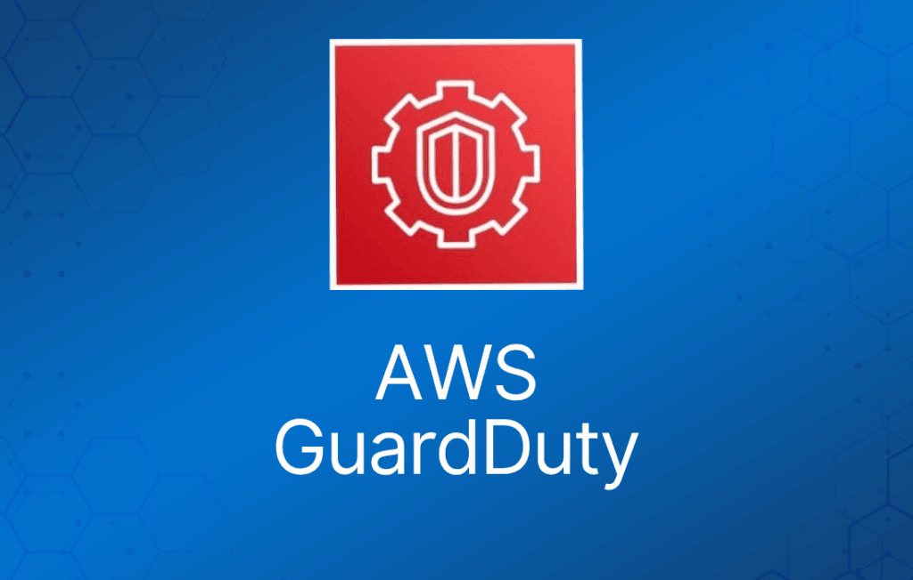

智能威胁检测服务。

持续监控恶意活动，并提供详细的安全发现结果，便于查看和修复。

监控 AWS 账户、工作负载以及 Amazon S3 中的数据。

可检测账户失陷、实例失陷、恶意侦察和存储桶失陷。

Amazon GuardDuty 让你能够使用专为云端开发和优化的内置检测技术。

AWS 安全团队会持续维护和改进这些检测算法。

主要的检测类别包括：

- **侦察（Reconnaissance）：** 表明攻击者正在进行侦察的活动，例如：
  - 异常的 API 活动。
  - VPC 内部端口扫描。
  - 异常的登录失败请求模式。
  - 来自已知恶意 IP 的未拦截端口探测。
- **实例失陷（Instance compromise）：** 表明实例已失陷的活动，例如：
  - 加密货币挖矿
  - 后门命令与控制（C&C）活动。
  - 使用域名生成算法（DGA）的恶意软件。
  - 出站拒绝服务活动。
  - 异常高的网络流量。
  - 异常的网络协议。
  - 实例与已知恶意 IP 的出站通信。
  - 临时 Amazon EC2 凭证被外部 IP 地址使用。
  - 利用 DNS 进行数据外泄。
- **账户失陷（Account compromise）：** 表明账户失陷的常见模式包括：
  - 来自异常地理位置或匿名代理的 API 调用。
  - 尝试禁用 AWS CloudTrail 日志记录。
  - 削弱账户密码策略的变更。
  - 异常的实例或基础设施启动。
  - 在异常区域部署基础设施。
  - 来自已知恶意 IP 地址的 API 调用。
- **存储桶失陷（Bucket compromise）：** 表明存储桶失陷的活动，例如：
  - 表明凭证被滥用的可疑数据访问模式。
  - 来自远程主机的异常 Amazon S3 API 活动。
  - 来自已知恶意 IP 地址的未授权 S3 访问。
  - 由此前从未访问过该存储桶的用户发起的、或从异常位置发起的检索 S3 存储桶数据的 API 调用。
