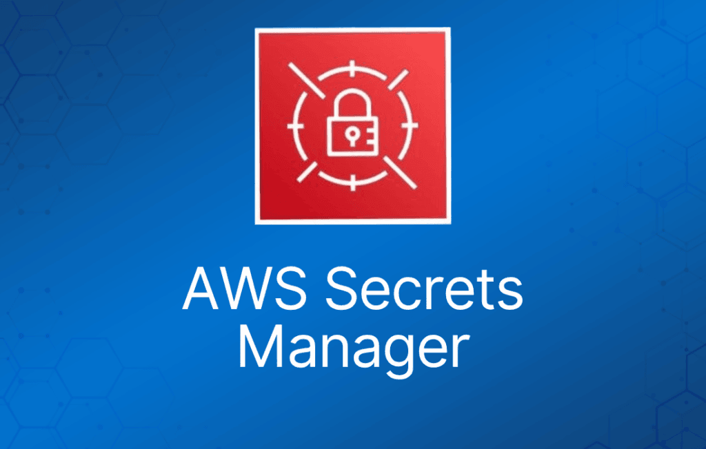
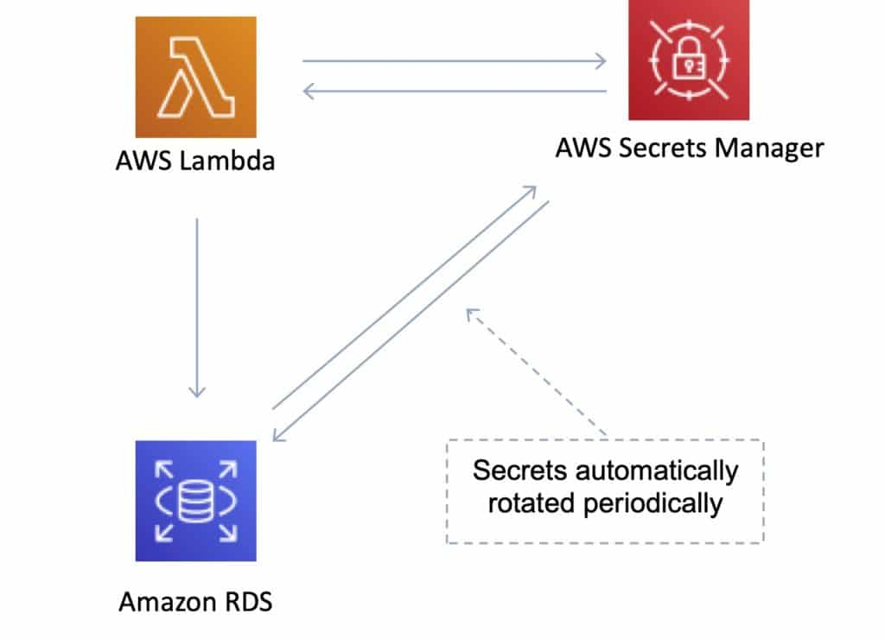

AWS Secrets Manager 帮助你保护访问应用程序、服务和 IT 资源所需的密钥（secret）。

该服务让你能够在密钥的整个生命周期内轻松地轮换、管理和检索数据库凭证、API key 以及其他密钥。

用户和应用通过调用 Secrets Manager API 来检索密钥，无需再以明文硬编码敏感信息。

Secrets Manager 提供密钥轮换功能，并内置了与 Amazon RDS、Amazon Redshift 和 Amazon DocumentDB 的集成。

此外，该服务还可扩展到其他类型的密钥，包括 API key 和 OAuth token。Secrets Manager 还允许你使用细粒度权限控制对密钥的访问，并集中审计 AWS 云、第三方服务和本地环境中资源的密钥轮换情况。

|  |  |  |
| --- | --- | --- |
|  | **Secrets Manager** | **SSM Parameter Store** |
| 自动密钥轮换 | 支持，部分服务内置，其他服务使用 Lambda | 无原生密钥轮换；可使用自定义 Lambda |
| 键/值类型 | String 或 Binary（加密） | String、StringList、SecureString（加密） |
| 层级键 | 不支持 | 支持 |
| 价格 | 按密钥收费 | standard 免费，advanced 收费 |

AWS Secrets Manager 使用你拥有并存储在 AWS Key Management Service (KMS) 中的加密密钥，对静态密钥进行加密。

当你检索密钥时，Secrets Manager 会解密密钥并通过 TLS 安全地传输到你的本地环境。

Secrets Manager 不会将密钥写入或缓存到持久化存储。

你可以使用细粒度的 AWS Identity and Access Management (IAM) 策略和 resource-based policy 来控制对密钥的访问。

你还可以为密钥单独打标签，并应用基于标签的访问控制。

使用 AWS Secrets Manager，你可以通过 Secrets Manager 控制台、AWS SDK 或 AWS CLI 按计划或按需轮换密钥。

例如，要轮换数据库密码，你需要在将密码存入 Secrets Manager 时提供数据库类型、轮换频率和主数据库凭证。

Secrets Manager 原生支持轮换托管在 Amazon RDS 和 Amazon DocumentDB 上的数据库以及托管在 Amazon Redshift 上的集群的凭证。

你可以通过修改示例 Lambda 函数，将 Secrets Manager 扩展到其他密钥的轮换。

你可以使用 AWS Secrets Manager 控制台、AWS SDK、AWS CLI 或 AWS CloudFormation 来存储和检索密钥。

检索密钥时，只需将应用中明文存储的密钥替换为通过 Secrets Manager API 以编程方式拉取密钥的代码。Secrets Manager 提供了调用 API 的代码示例，也可在 [**Secrets Manager Resources**](https://aws.amazon.com/secrets-manager/resources/) 页面获取。

你可以配置 Amazon Virtual Private Cloud (VPC) endpoint，让 VPC 与 Secrets Manager 之间的流量保持在 AWS 网络内部。

你还可以使用 Secrets Manager 的客户端缓存库来提升密钥使用的可用性并降低延迟。

AWS Secrets Manager 通过与 AWS 的日志、监控和通知服务集成，让你能够审计和监控密钥。
